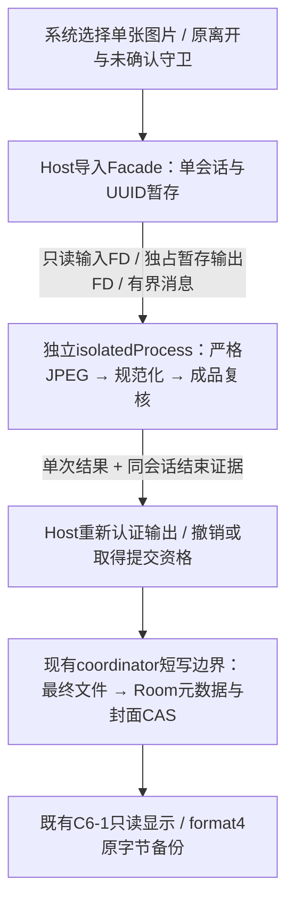

# C6-2B 安全媒体导入架构定稿候选

2026-10-28；`codex/lithic-v1-product-completion`；基线`35a616a70334f830d9ebc0ed05ab2c7ed9e653fc`。用户转交C6-2A **PASS WITH NOTES，仅历史证据复核**。

**建议：CONDITIONAL GO，仅供独立架构审查后授权下一阶段开发；生产媒体导入仍BLOCKED。** 优先实现无业务写入的隔离适配与资源/生命周期证明，再接封面事务及UI。本文是拟实施合同，所有新阈值、隔离UID适配和收口机制均未运行，不是安全验收通过。

本轮唯一产物是本文；不改产品、测试、构建或当前状态文件，不重复容器实验、不新增依赖/二进制、不操作设备。Room5、backup4、Owner/generation、恢复Token/指针及C6-1冻结读取模块保持。历史三项M10 JPEG FAIL、14项C6-1 Android NOT_RUN、40MP Android全链资源UNKNOWN、取消及异常恢复NOT_RUN均不改判。

## 1. 推荐架构与取舍

采用同一`:app`内显式、`exported=false`、`isolatedProcess=true`的**单次计算Service**，拟名`:media_sandbox`；不是WorkManager Worker，不增加常驻/周期/前台服务。计算进程只能得到本次FD和消息，不得获得URI授权、业务目录、Room、DataStore、AppContainer或恢复能力。[Android隔离服务定义](https://developer.android.com/guide/topics/manifest/service-element#isolated)。

不选：①主App线程池JNI，无法隔离native崩溃；②直接迁入旧`:jpeg_worker`，它是**同UID**服务，只隔离堆和崩溃，不能称数据沙箱。隔离UID增加FD/启动/结束适配成本，但缩小解析异常对真实账本的权限面。它仍不保证系统低内存时主App绝不被回收，也不是任意native漏洞已被证明无害。

**启动是先决门禁**：[LithicApplication](../../app/src/main/java/com/cooper/lithic/app/LithicApplication.kt)目前无条件启动账本与提醒。下一阶段须在任何lazy Owner、WorkManager配置或提醒触发前识别MAIN/SANDBOX/UNKNOWN；SANDBOX与UNKNOWN均不进行业务初始化。API28+可用平台进程名，API26采用仅本进程、定长读取的角色识别，不用反射或全局进程扫描；识别失败拒绝解析。合并Manifest/Startup须证明只有主进程承载业务Provider。不能依靠Service.onCreate或测试@Before补救；不改变主进程原Owner生命周期合同。

## 2. 固定库、许可与复用

推荐**已有libjpeg-turbo 3.2.0**；官方tag当前对应提交`c85e6b905bf237038faa936dab160ebfc5da0344`。只采用其libjpeg API静态库，并以受审JNI桥放入sandbox；禁用TurboJPEG、工具、测试及SIMD，避免本轮增加libspng、NASM或另一解码依赖。不得取Android私有libjpeg或未知预编译`.so`，不得升级版本替代研究候选。

- 已有官方发布包锁：`libjpeg-turbo-3.2.0.tar.gz`，2,537,858字节，SHA-256 `6f30092cef9fb839779646608f4ee14ae3cbac989c47fa05e841b0841f09878e`；来源和GPG指纹见旧ref`732333b7`的`docs/research/m10-jpeg-r1/evidence/upstream-r1-provenance.json`。本轮未下载/重新验证包签名，不把旧签名记录当新验证。
- 本轮只读核对官方[LICENSE.md](https://github.com/libjpeg-turbo/libjpeg-turbo/blob/c85e6b905bf237038faa936dab160ebfc5da0344/LICENSE.md)与[README.ijg](https://github.com/libjpeg-turbo/libjpeg-turbo/blob/c85e6b905bf237038faa936dab160ebfc5da0344/README.ijg)，SHA分别`ba6bceebcba0fdd35488477c2cca8c4632ce82c74dbfbc87d886ce6fc4433579`、`75815e3bf6484201a3c3d17a1bbf10f2e8e3237f84df10a2357ea896db2a81d6`，与旧来源锁一致。主体为IJG及BSD-3-Clause；组件还列zlib等许可。未来分发须按实际链接文件保留版权/许可及修改说明，随App提供许可清单和IJG致谢；不是只写一句“开源库”即可。不能以项目/作者名背书。

| 旧M10成果 | 最小复用方式 | 不得直接迁入 |
|---|---|---|
| `strict_probe.c / strict_core.h / budget.c / budget.h / jmem_budget.c` | 从`732333b7a2803ec1f4487e437a581979a270e3ee`提取并核对C6-2A五份源码锁；保留warning拒绝、输入耗尽不补EOI、全行/finish及分配计量；为Android FD ABI做薄适配 | 不重写JPEG解析器；不以EOI/BitmapFactory替代严格核验；不把旧CLI/host回执当新库证据 |
| 固定正常/坏图、旧断言及原始结果 | 保留同字节图片、原三项业务断言和baseline/progressive矩阵；旧PASS/FAIL单列 | 三个FAIL用同一坏图，不能包装成三张坏图；不改断言换PASS |
| `AndroidImageCodec`规范化思路 | 仅参考采样、EXIF方向、1600px及有限质量/尺寸尝试，改为FD-only；先严格通过再规范化 | 旧按私有路径的整类、平台宽松JPEG入口不能照搬；原File路径不是隔离UID能力 |
| JNI / Worker / Stage V2 / 输入supervisor | 参考协议不变量、错误分类、迟到/取消/退休测试 | **不整包迁入**；旧same-UID Binder认证、cache路径、guard和退出判断需重审；新FD桥单独验证 |

严格支持目标保留8bit Huffman baseline/sequential及progressive，涵盖原候选声明的灰度/RGB/YCbCr/CMYK/YCCK；不默改PNG-only或baseline-only。其他编码/色彩规范化不支持时明确拒绝，不称图片已损坏；旧核心无法给出可靠细类时保留INFRA_ERROR，不能按异常文字猜测。严格全解码也不证明原始内容真实性或检出所有合法渐进扫描删减。

## 3. 输入与资源合同

以下数值为**下一候选的实施预算**，不是已测Android上限；不得为让测试通过临时增大。新库不通过前不开放生产Picker/写入。继续支持静态PNG，沿用既有PNG验证思路且放在同一隔离计算边界，不能借PNG入口把JPEG送宽松路径。

| 范围 | 明确约束与越界处理 |
|---|---|
| 原始输入 | 继承旧研究压缩字节`1..64MiB`、像素`1..40,000,000`；每边最大65,535为本候选额外资源边界，乘法用检查溢出的Long。按内容辨型，与声明MIME不符拒绝。流式复制用≤64KiB缓冲；未知长度同样硬计数，不能先readBytes。格式/尺寸检查仍在sandbox，不在主App先解码。 |
| 暂存及并发 | 全App一个导入会话、零无界排队；每会话源≤64MiB、输出及最终复制各<2MiB、控制日志≤64KiB，暂存预留80MiB并检查磁盘余量；磁盘不足拒绝。未知旧会话未收口时不再创建新会话；不清历史目录腾空间。 |
| 严格核心 | 首个Android候选计量分配预算**256MiB**，替代旧研究512MiB默认；旧host最高240,265,637字节只作设值依据，**不是余量证明**。只接受完整行/finish、零warning；严格核心destroy且计量释放后才开始采样规范化，不主动并行两个峰值。 |
| 规范化 | 后台按≤1600px采样；不生成40MP全尺寸Bitmap。活跃像素/旋转/缩放账本上限32MiB，按实际allocationByteCount复核；编码缓冲有界，沿用最多3尺寸×3JPEG质量尝试，超限明确RESOURCE_REJECT。平台codec、EXIF和malloc内部开销不在该账本内，必须测全链。 |
| 整体内存 | sandbox本进程RSS **384MiB预警/中止阈值**，由自身有界采样；这不是OS硬限额，采样/线程也可能迟到。不得用RLIMIT_AS、Java堆设置、native计量或GC调用冒称总峰值封顶。主进程增量、sandbox RSS/PSS和内核资源须实测；三张40MP未在预算内通过则资源子项BLOCKED，不缩小样本或静默涨预算。 |
| 时间 | 输入采集60s、绑定/HELLO5s、严格+规范化总120s、退休10s；使用单调时钟，含排队，分阶段独立记录。Host等待有界但不等于native/Provider已经停止；不重设截止延长重试。全部超时先撤销提交资格。 |
| 登记成品 | **`0 < byteLength < 2MiB`**、每边`1..1600`、PNG/JPEG，匹配当前backup4；不照搬旧Stage中允许恰好2MiB的边界。首次Q05规范化后才登记；以后显示、导出、恢复保留原字节，不重新规范化旧资产。 |

输出FD仅指Host创建的本次空白文件，可读写但不含任何旧资源；输出流硬计数并在写入前拒绝超限。内存账本、输出流检查与隔离进程都不是恶意native代码下的绝对资源封顶承诺，必须用异常注入和实际设备资源观测补证。

失败类别固定：`IMAGE_REJECT / UNSUPPORTED / RESOURCE_REJECT / CANCELLED / TIMEOUT / NATIVE_CRASH / INFRA_ERROR / RESULT_UNKNOWN`，与`PREPARED`、`COMMITTED`分开。OOM/崩溃/无回执不能算坏图被正确拒绝；TIMEOUT/CANCELLED也不自动表示资源关闭。平台可解码不是熵流证明。

## 4. 会话、取消与Worker结束

1. Host建立唯一`operationId/assetId/attemptId/sessionNonce`，捕获**Owner实例**、generation实例、记录类型/ID、expectedCover及记录版本；nonce与输入长度/SHA、策略版本绑定。暂存位于独立`noBackupFilesDir/media-import/<UUID>/`，不在业务`media/`；Host独占输入写入，关闭写FD、fsync后只传只读regular FD。Worker无原URI/文件路径；双方复核FD类型、权限、dev/ino、长度，文件UID应为已认证Host UID而非隔离UID，Worker再核SHA。输入采集IO卡住时同样撤销并保留slot，不能把协程取消当读取已结束。
2. 使用小型版本化Messenger协议，最多本次输入FD、输出FD及一个guard FD，另有回调Binder和有界标量，禁止Bitmap/整图ByteArray/任意Bundle对象图；处理线程与codec线程分离，Binder/主线程不等待native。身份读取平台`Message.sendingUid`（或Binder入口捕获的真实UID），不能在异步Handler里误用`Binder.getCallingUid`，更不能信消息自报UID。Host从显式非导出Service的会话HELLO绑定隔离UID/回调/nonce；Worker只接收安装包真实host UID。旧same-UID判断不得照搬。
3. 严格成功后才采样、方向处理、有限编码；输出JPEG再做严格成品核验，PNG做完整既有格式/数据核验。成功消息只表示`RESULT_READY`，包括输入/输出SHA、长度、格式、尺寸、完成及释放证据，**不直接允许写Room**。Host把返回值视为不可信，拒绝重复/非法字段，重新检查输出文件身份、长度、SHA、格式/尺寸；成品候选复制前后再次核对，Worker从未得到最终资产FD。
4. 正常完成、用户取消、Owner切换、回调死亡或超时均进入单向退休。取消/超时先不可逆撤销commit资格；任何迟到SUCCESS仅供诊断，不再变为PREPARED。不自动重试输入、计算或提交，不让新页面继承旧会话。
5. 明确两条状态链：正常`SUCCESS_CANDIDATE → RETIRING → PREPARED`保留候选资格，退休期间尚不可提交；取消/超时/Owner失效则进入不可逆`REVOKED → RETIRING`，永不转回PREPARED。避免旧代码在`BIND_AUTO_CREATE`仍有效时自杀触发重建：Host停止投递后准确解绑本次连接，禁自动重绑（正常退休不等于撤销候选）；Worker仅在本次最后绑定已释放后由独立watchdog终止**自身**计算进程。`stopSelf`、解绑、onDestroy不作为进程已死证明；主App也不假设有权限kill不同UID的隔离PID。若主线程/解绑通知/终止路径卡死，不通过循环kill、重建或再启动服务兜底。
6. **PREPARED门禁**：唯一结果、精确会话Binder的OS死亡通知、数据FD/guard租约归还及无在途RPC等退出证据同时吻合。guard为Host在同UUID目录创建的普通单链接控制文件，以第三个FD授予Worker。固定使用两端一致的`FileChannel.tryLock(0, Long.MAX_VALUE, false)`整文件fcntl排他锁语义，不混用flock/OFD锁；Worker先持锁发送GUARD_HELD，Host通过**独立open**同一dev/ino确认该锁不可取得后才允许COMPUTE。Host观测句柄不能仅dup/复用传出的open-file-description；Worker不得为guard另开/关闭重复FD而提前释放进程锁。退休后Host再由该独立句柄取得锁才计为租约归还，不以磁盘标记或超时冒充。Worker禁止fork或转发FD；该锁在API26/36不可用或证据不足即阻断，不用轮询陌生PID补救。不是仅凭Worker自报closed、PID数值或onServiceDisconnected；不能靠主App读取其他UID的`/proc`补权限。需验证API26/36下哪些退出证据确实可得，取不到则`RESULT_UNKNOWN(reason=RESOURCE_CLOSE_UNKNOWN)`，保留FD/文件状态和单会话封锁；Binder死亡也不称优雅关闭。
7. Host/进程被杀后，UUID控制记录只供后续受控只读核对；不自动恢复计算或写入。无法证明旧Worker退出则不清暂存、不释放并发准入。最终提交UNKNOWN时不重新生成assetId或自动再写。此保守降级保护业务数据，但可能使本次媒体功能暂时不可用；须向用户如实提示，不引导清App数据。

**最大实施风险**：隔离UID的FD、退出证明和watchdog不是旧研究已经验证的路径。若平台下无法建立上述可获得、可信且有界的收口链，停止该子项并回独立架构审查，不默改同UID服务或宣称“安全关闭”。

## 5. 先文件、后引用的提交协议

当前[MediaDao](../../app/src/main/java/com/cooper/lithic/data/local/MediaDao.kt)仅insert/list/find，**没有可直接接入的生产MediaRepository、封面CAS或媒体operation回执表**。新Facade依附现有Ready/Owner作用域；C6-1接口/读取器/缩略预算不改，不另开Room。

- 耗时采集、严格解析、规范化、输出认证都在coordinator外；最终只处理<2MiB成品。拟用固定operation UUID作本次asset UUID，不依赖其他金额/付款的operationId。Host在`media-import/session.json`原子写≤64KiB控制记录，绑定本次UUID/文件归属与阶段；下次导入准入前必读这个固定位置，非明确终态、缺损或未知文件则封锁新会话，不能仅依赖进程内Semaphore。首次目录确认为全新时可建立控制记录；已有stage却缺失控制记录则UNKNOWN。须先持久化ADMITTED并同步后才启动输入消费者或sandbox。它是非业务诊断记录，不是`active-generation`指针，不新增Room字段、不参加backup、不获得恢复Token，不能单凭它认定事务成功。
- 进入原`withWrite`后复核当前Ready的Owner**实例等同**捕获对象、settings Owner有效、DB仍open、coordinator未退休，再读记录与完整expected版本/cover。锁内不等待`openStorage()`初始化、不碰旧关闭DB、不重开旧generation；不因ID相同就放行。切换/重开/删除/并发修改均拒绝当前提交。
- Host在该代`media/<新UUID>.<格式>`以`O_CREAT|O_EXCL|NOFOLLOW`创建全新最终文件；验证父目录/UID/单链接/FD身份，复制认证成品、重算长度/SHA并fsync文件及父目录。**不覆盖旧文件、不要求跨目录rename原子性**。当前同一coordinator的[完整导出快照](../../app/src/main/java/com/cooper/lithic/data/backup/RoomBackupSnapshotSource.kt)会等待这段提交；未知额外文件不被误当登记媒体。
- 同一Room事务插媒体元数据并CAS更新**唯一目标**`coverAssetId/updatedAt`；必须影响1行，否则整体回滚，不改金额、付款、状态或交易组。事务返回后才`COMMITTED`。已提交文件与Room不具跨存储原子性；文件成功而事务失败可有未登记孤儿，但原封面及完整备份仍可用。
- 回执丢失/进程中断：进入UNCONFIRMED，保留所有本次候选；只通过当前Owner读取固定asset元数据和目标引用/版本核对。吻合才能确认；后续已被替换、指向其他代或事实不足则UNKNOWN，不猜成功、不自动重提或删除。不得为核对重开旧库。

替换后**保留旧登记元数据及文件**，不自动去重或GC；其他项目/订阅的共享引用不变。移除只CAS解除本记录引用，不宣称回收空间。backup4包含全部登记媒体（含未引用），因此禁止先删旧文件或只按单一类型引用清理。未来物理GC需另审跨两类零引用、事务删metadata后精确删文件及中断恢复；初版不实现。替换积累会占磁盘并触及原备份大小/条目上限，需明确告知与准入检查，不擅自提高backup4上限。

仅当本次UUID归属、Writer/FD/RPC均已结束且事务已明确未提交时，才可精确清理本次未登记成品及stage；UNKNOWN、登记资产、共享、旧代或陌生文件一律保留，禁止扫描目录兜底删除。恢复后旧会话撤销，不沿旧Owner回写；恢复媒体仍按原长度/SHA/格式/尺寸合同保留原字节，不能将新导入的严格策略追溯改写所有历史备份。

## 6. 最小改动范围（本轮均未实施）

| 位置 | 只承担的职责 |
|---|---|
| `app/build.gradle.kts`、新增`src/main/cpp`及受审固定源码/许可证目录 | 锁NDK/CMake/3.2.0、两ABI、libjpeg静态+薄JNI桥；主App不加载此库。无新增通用图片框架 |
| `AndroidManifest.xml`、`LithicApplication.kt`、拟增`AppProcessRole.kt` | 非导出隔离Service与启动前角色门禁；主进程身份/权限/提醒合同不改 |
| 新增`data/media/import`下policy/session、Host stage、sandbox Service/FD codec/薄native适配 | 单会话、可信IPC身份、严格核验、规范化、取消/终结和资源计量；借鉴研究，不整包迁移 |
| 新增`MediaImportRepository`；`MediaDao / ProjectDao / SubscriptionDao` | 当前Owner内认证/事务/CAS和结果核对；无schema、索引或持久业务状态增加 |
| `LedgerUiState/Holder`及现有导航装配、拟增封面操作VM/系统选择入口 | 注入同代写facade，选择/查看/替换/移除及原dirty/pending/UNCONFIRMED保护；Picker仅用户选中对象，未来优先API26可用SAF，无广泛照片/网络权限 |
| 定向JVM、隔离Android/native测试 | 原三项业务断言、生命周期、资源、共享/备份及换代；不复用受保护设备或个人数据 |

不改`DataGenerationStore/ManagedGeneration/RestoreCoordinator`的生命周期及切换协议、不改C6-1 reader和已冻结引擎。若实现必须改这些合同，停止对应子项回审，不借本表获得授权。

## 7. 工具链与执行顺序

本轮仅读目录/版本元数据：现有JDK17、SDK36/build-tools36.0.0、NDK **28.2.13676358（r28c）**、CMake **3.22.1**及其ninja.exe、Windows LLVM clang.exe均存在，arm64/x86_64的API26 sysroot目录存在。NDK元数据最高列35，不表示需下载新NDK：拟按`ANDROID_PLATFORM=26`交叉编译供API26及36运行；实际兼容尚未构建。native 16KiB页对齐/ABI/装载需静态及API36实测。

没有核实可用且通过来源校验的本地3.2.0原包/源码库；不扫描旧运行/AVD目录、不下载依赖，不借Docker内部WSL。现有Windows Android交叉工具**不等于**Linux host研究harness可运行。新库原包取得/许可锁、Android静态链接和设备资源证据仍是后续准入条件，本轮没有编译、链接或测试。

按顺序实施，任一步不达标即停该后续路径：

1. **架构独立批准＋新开发授权**：确认隔离UID、预算与新库来源/许可。之后才能取得锁定源码并做薄适配；不因本文自批准依赖或native生产接入。
2. **无写入启动/FD/结束证明**：生产相同Application预启动门禁、无默认generation/提醒、跨UID消息认证、FD拒绝、主App/Service取消、native永不返回及迟到结果、解绑不重建；不接个人数据或封面写入。新路径证据不足则BLOCKED。
3. **严格库与资源**：baseline/progressive及同字节锁定坏图，计量OOM/FD错误/崩溃/各阶段取消；三种完整40MP及总链RSS/主进程增量/耗时、FD归还、异常恢复。固定预算，不能以平台decode成功代替。所有构建源/ABI/策略及样本SHA绑定同一候选。
4. **事务Facade**：真实Room测试CAS竞争、Owner同id重开/换代、文件完成后中断、事务回滚/回执丢失、共享引用、无引用保留、磁盘满与文件被替换。原三个坏JPEG断言+项目金额、订阅付款/状态保护均实际执行；format4完整往返保持原字节。新写入未验前不能开放UI。
5. **真实产品接线与集中体验**：仅上述门禁通过后接系统选择和操作VM，沿用C6-1显示；另授权设备和必要新体验包，检查正常MainActivity与真实升级/恢复。不是M23/正式发行。

| 新候选运行范围 | 必需证据；本轮状态 |
|---|---|
| API26 × x86_64；API36 × x86_64 | 各自启动隔离、严格库、取消/异常恢复及40MP全链；全部NOT_RUN |
| API26 × arm64-v8a | 最低API原生装载/隔离/资源；无已准入设备，NOT_RUN，不能以交叉编译替代 |
| API36 × arm64-v8a真实手机 | 最终同候选、实际内存/厂商生命周期、UI及原封面保护；另行明确授权与隔离包，NOT_RUN |

老API26/36各九项限定证据、host40MP及C6-1桌面冻结均继承但不补上述新矩阵。原APK尚无此native依赖，两ABI验证目标不能顺便变为新的产品安装支持声明；下一阶段须核对native打包对原安装范围的影响，不能因缺库让核心App无法启动或静默收窄ABI范围。其它ABI没有证据，涉及改变原支持范围时单独回审，不回退主进程宽松JPEG解析。无API26 arm64设备时明确保留该缺口，不能声称完整minSdk/两ABI安全验证通过；不要求本轮创建或启动任何设备。

## 8. 审查结论与边界

**CONDITIONAL GO**：方案可进入“独立审查后、按顺序的小范围开发”，不是写入或依赖准入已获批准。首要阻断是**隔离UID下可取得的结束/FD证明**与**40MP全链预算**；原始源码取得/原生离线构建也尚未验证。若结束链不可证明，不靠放松证据或改回同UID推进。

本轮验证只有本地源码/历史Git、官方3.2.0许可及现有工具文件只读核对、文档链接/差异/敏感信息检查。无新JVM/native/Android测试、构建、APK、ADB或设备操作。保留M10三FAIL、M20/M22/C3/M13-T06/G1～G4及全部旧NOTES/UNKNOWN/NOT_RUN；不合并main，不进入M23。

依据：[C6-0](../evidence/LITHIC-C6-Media-Admission.md)、[C6-1](../evidence/LITHIC-C6-1-ReadOnly-Media.md)、[C6-2A](../evidence/LITHIC-C6-2A-JPEG-Admission.md)、[旧研究具体路径及源码锁](../evidence/c6-jpeg-admission-20261028-095202/inputs-and-source.json)、[绑定Service生命周期](https://developer.android.com/develop/background-work/services/bound-services)。官方许可与Android文档为本轮查阅，旧实验结果没有重新执行。

**C6-2B MEDIA ARCHITECTURE — READY_FOR_INDEPENDENT_REVIEW**

**MEDIA_IMPORT_BLOCKED**
