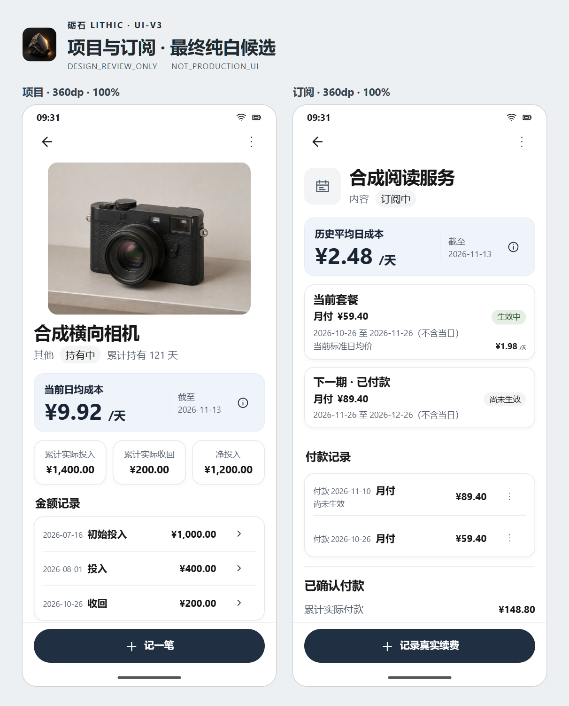

# 砺石 · 详情页最终设计候选

**LITHIC_UI_V3_DETAIL_DESIGN_FREEZE_03 — READY_FOR_FINAL_APPROVAL**

**DESIGN_REVIEW_ONLY — NOT_PRODUCTION_UI**

固定基线为 `6289d9400a19ac28e6a099a460d08b461aa6e274`。延续已审的双屏结构、三主题、浅雾蓝成本卡、项目三张财务卡、订阅当前及下一期套餐、付款历史和深蓝黑底部按钮。[用户选中的双屏原图](boards/reference/user-selected-pair.png) · [调整前的精修 02 双屏图](https://github.com/cc7279694-debug/property/blob/6289d9400a19ac28e6a099a460d08b461aa6e274/docs/design/lithic-ui-v3-detail-visual-refinement-02/boards/renders/pair.png)

[纯白项目详情](boards/renders/project-white.png) · [纯白订阅详情](boards/renders/subscription-white.png) · [纯白双屏对照](boards/renders/pair.png) · [项目三主题](boards/renders/project-themes.png) · [订阅三主题](boards/renders/subscription-themes.png) · [模拟 200%](boards/renders/font-200.png)

## 三处调整

| 项目 | 精修 02 | 最终候选与取舍 |
| --- | --- | --- |
| 项目封面 | 宽框以 Fit 显示样本，360 和 400 宽度分别为 328×172、368×172，4:3 照片两侧各有大块底色。 | 使用居中 4:3 框，约 288×216、309×232。照片在框内完整显示，其他比例仍保留必要边距。看清相机细节需要多用一点首屏高度，成本仍在首屏。模拟 200% 时框收为 240×180，把空间留给文字。已就绪的封面才可点开完整查看。画板复用同一张照片。Android 候选复用当前已验证的封面位图，保持其完整画幅、字节及存储协议。 |
| 金额记录 | 每条默认显示现金或折抵口径、说明、金额和纠错按钮。 | 默认行显示发生日期、类型、完整金额与查看入口。非现金折抵继续在行内明确标出。现金口径、备注、关联限制及原纠错动作集中在单笔详情。多一次点击，换取默认列表可直接扫读日期和金额。大字和长金额允许换行。 |
| 「全部」 | 浏览器使用只读弹层显示完整列表，Android 方式待定。 | 按现有排序先显示前三条，超过三条才显示「全部」。点按在同一列表就地显示剩余记录，标题按钮变为「收起」，焦点留在该处。单笔查看使用自己的短弹层。系统返回关闭当前弹层或执行原详情返回。原「查看成本历史」仍进入独立的成本历史页面。 |

[四笔合成事件的展开前后](boards/renders/history.png) · [其他状态](boards/renders/states.png)

观察日仍为 2026-11-13。相机 121 天，投入 ¥1,400.00、收回 ¥200.00、净投入 ¥1,200.00，日均 ¥9.92。展开样本把初始 ¥1,000.00 拆为同日现金 ¥700.00 与旧物折抵 ¥300.00，汇总相同。四笔按实际发生日升序、同日按既有 ID 顺序。订阅当前月付 ¥59.40，与已付款但未生效的 ¥89.40 分开。累计实付 ¥148.80、历史平均 ¥2.48/天、当前标准日均价 ¥1.98/天。主图重新导出后，纯白订阅图与基线逐字节相同。[样本业务依据](../lithic-ui-v3-03-details/BUSINESS_FACTS_AND_GUARDS.md)

## Android 实施组件

| 范围 | 复用与接线 |
| --- | --- |
| 项目页与成本 | 延续 `ProjectDetailScreen` 的顶栏、单一 `LazyColumn` 与独立固定区，沿用 `ProjectCostSummary`、`ProjectSecondaryTotals`、`MoneyMetric`、`C5InformationButton` 和现有主题。纵排大字卡片，保持金额完整的可访问语义和读取入口。 |
| 封面 | 项目详情局部使用 `RecordCover` 和 `ContentScale.Fit`，列表及其他调用方沿用原参数。仅当前项目、当前代、当前封面已取得可用结果时开放只读 `Dialog`。复用已验证位图及原有读取预算，切换身份、图片引用或状态即撤销显示资格。关闭回到封面，明确关闭按钮需至少 48dp。 |
| 金额记录 | 在原有 `itemsIndexed` 中按 `event.id` 保持行键稳定。前三条是同一批已加载事实的切片，展开仍使用原列表与原数据。展开状态按当前项目与代隔离，身份切换重置。无额外查询、路线或写入。单笔详情复用原事实字段，沿原更正回调分派。含现金、非现金折抵、事件角色、备注以及关联提示。 |
| 订阅 | 留作后续独立实施。`SubscriptionDetailScreen` 原历史列表、付款日期入口、分页、管理面板和写入守卫全部保留。 |

## 业务操作与 TestTag 清单

表内 `<id>` 代表原实体 ID。已有标签按事实或动作所在节点保留。若节点移入单笔明细，测试先展开记录或打开单笔，再断言原标签和保护条件。

| 路径 | 现有操作或事实 | 应保留的 TestTag |
| --- | --- | --- |
| 项目详情与读状态 | 返回、更多、名称、分类、持有期、日均及说明、投入收回净额、旧快照、重试 | `project-detail-screen`、`project-detail-content`、`project-detail-back`、`project-detail-more`、`project-detail-menu`、`project-detail-name`、`project-detail-category`、`project-detail-status`、`project-ownership-period`、`project-detail-held-days`、`project-core-metrics`、`project-financial-totals`、`project-detail-{daily,metric-information,outlay,recovery,net,error,stale,retry}` |
| 封面 | 无图、读取中、失效；原有添加、更换、取消显示和不可用提示 | `project-identity-symbol`、`project-detail-cover`、`project-detail-cover-expanded`、`project-detail-cover-unavailable`、`record-cover-{image,loading,unavailable}`、`project-{add,replace,remove}-photo`、`project-photo-unavailable` |
| 金额 | 查看日期、类型、口径、金额；记投入或收回；只有明确点纠错才发起操作。`END_SETTLEMENT` 继续走 `onUpdateEnd`，普通记录走 `onCorrectMoney(id)`，以旧换新关联项仍只允许修改说明 | `project-event-<id>`、`project-event-{date,basis,type,amount}-<id>`、`project-correct-event-<id>`、`project-record-money`、`project-money-sheet`、`project-money-sheet-close`、`project-add-outlay`、`project-add-recovery` |
| 项目管理 | 编辑、结束及修正结束、成本历史、替换比较、以旧换新、永久删除资格与确认。维护未保存、待核对写入、关联保护和原返回来源 | `project-edit`、`project-end`、`project-update-end`、`project-replacement`、`project-trade-in`、`project-cost-history-menu`、`project-cost-history`、`project-lifecycle-explanation`、`project-trade-in-protection`、`project-secondary-management`、`project-detail-note`、`project-delete`、`project-delete-{dialog,confirm,cancel,retry-read}` |
| 订阅详情及管理 | 当前套餐与历史平均、实际付款与覆盖区间、纠错或删除付款、分页与读失败、真实续费、暂停／恢复／停止／重开及已安排停止管理 | `subscription-detail-{screen,content,back,open-management,close-management,current-plan,current-rate,historical-average,total-paid,history-error,history-retry,load-more-history,renewal,resume,reopen,pause,stop,scheduled-stop,correct-stop,cancel-stop}`、`subscription-state-correct-<id>`、`subscription-renewal-<id>`、`subscription-renewal-{paid-on,amount,future,date-information,actions,correct,delete}-<id>`、`subscription-price-history` |

可新增 `project-money-all`、`project-event-details-<id>` 和 `project-cover-full-view` 来验证三个只读入口。它们是后续实施建议。[项目页面](../../../app/src/main/java/com/cooper/lithic/feature/project/ProjectDetailScreen.kt) · [操作资格](../../../app/src/main/java/com/cooper/lithic/feature/project/ProjectDetailPresentation.kt) · [图片组件](../../../app/src/main/java/com/cooper/lithic/feature/media/CoverPreviews.kt) · [订阅页面](../../../app/src/main/java/com/cooper/lithic/feature/subscription/SubscriptionDetailScreen.kt)

## 验证与下一批范围

- Chromium 157 共核对 8 个规格组合，覆盖两页各自的 360／400、100%／模拟 200%。布局检查未发现横向溢出，参与检查的交互目标至少 48 CSS px，底部按钮位于独立区域。另核对封面查看使用同一个 1448×1086 图像、单笔明细保留现金与折抵事实及纠错入口、「全部」3→4→3 且只存在一组列表、订阅付款日期弹层。订阅主图与原稿字节一致。[浏览器结果](boards/layout-checks.json)
- Android 实际运行 **NOT_RUN**。系统 200% 字体、TalkBack、原生返回与焦点、图片加载或失效、Compose 滚动及动效留给实施后验证。
- 获得授权后，下一批仅实施项目详情的封面、三卡、金额记录及就地展开。修改范围以 `ProjectDetailScreen.kt` 为主，若需从 `RecordCover` 暴露已验证的只读位图状态，限局部可选参数并保护其他调用方。复跑 `ProjectScreensTest`、`C2ProjectDetailSemanticsTest`、`C2R1ProjectDetailLayoutTest`、`ProjectNavigationGuardTest`、`CoverPreviewsTest` 的受影响案例。补验长金额、横竖图与不可用、3→4→3、零写入、系统返回和联动纠错，保留业务与安全断言。订阅生产界面、导航路由、成本引擎、Room、备份与图片协议继续使用当前版本。
