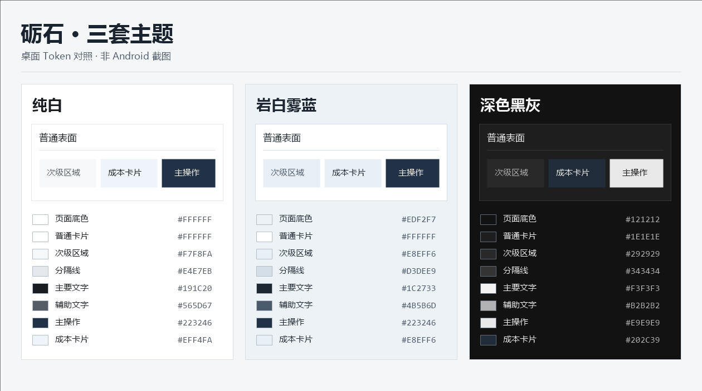

# 砺石 UI-V3 · 全应用主题与信息密度

基线 `c5797d4dd11374c6368d64e4b283d64e0a1b57d6` 经远端 fetch 核对。工作分支 `codex/lithic-ui-v3-global-theme-density-01`。先提交独立页面盘点 `2d76cee3`，再提交整改源码及直接受影响断言。GitHub 保留文档和验证记录，Debug APK 实物由本机交付。

[页面盘点与覆盖矩阵](../design/LITHIC_UI_V3_GLOBAL_POLISH_01_PAGE_INVENTORY.md) · [文案实际删改](../design/LITHIC_UI_V3_GLOBAL_POLISH_01_COPY_AUDIT.md)

## 主题与文案

| 角色 | 纯白 | 岩白雾蓝 | 深色黑灰 |
| --- | --- | --- | --- |
| 页面 | `#FFFFFF` | `#EDF2F7` | `#121212` |
| 卡片 | `#FFFFFF` | `#FFFFFF` | `#1E1E1E` |
| 次级区域 | `#F7F8FA` | `#E8EFF6` | `#292929` |
| 装饰分隔 | `#E4E7EB` | `#D3DEE9` | `#343434` |
| 正文／辅助文字 | `#191C20`／`#565D67` | `#1C2733`／`#4B5B6D` | `#F3F3F3`／`#B2B2B2` |
| 核心成本卡 | `#EFF4FA` | `#E8EFF6` | `#202C39` |
| 主操作 | `#223246` | `#223246` | `#E9E9E9` |

- 38 个 Nav3 注册键和顺序与基线一致。核查包含宿主、三主入口、项目与订阅详情及表单、图表、各类报表、设置和局部弹层。系统文件选择器沿用系统配色。
- 宿主和启动保护读取页面色。列表卡和首页卡读取表面与边线，五个底部面板读取同一主题角色，导航读取次级面，项目详情成本卡读取集中主题配置。暗色主色、三个既有层级和图表配色保留。
- 120 处文案变动覆盖实际页面。删除首页重复品牌副标题、订阅详情已在首屏呈现的额外类别行，合并重复成本构成说明，收紧搜索、图表、回看、账本、表单和备份说明。保留未知、真实零、旧快照和失败状态的区别，保留历史平均日成本、当前标准日均价、累计实际付款和未来已付款之间的区别。
- 保持原类型字号、动态换行、滚动与固定操作。恢复覆盖、不合并、备份未加密、危险操作、日期、金额、非现金折抵、纠错依据和必要无障碍语义仍在原入口。选用比任务示例更深的两种辅助文字，保证次级底、聚焦层等配对的文字对比度。装饰分隔与交互描边使用不同角色。

## 验证

| 验证项 | 结果 |
| --- | --- |
| 生产 Kotlin、AndroidTest Kotlin、Debug App 与 Test APK 构建 | PASS，均在固定源码构建任务执行 |
| JVM 全量 | 116 类、984 PASS，0 FAIL／ERROR／SKIP。主题令牌两类共 10 项，外观保存与 DataStore 17 项，其中包括无读写权限状态与失败保护 |
| Debug Lint | PASS WITH NOTES，0 错误、20 警告 |
| 页面、口径与协议保护 | PASS，38 个注册键顺序一致。仅改界面／测试，Room、Money、BusinessClock、Repository、Owner、媒体协议、Manifest、签名及版本配置保持基线 |
| 三主题实际切换、系统栏、真实 360dp／200%、长名称、大金额、TalkBack、滚动及固定操作 | NOT_RUN。相关 Compose 断言已编译，桌面颜色测试与对照图的范围仅限令牌和已接线的源码 |
| 真机及模拟器、真实 SAF／照片系统操作 | NOT_RUN。旧隔离 AVD 的启动环境阻断见上一轮证据。本轮没有启动 ADB、启动模拟器、安装 APK 或操作小米14 |

原过渡构建第一次遇到并行修改时的 `sheetSurface` 引用编译错误，保留原日志。第二次构建通过，随后应用独立审查的文案语义和断言修正，再从固定源码完整验证，最终只归档这一对 App/Test。保留了原有保护断言，并更新受文案影响的准确匹配和卡片填色取样位置。Android 测试只编译，上一轮失败和阻断证据保持原样。

[固定源码构建日志](lithic-ui-v3-global-polish-01/build-final.log) · [首轮编译日志](lithic-ui-v3-global-polish-01/build-01.log) · [JVM 方法计数与主题用例](lithic-ui-v3-global-polish-01/jvm-summary.json) · [主题原始 XML](lithic-ui-v3-global-polish-01/TEST-com.cooper.lithic.core.design.C9ThemePaletteTest.xml) · [Lint 原文](lithic-ui-v3-global-polish-01/lint-results-debug.txt) · [源码覆盖核对](lithic-ui-v3-global-polish-01/coverage-static.json)

## 本机交付

固定源码 `61471857d4398f1ab9e5f08512265dd6c5ed0617`，App 树 `b195d881bdf14623f07f161a234bd55398d7ac92`。

本机目录 `E:\CODEX\lithic-ui-v3-global-theme-density-01-local\verified-debug\`。归档后与 Gradle 实物逐字节比较通过。

| 本机文件 | 实际包名与版本 | 字节 | APK SHA-256 |
| --- | --- | ---: | --- |
| `app-debug.apk` | `com.cooper.lithic.debug`，`0.1.0-m22-debug` / code 17 | 20,558,054 | `224326de6cbb2c9a7b7abbfe18bbee146d7fadbf1ce61ef49b378e32c84b035d` |
| `app-debug-androidTest.apk` | `com.cooper.lithic.debug.test`，Manifest 未声明独立版本。AndroidJUnitRunner 指向 Debug App | 4,668,627 | `e9be354ebd873ab6fad1f6045cd49464bc0f9ad1d98227f00d4b59b598a97b80` |

两份 APK v2 签名验证通过，证书 SHA-256 同为 `29ded26bea44f1afe4fe383a302e4b507423d16223469d7da3fe578d9a7f83b9`。两包权限与基线相同。App DEX 已确认新雾蓝令牌、原 Debug 身份和两个照片写入开关均为 false。Test DEX 确认新增主题导航像素测试含原生断言调用。仅本机 Debug 交付。[身份及版本核验](lithic-ui-v3-global-polish-01/apk-identity.json) · [签名与权限](lithic-ui-v3-global-polish-01/apk-offline-audit.txt) · [DEX 原始核验](lithic-ui-v3-global-polish-01/dex-audit.txt)

**READY_FOR_INDEPENDENT_REVIEW** · 桌面整改已验证，等待 ChatGPT 独立审查。Android 实际效果及设备无障碍继续 NOT_RUN。
