# M06 模块交付报告

2026-10-12。**READY_FOR_REVIEW — M06**；ChatGPT独立代码验收 **PENDING**。起点 `4576b03565e58011e2fa78a086039fee33e3352f` / feat/m05-ui-foundation，当前 `feat/m06-project-entry`。当前授权附件SHA-256 `ac70a90d15afcdc42c8b43395037f77004beab32708d0bb8daf148cbaded3ee0`；开工干净且本地/远端一致，未覆盖其他工作。编码前[契约](../planning/M06_CONTRACT.md)及[不可变原M06](../planning/original-v1/lithic_v1_plan/docs/superpowers/plans/2026-10-10-m06.md)已实际读取。

本轮只连接已冻结M02领域、M04存储与M05原生UI。**完整四任务退出0；284个唯一测试全PASS，原200项保留。**实际逐方法结果、XML/输入哈希、APK/设备信息在[JSON](M06-verification.json)。原43文件、130案例、历史证据与16完整补测不改，不将未来能力标PASS。

## 1. 正式功能

现在页可以创建长期项目；0元/正额初始实际投入与真实付款日分别输入，付款日默认随开始日，显式预付款可更早。正式列表、详情、名称/拥有日/PROJECT类别/备注编辑、普通投入和收回表单已接线，没有假按钮。详情显示状态、自然持有天数、日均、累计投入/收回/净额、类别备注与逐笔真实日期。未开始无有效日均，未来结束不提前结束、后结算不重新激活，负净额/微小日均复用被冻结引擎与AmountText。

未做结束/卖出向导/删除/历史金额编辑、替换、订阅、封面、汇总、图表、搜索或备份。形式上的CRUD不成为越界理由。

## 2. Repository / DAO、原子与幂等

[ProjectRepository](../../app/src/main/java/com/cooper/lithic/data/repository/ProjectRepository.kt)是轻量非owner facade，创建/追加委托原M04写Repository/协调器，项目＋INITIAL同Room事务、operationId唯一索引不变。资料更新增加明确ProjectUpdated结果；完整expected与target在同一写边界/Room事务比较，已是目标则重放、已被另一修改替换则Conflict。仅允许字段和updatedAt递增，UUID/createdAt/结束/封面/旧事件不动，非法类别和日期拒绝。

提交前同步固定command/event/project UUID、输入、时间和阶段于当前任务SavedStateHandle；busy不再点击或改内容。已写成功但结果丢失只能同命令重放；读取失败明确“已保存，暂时无法读取”，只重读。资料冲突只有明确点击核对后换基线，自动前台刷新不替用户确认。schema v1没有持久编辑日志，重放核对当前完整行，不能声称永久操作历史。

## 3. 真实写后刷新

LedgerUiStateHolder正常入口只读取持久时区及SQL COUNT，Ready前错误不成空账本；Room三表真实变化驱动数量和ProjectViewModel当前列表/详情重查。写成功与读成功分别处理，读取失败保留明确旧内容/错误；同owner不开新库。迟到详情响应需当前项目身份和版本一致，初次编辑恢复只补尚无基线/未submitted表单的缺失字段。所有成本唯一来自冻结ProjectCostEngine，UI不复制公式。M05两项交接中的真实写后刷新已实际闭环。

## 4. 分页与数据规模

[ProjectDao](../../app/src/main/java/com/cooper/lithic/data/local/ProjectDao.kt)按startedOn升序＋UUID平局的SQL游标，最多51查询行（50展示＋1判断下一页）；可见事件/类别批读，无逐行N+1。真实51、100、1000项目的分页、稳定同日排序、COUNT无全库事实读取、SQL限制/批次断言通过。页面增改后重建已加载窗口。

实际竞态测试曾在101源项目得到102行：逐页释放协调器后另一编辑改变排序键，旧页和新页混合。修复为loadProjectWindow一次协调边界/Room事务覆盖整个窗口，仍每页50批读，原断言和新排序复验均通过。1000条是查询范围和正确性验证，未冒称手机性能基准；单项目准确成本仍需其完整必要事件。

## 5. M06-T01～T05

| 案例 | 结果 | 真实执行依据 |
|---|---|---|
| T01 create_zero_and_normal_project | PASS | 真实Room、正式UI创建0与普通项目；关联初始事件，关闭重开/force-stop重启持久读取 |
| T02 initial_cost_counted_once | PASS | 1000只计一次、唯一INITIAL；真实重放及重开；10天100/天 |
| T03 double_tap_no_duplicate | PASS | UI快速双击/busy、真实并发调用/同命令重放、结果中断及稳定身份恢复；异内容冲突 |
| T04 failed_save_preserves_form | PASS（已执行路径） | 非法金额/真实SQLite满页/实际读失败，raw及提交身份不丢；弃改取消/Tab重选/真返回、旋转/保存任务恢复 |
| T05 backdated_money_recalculates | PASS | 固定1月样例：1000/10天100→1/5真实投入200后120；1/4不提前包含；正式详情/列表/COUNT刷新、负净额和重开 |

直接真实UI＋Room闭环在ProjectEntryFlowTest六方法，Nav守卫四方法；不是未接入Room的回调演示。补充覆盖金额格式/三位/超限/0、预付款/未来付款、固定时区、负净额/同日稳定、保护字段/陈旧编辑、读错无假空、51/100/1000及异步恢复等，完整方法在JSON。

## 6. 回归、RED/GREEN和构建

```powershell
$env:JAVA_HOME='C:/Users/CDD/AppData/Local/MirraAndroid/jdk17/jdk-17.0.20.1+1'
$env:PATH="$env:JAVA_HOME/bin;$env:PATH"
$env:ANDROID_SERIAL='emulator-5596'
.\gradlew.bat :app:testDebugUnitTest :app:connectedDebugAndroidTest :app:lintDebug :app:assembleDebug --max-workers=2 --console=plain
```

末尾CRLF格式清理后最终完整复跑，实际退出0 / 9m 53s，82 JVM＋202 Android＝**284个唯一方法**，0失败/错误/跳过，原200身份与断言完整保留、新84 Android。新增分类：Repository34、ViewModel17、Routes3、Screens15、DateInput5、EntryFlow6、NavigationGuard4。源码@Test、7完整GREEN XML及JSON方法精确同集，75source/schema输入hash一致；JSON同时登记实际Windows输入字节与Git规范换行后的blob SHA，避免把CRLF/LF差异当源码漂移。原NavigationShellTest/StorageUiStateTest仅适配新的COUNT/Repository接口和正式详情，未删事实、日期、错误或返回断言。旧M05报告不改。完整[构建日志](m06-tests/green-full.log)和[XML](m06-tests/green-full-native-0.xml)已保存。

真实初始行为RED64项/55失败/9既有正确PASS；窗口竞态/冲突入口RED2/2。后续76/6、81/3、诊断7/1和异步3/3、最后初读UI4/1均保留XML，原因/方法见JSON。import编译失败、JUnit非void runner初始化不是行为RED；精确读批次数量测试排除Room自身invalidation元数据SELECT，保留业务COUNT和批读断言；UI金额文本断言按真实独立语义节点修正，不改正确生产结果。

**真实磁盘满的分类边界：**用主写连接PRAGMA max_page_count制造页数耗尽，存量真实库出现`DATABASE / cannot rollback - no transaction is active`，而非直接SQLiteFull；生产开库重开（无QueryCallback）复现，排除仅QueryInterceptor假设。新测试纠正其过度严格kind预期，仅允许StorageFailure/DISK_FULL或这个已复现精确DATABASE回滚错误；旧行/事件无部分插入、同命令恢复/重放一次全部断言保留。另VM真实SQLiteFull直接归DISK_FULL、留表单、解除限制后原命令单笔恢复通过。没有消息猜分类、吞异常或伪装成功。

Lint **0 errors / 20 warnings**，与M05一致：OldTargetApi1/AGP2/GradleDependency9/NewerVersion5/UnusedResources3；不升级/抑制。新测试6处unnecessary safe-call/!!编译警告保留。TypeScript/ESLint不适用；NO-SOURCE不计测试PASS。

## 7. 实际Android操作与失败/重启

仅已有砺石专用API36 emulator-5596，未操作其他项目设备。下列完整业务动线和大字体/恢复在首次M06 APK实测；末尾格式清理后APK指纹改变，已对最终APK实跑284回归并重新安装/断网冷启/持久列表及0和负净额/校验失败与弃改，旧证据不冒充新产物截图。首次APK（d75549af…）安装Success，关闭Wi-Fi/移动数据/启飞行模式、无active default network后force-stop COLD启动。正式MainActivity依次完成：

1. 0元项目，持有首日1天、日均0；从现在进入列表/详情。
2. 10月3日开始实际初始1000，10月12日观察10天、100/天。
3. 10月5日历史投入200后120/天；10月6日收回1400，净−200、−20/天。
4. 名称改M06_RENAMED、拥有日10月8日，5天/−40日均，旧事实不改；列表同步−40和0，首页COUNT=2，尚无M13合计。
5. force-stop再开仍读真实值；实际库只读诊断复制核对2项目/4事件/2INITIAL/4独立operationId，integrity_check=ok、foreign_key_check空，schema1。复制库只在忽略目录，未公开/提交或变成App备份功能。

360dp/font2.0：真实Gboard、日期选择器确认、1.234错误、弃改取消保留、横竖恢复及深色详情已查看。首次恢复探针HOME后1秒便杀进程没有确认STOPPED/haveState，重开回首页，**不计草稿恢复PASS**。正确复验先确认Task659/Record83054542 STOPPED、mHaveState=true/Bundle4444，UID SIGKILL后12436消失；从Recents点回同任务/Record，新PID12799，raw名称M06_TASK_RESTORE_PROBE与1.234保留。明确是系统已保存任务后的真实进程死亡模拟，未冒充实际内存压力LMK。

系统时区实际Pacific/Honolulu，OS日10月11日；新进程表单默认/详情业务日仍10月12日、设置GMT。原错误IANA America/Honolulu被拒绝，未计成功；随后正确值实测。临时屏幕/密度/字体/IME/明暗/旋转/网络/时区及auto_time_zone都恢复，第一次立即网络恢复断言未等异步更新，后逐项再次核对完全相同。draft弃改未写第三个项目。真实磁盘满保存失败属于instrumented真实SQLite，不宣称手动耗尽整台设备空间。

初次业务/大字体/草稿恢复13张由格式整理前APK（SHA d75549af…）实测；最终APK（SHA 81b4c698…）另复验安装/断网COLD/真实记录与失败保护并补5张。仅合成数据，共18张均实际查看：

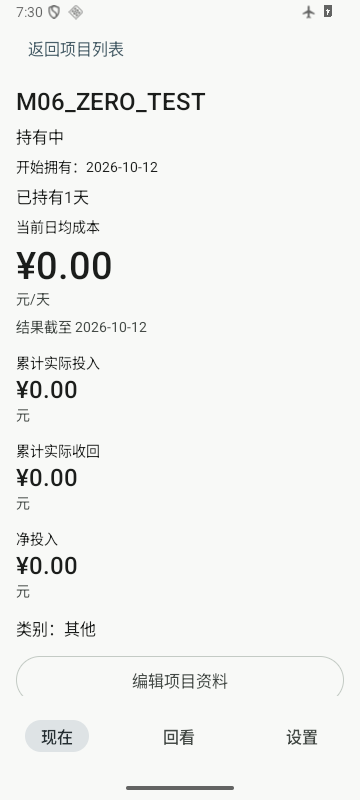

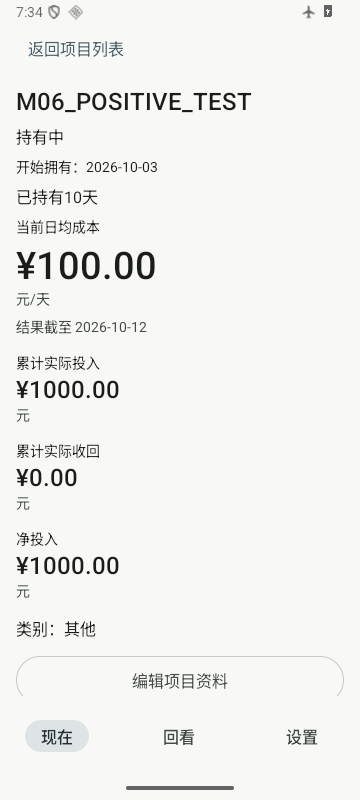


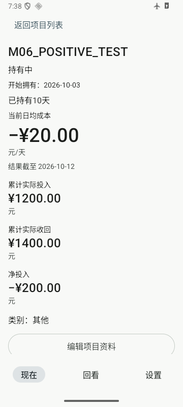

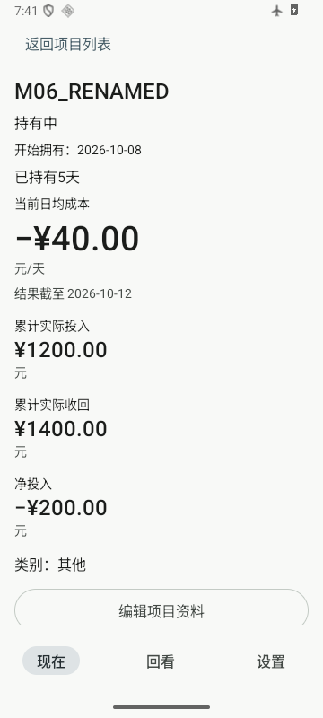

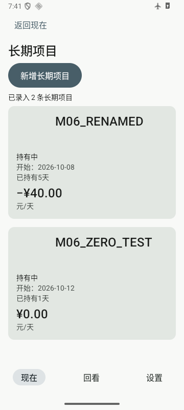

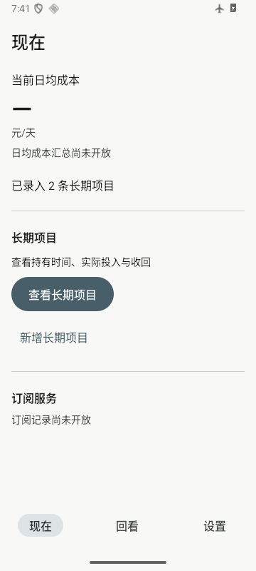

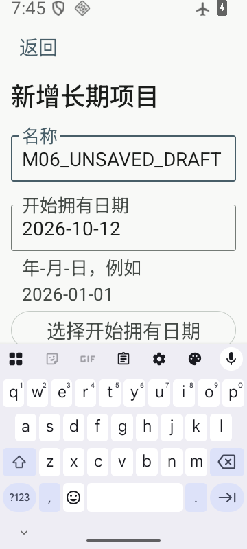

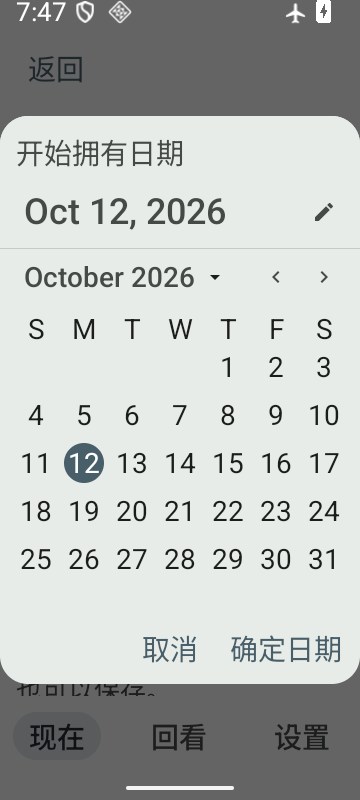

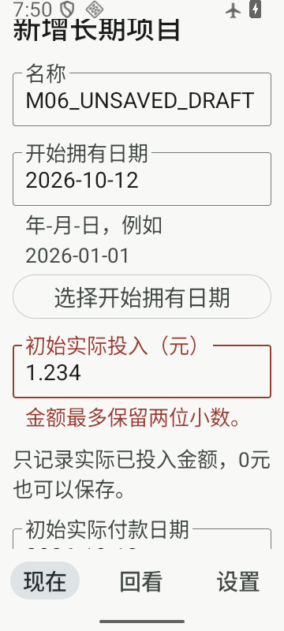

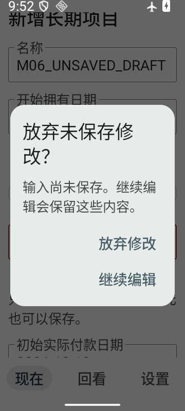

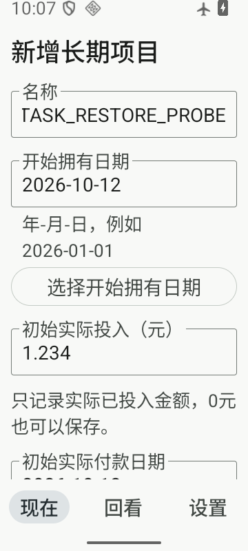

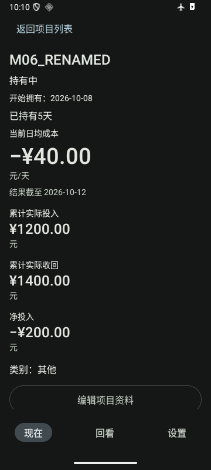

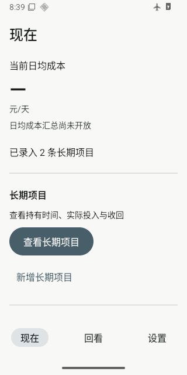

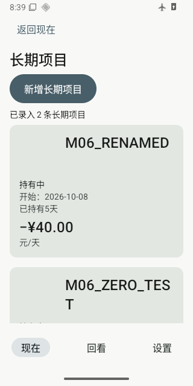

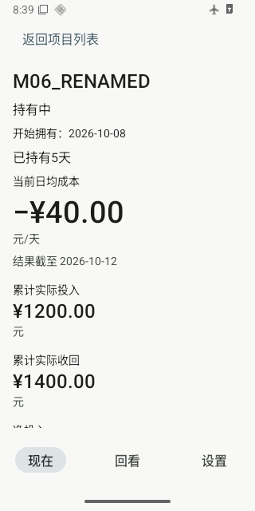

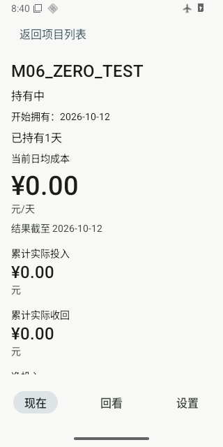

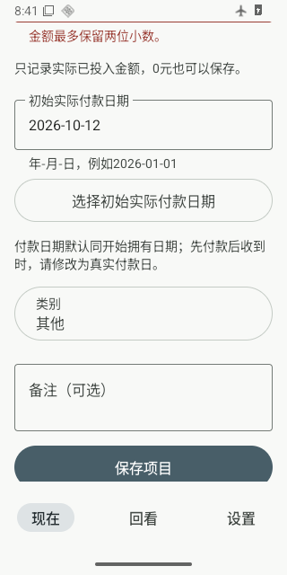

## 8. schema、记录时区、generation、权限和依赖

Room仍四表v1，schemaSHA `351b2e7c1fb952bce961c52948a6711c999f59c79dfd66e2da5564d2697b823b`；无迁移/新表/独立购买价/派生成本真值。AppContainer、DataGenerationStore、SettingsStore、实体/领域/备份配置未改。真实手工前后pointer的activeId为2d6c9460-a2f3-4976-ba04-781c416a0b52、STABLE/previousId=null，ready身份相同，settingsSHA `fff800a6a09afbc2e6656c8d67b512b74ba8e1693666e32b96701c7dfcf06c44`保持。

运行依赖122→122、所有坐标版本一致，0新增/删除/升级；继承JDK17.0.20.1+1、Gradle8.14.3、AGP8.13.2、Kotlin2.3.10、Room2.8.5、DataStore1.2.1、Nav3 1.0.1、Lifecycle2.10.0及SDK/BuildTools36。实际版本登记见[工具链](../TOOLCHAIN_LOCK.md)。

最终APK和合并Manifest无网络/其他禁止权限，仅应用自有DYNAMIC_RECEIVER_NOT_EXPORTED_PERMISSION；allowBackup=false、legacy/cloud/device-transfer九域排除、Emoji初始化排除及Wrapperhash检查通过。26生产类存在，JUnit/测试类未打包。Debug仍另有exported非launcher空ComponentActivity测试宿主；Release仅配置排除，未构建，不能当正式交付验证。

## 9. 完整文件变更

新增52、修改25、删除0；含14份实际测试XML、构建日志、18张合成截图与当前文档。所有旧规划/证据/checkpoint不变。

- `M` [AGENTS.md](../../AGENTS.md)
- `M` [README.md](../../README.md)
- `M` [app/build.gradle.kts](../../app/build.gradle.kts)
- `A` [app/src/androidTest/java/com/cooper/lithic/data/repository/ProjectRepositoryTest.kt](../../app/src/androidTest/java/com/cooper/lithic/data/repository/ProjectRepositoryTest.kt)
- `A` [app/src/androidTest/java/com/cooper/lithic/feature/project/ProjectDateInputTest.kt](../../app/src/androidTest/java/com/cooper/lithic/feature/project/ProjectDateInputTest.kt)
- `A` [app/src/androidTest/java/com/cooper/lithic/feature/project/ProjectEntryFlowTest.kt](../../app/src/androidTest/java/com/cooper/lithic/feature/project/ProjectEntryFlowTest.kt)
- `A` [app/src/androidTest/java/com/cooper/lithic/feature/project/ProjectNavigationGuardTest.kt](../../app/src/androidTest/java/com/cooper/lithic/feature/project/ProjectNavigationGuardTest.kt)
- `A` [app/src/androidTest/java/com/cooper/lithic/feature/project/ProjectRoutesTest.kt](../../app/src/androidTest/java/com/cooper/lithic/feature/project/ProjectRoutesTest.kt)
- `A` [app/src/androidTest/java/com/cooper/lithic/feature/project/ProjectScreensTest.kt](../../app/src/androidTest/java/com/cooper/lithic/feature/project/ProjectScreensTest.kt)
- `A` [app/src/androidTest/java/com/cooper/lithic/feature/project/ProjectViewModelTest.kt](../../app/src/androidTest/java/com/cooper/lithic/feature/project/ProjectViewModelTest.kt)
- `M` [app/src/androidTest/java/com/cooper/lithic/ui/NavigationShellTest.kt](../../app/src/androidTest/java/com/cooper/lithic/ui/NavigationShellTest.kt)
- `M` [app/src/androidTest/java/com/cooper/lithic/ui/StorageUiStateTest.kt](../../app/src/androidTest/java/com/cooper/lithic/ui/StorageUiStateTest.kt)
- `M` [app/src/main/java/com/cooper/lithic/app/LedgerUiState.kt](../../app/src/main/java/com/cooper/lithic/app/LedgerUiState.kt)
- `M` [app/src/main/java/com/cooper/lithic/app/LedgerUiStateHolder.kt](../../app/src/main/java/com/cooper/lithic/app/LedgerUiStateHolder.kt)
- `M` [app/src/main/java/com/cooper/lithic/app/LithicApp.kt](../../app/src/main/java/com/cooper/lithic/app/LithicApp.kt)
- `M` [app/src/main/java/com/cooper/lithic/app/LithicNavigation.kt](../../app/src/main/java/com/cooper/lithic/app/LithicNavigation.kt)
- `M` [app/src/main/java/com/cooper/lithic/app/LithicRoutes.kt](../../app/src/main/java/com/cooper/lithic/app/LithicRoutes.kt)
- `M` [app/src/main/java/com/cooper/lithic/app/MainActivity.kt](../../app/src/main/java/com/cooper/lithic/app/MainActivity.kt)
- `M` [app/src/main/java/com/cooper/lithic/data/local/ProjectDao.kt](../../app/src/main/java/com/cooper/lithic/data/local/ProjectDao.kt)
- `M` [app/src/main/java/com/cooper/lithic/data/repository/LedgerReadRepository.kt](../../app/src/main/java/com/cooper/lithic/data/repository/LedgerReadRepository.kt)
- `A` [app/src/main/java/com/cooper/lithic/data/repository/ProjectRepository.kt](../../app/src/main/java/com/cooper/lithic/data/repository/ProjectRepository.kt)
- `M` [app/src/main/java/com/cooper/lithic/data/repository/ProjectWriteRepository.kt](../../app/src/main/java/com/cooper/lithic/data/repository/ProjectWriteRepository.kt)
- `M` [app/src/main/java/com/cooper/lithic/feature/home/HomeShell.kt](../../app/src/main/java/com/cooper/lithic/feature/home/HomeShell.kt)
- `A` [app/src/main/java/com/cooper/lithic/feature/project/MoneyEventEditor.kt](../../app/src/main/java/com/cooper/lithic/feature/project/MoneyEventEditor.kt)
- `A` [app/src/main/java/com/cooper/lithic/feature/project/ProjectDetailScreen.kt](../../app/src/main/java/com/cooper/lithic/feature/project/ProjectDetailScreen.kt)
- `A` [app/src/main/java/com/cooper/lithic/feature/project/ProjectEditorScreen.kt](../../app/src/main/java/com/cooper/lithic/feature/project/ProjectEditorScreen.kt)
- `A` [app/src/main/java/com/cooper/lithic/feature/project/ProjectInputs.kt](../../app/src/main/java/com/cooper/lithic/feature/project/ProjectInputs.kt)
- `A` [app/src/main/java/com/cooper/lithic/feature/project/ProjectListScreen.kt](../../app/src/main/java/com/cooper/lithic/feature/project/ProjectListScreen.kt)
- `A` [app/src/main/java/com/cooper/lithic/feature/project/ProjectUiModels.kt](../../app/src/main/java/com/cooper/lithic/feature/project/ProjectUiModels.kt)
- `A` [app/src/main/java/com/cooper/lithic/feature/project/ProjectViewModel.kt](../../app/src/main/java/com/cooper/lithic/feature/project/ProjectViewModel.kt)
- `M` [app/src/main/java/com/cooper/lithic/feature/review/ReviewShell.kt](../../app/src/main/java/com/cooper/lithic/feature/review/ReviewShell.kt)
- `M` [docs/ACCEPTANCE_MATRIX.md](../../docs/ACCEPTANCE_MATRIX.md)
- `M` [docs/ARCHITECTURE.md](../../docs/ARCHITECTURE.md)
- `M` [docs/CURRENT_STATE.md](../../docs/CURRENT_STATE.md)
- `M` [docs/DECISIONS.md](../../docs/DECISIONS.md)
- `M` [docs/EXECUTION_PROTOCOL.md](../../docs/EXECUTION_PROTOCOL.md)
- `M` [docs/ROADMAP.md](../../docs/ROADMAP.md)
- `M` [docs/SPEC_ISSUES.md](../../docs/SPEC_ISSUES.md)
- `M` [docs/TOOLCHAIN_LOCK.md](../../docs/TOOLCHAIN_LOCK.md)
- `A` [docs/checkpoints/2026-10-12-M06.md](../../docs/checkpoints/2026-10-12-M06.md)
- `A` [docs/evidence/M06-verification.json](../../docs/evidence/M06-verification.json)
- `A` [docs/evidence/M06-verification.md](../../docs/evidence/M06-verification.md)
- `A` [docs/evidence/m06-tests/diagnostic-full-and-flow-native-0.xml](../../docs/evidence/m06-tests/diagnostic-full-and-flow-native-0.xml)
- `A` [docs/evidence/m06-tests/green-full-TEST-com.cooper.lithic.core.design.AmountFormatterTest.xml](../../docs/evidence/m06-tests/green-full-TEST-com.cooper.lithic.core.design.AmountFormatterTest.xml)
- `A` [docs/evidence/m06-tests/green-full-TEST-com.cooper.lithic.core.model.MoneyParserTest.xml](../../docs/evidence/m06-tests/green-full-TEST-com.cooper.lithic.core.model.MoneyParserTest.xml)
- `A` [docs/evidence/m06-tests/green-full-TEST-com.cooper.lithic.core.time.BusinessClockTest.xml](../../docs/evidence/m06-tests/green-full-TEST-com.cooper.lithic.core.time.BusinessClockTest.xml)
- `A` [docs/evidence/m06-tests/green-full-TEST-com.cooper.lithic.domain.project.ProjectCostEngineTest.xml](../../docs/evidence/m06-tests/green-full-TEST-com.cooper.lithic.domain.project.ProjectCostEngineTest.xml)
- `A` [docs/evidence/m06-tests/green-full-TEST-com.cooper.lithic.domain.subscription.SubscriptionAccumulationTest.xml](../../docs/evidence/m06-tests/green-full-TEST-com.cooper.lithic.domain.subscription.SubscriptionAccumulationTest.xml)
- `A` [docs/evidence/m06-tests/green-full-TEST-com.cooper.lithic.domain.subscription.SubscriptionCostEngineTest.xml](../../docs/evidence/m06-tests/green-full-TEST-com.cooper.lithic.domain.subscription.SubscriptionCostEngineTest.xml)
- `A` [docs/evidence/m06-tests/green-full-native-0.xml](../../docs/evidence/m06-tests/green-full-native-0.xml)
- `A` [docs/evidence/m06-tests/green-full.log](../../docs/evidence/m06-tests/green-full.log)
- `A` [docs/evidence/m06-tests/green-new-attempt1-native-0.xml](../../docs/evidence/m06-tests/green-new-attempt1-native-0.xml)
- `A` [docs/evidence/m06-tests/green-new-attempt2-native-0.xml](../../docs/evidence/m06-tests/green-new-attempt2-native-0.xml)
- `A` [docs/evidence/m06-tests/red-async-boundaries-full-recheck-native-0.xml](../../docs/evidence/m06-tests/red-async-boundaries-full-recheck-native-0.xml)
- `A` [docs/evidence/m06-tests/red-initial-read-ui-and-green-recheck-native-0.xml](../../docs/evidence/m06-tests/red-initial-read-ui-and-green-recheck-native-0.xml)
- `A` [docs/evidence/m06-tests/red-native-native-0.xml](../../docs/evidence/m06-tests/red-native-native-0.xml)
- `A` [docs/evidence/m06-tests/red-review-gaps-native-0.xml](../../docs/evidence/m06-tests/red-review-gaps-native-0.xml)
- `A` [docs/evidence/m06-ui/backdated-outlay-detail.png](../../docs/evidence/m06-ui/backdated-outlay-detail.png)
- `A` [docs/evidence/m06-ui/dark-edited-detail.png](../../docs/evidence/m06-ui/dark-edited-detail.png)
- `A` [docs/evidence/m06-ui/edited-detail.png](../../docs/evidence/m06-ui/edited-detail.png)
- `A` [docs/evidence/m06-ui/final-home.png](../../docs/evidence/m06-ui/final-home.png)
- `A` [docs/evidence/m06-ui/final-list.png](../../docs/evidence/m06-ui/final-list.png)
- `A` [docs/evidence/m06-ui/final-negative-detail.png](../../docs/evidence/m06-ui/final-negative-detail.png)
- `A` [docs/evidence/m06-ui/final-validation-error.png](../../docs/evidence/m06-ui/final-validation-error.png)
- `A` [docs/evidence/m06-ui/final-zero-detail.png](../../docs/evidence/m06-ui/final-zero-detail.png)
- `A` [docs/evidence/m06-ui/large-date-picker.png](../../docs/evidence/m06-ui/large-date-picker.png)
- `A` [docs/evidence/m06-ui/large-discard-dialog.png](../../docs/evidence/m06-ui/large-discard-dialog.png)
- `A` [docs/evidence/m06-ui/large-draft-ime.png](../../docs/evidence/m06-ui/large-draft-ime.png)
- `A` [docs/evidence/m06-ui/large-validation-error.png](../../docs/evidence/m06-ui/large-validation-error.png)
- `A` [docs/evidence/m06-ui/negative-detail.png](../../docs/evidence/m06-ui/negative-detail.png)
- `A` [docs/evidence/m06-ui/positive-initial-detail.png](../../docs/evidence/m06-ui/positive-initial-detail.png)
- `A` [docs/evidence/m06-ui/refreshed-home.png](../../docs/evidence/m06-ui/refreshed-home.png)
- `A` [docs/evidence/m06-ui/refreshed-list.png](../../docs/evidence/m06-ui/refreshed-list.png)
- `A` [docs/evidence/m06-ui/task-restored-final-draft.png](../../docs/evidence/m06-ui/task-restored-final-draft.png)
- `A` [docs/evidence/m06-ui/zero-detail.png](../../docs/evidence/m06-ui/zero-detail.png)
- `A` [docs/planning/M06_CONTRACT.md](../../docs/planning/M06_CONTRACT.md)
- `M` [docs/planning/README.md](../../docs/planning/README.md)

## 10. APK与Git

- APK绝对路径：`E:/CODEX/砺石新APP/app/build/outputs/apk/debug/app-debug.apk`（构建产物忽略，不公开发布）。
- applicationId：com.cooper.lithic.debug；code4 / 0.1.0-m06-debug。
- 大小：12,076,349 bytes；SHA-256 `81b4c698c1d1355b018094bcc391be9b1ada8e4c4e447b7eb43ace8d7c7a2895`。
- 实际v2 Debug签名PASS，证书SHA `29ded26bea44f1afe4fe383a302e4b507423d16223469d7da3fe578d9a7f83b9`；未提交私钥。安装base.apk与本地hash相同。
- 仅提交推送feat/m06-project-entry；本报告属该提交，最终自身SHA/推送后origin一致/干净状态由Git日志和本地`build/m06-evidence/M06-delivery.md`回执登记，避免在被hash文档内自引用。提交前实际范围/敏感信息/旧输入/链接518项无缺失、原43/130和规格风险不变、77文件清单及diff检查已通过，提交后再次查保护ref。没有main合并、force、PR、WHOCARE、公开APK或真实个人数据。

## 11. 未解决/NOT_RUN与M07前置条件

没有已确认未解决的本轮阻塞代码缺陷。SQLiteFull被回滚错误掩盖的分类边界、无持久编辑日志、任务saved-state前提、单项目完整事件需求和20Lint提示保留为明确限制。独立ChatGPT验收PENDING，不由内部代理审查替代。

**NOT_RUN：**真机/API26/OEM备份迁移、完整TalkBack、实际内存压力LMK、Release正式构建/签名升级；M07结束/删除/历史纠错、M08订阅/版本迁移/预检集成、M09两项订阅流程、M10图片、M11/M12完整备份恢复、M13汇总、M14搜索类别及后续未授权能力。原130归档及16完整跨模块补测继续NOT_RUN；本轮矩阵另记实际结果。

Q03～Q06与既有期限、M09 STOPPED重新启用及多期预付停止两风险保持；M04中断残留generation不能静默删除真实数据，M08迁移须同步版本预检，M12切换/恢复/回退仍待执行。M00～M05独立NOTES全部保留。M05正式刷新/分页要求本轮已解决，旧记录不改写。

M07前置：ChatGPT独立验收M06及用户新授权；读本checkpoint/当前事实/原M07与相关规格；继承同owner/schema/时区/CostEngine、资料CAS/提交身份/真实刷新/分页/错误保护，不以删除库修复升级或扩范围。

**本轮停止在READY_FOR_REVIEW — M06。**
