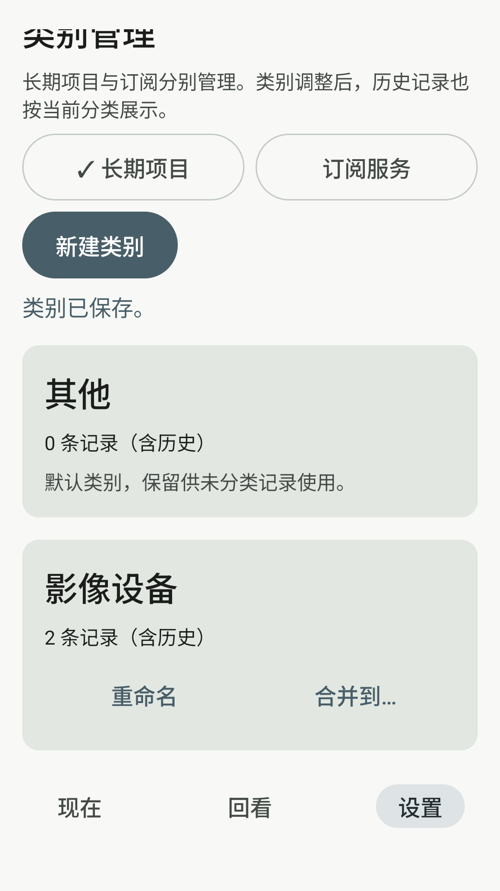
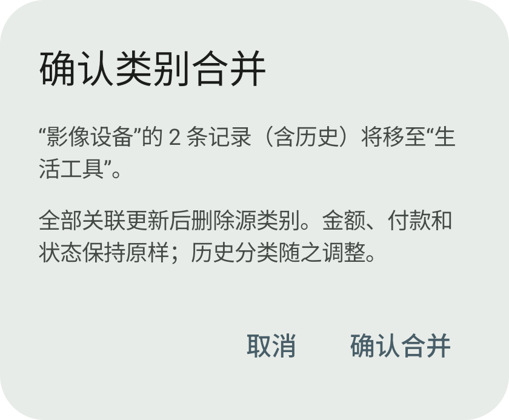
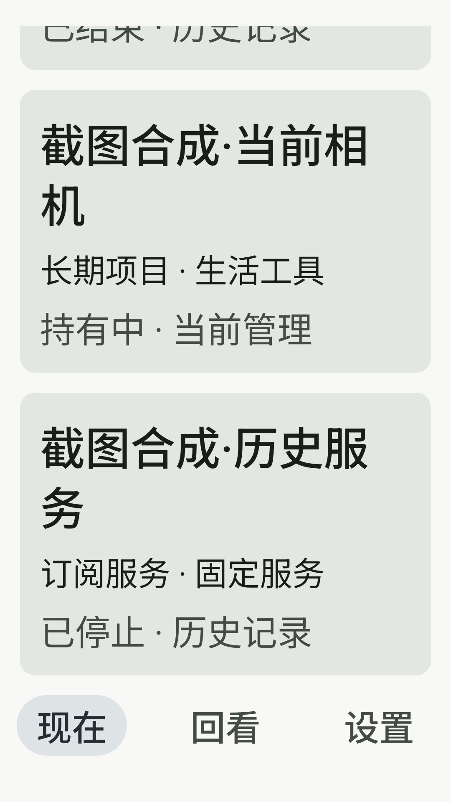

# M14 Android 补验索引

本批次仅API36新合成设备5672；[短报告](../M14-Android-verification.md)、[最终统计](results.json)。原`../m14/`是初次交付，保持历史NOT_RUN。

## 证据索引

- [最终原28项](final28/summary.json)：每类`.stdout.txt`是设备原始instrumentation；`.result.json`由旁存的薄命令记录脚本解析，保存命令、退出码、源码及stdout哈希、逐方法状态。**不是设备生成的JUnit XML**。
- [最终独立截图旅程](final-screenshots/M14ScreenshotsJourneyTest.stdout.txt)、[结果](final-screenshots/M14ScreenshotsJourneyTest.result.json)。status2仅发布PNG路径，非JUnit通过事件；测试完成仍由真实status0与JUnit OK判断。
- RED：[类别断言](red-category/CategoryRepositoryTest.stdout.txt)、[中间批次类别UI断言](intermediate-ui-red/CategoryManagementScreenTest.stdout.txt)、[搜索UI定位](red-search-ui/SearchScreenTest.stdout.txt)、[旧包截图诊断](red-screenshot-journey/M14ScreenshotsJourneyTest.stdout.txt)。中间目录原名green28不表示全部通过，真实27项中26PASS/1FAIL。
- 旧包截图诊断运行时，工作区帮助函数已有待打包修订；该claim的source hash是命令发起时工作区文件，**不能当旧APK编译输入证明**。该项FAIL保留；最终29项的当前源码、编译及安装身份另行核对，均匹配。
- [初次安装](install/commands.json)、[中间Test更新](test-update01/commands.json)、[最终Test更新](test-update02/commands.json)：App始终原SHA；同签名更新仅针对Test。证书和manifest原始输出相邻保存。
- [被拒绝的隔离Debug证书](rejected-test-certificate/test-certificate.stdout.txt)：该Test未安装；[构建恢复原证书](build/screenshot-test-build-original-debug-identity.log)。不包含密钥、密码或APK。
- [AVD创建/隔离](device/config-proof.json)、[启动主机身份](device/host-instance-proof.json)、[最终主机身份](device/end/host-instance.json)、[结束设备核查](device/end/commands.json)。SDK与数据目录实物留本地，不归档userdata/镜像/许可正文。
- [最终构建/Lint](build/test-ui-semantics-fix-build-lint.log)、[Lint XML](lint.xml)，其他构建/前置失败日志同目录保留。
- `reproduction/`为本次`build/m14-android/`薄记录脚本的取证副本，不是通用测试框架；原脚本的路径基于原位置、固定新serial及不可覆盖目录。复核优先读取JSON中的实际命令，不在证据目录直接重新执行安装脚本。

## 截图来源

8张均为**新合成数据、隔离ComponentActivity宿主中的真实LithicApp/Nav3**，不是MainActivity或正式发行截图；没有私人记录。图片为实际captureToImage原始PNG，设备侧SHA与读回SHA一致。[路径/字节/哈希/尺寸](screenshots/index.json)。所有画布宽360dp；1～6为fontScale1，7～8为fontScale2，未改变系统font/density；输入法关闭后拍摄。顶部/底部局部内容超出视口时使用页面真实滚动，未拼接、重绘或缩小系统字体。

| 图 | 场景 |
|---|---|
| [01](screenshots/01-project-category-list.png) | 长期项目类别、写入后2条当前/历史计数及操作反馈 |
| [02](screenshots/02-project-merge-confirmation.png) | 长期项目实际合并对话框根，源/目标及2条影响数 |
| [03](screenshots/03-subscription-category-list.png) | 订阅类别列表已滚动位置及真实2条计数 |
| [04](screenshots/04-subscription-merge-confirmation.png) | 订阅实际合并对话框根 |
| [05](screenshots/05-search-current-project.png) | 名称搜索及当前/历史项目 |
| [06](screenshots/06-search-history-subscription.png) | 已停止历史订阅与当前订阅 |
| [07](screenshots/07-search-360dp-font200-header.png) | 360dp/200%搜索标题、输入与结果数量 |
| [08](screenshots/08-search-360dp-font200-history.png) | 360dp/200%滚动后当前项目及历史服务状态 |

