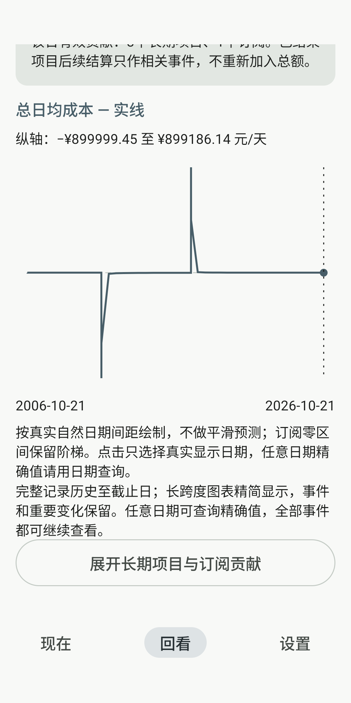
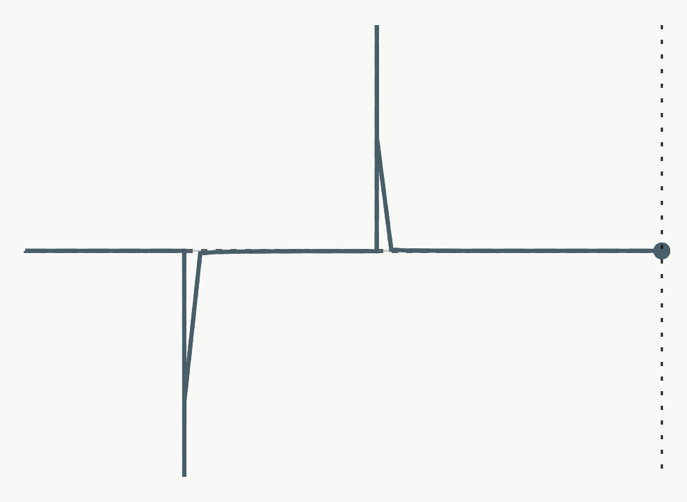
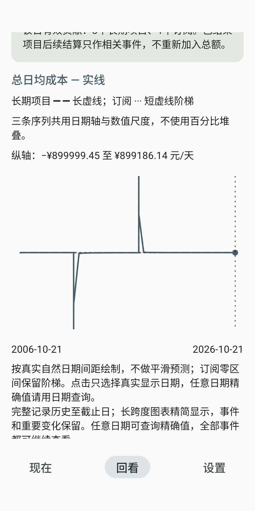
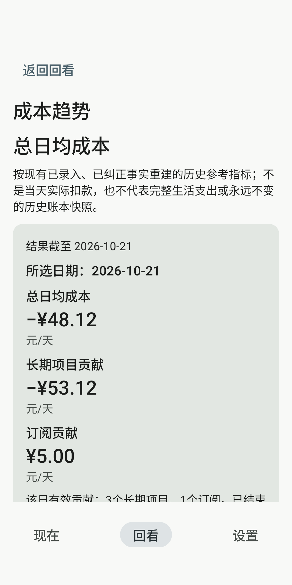
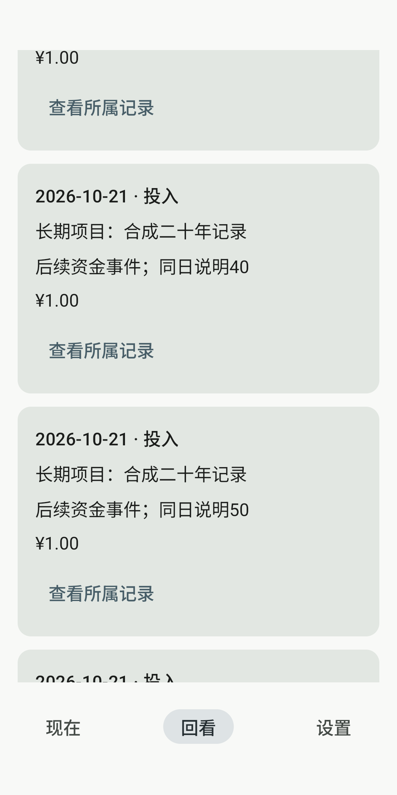
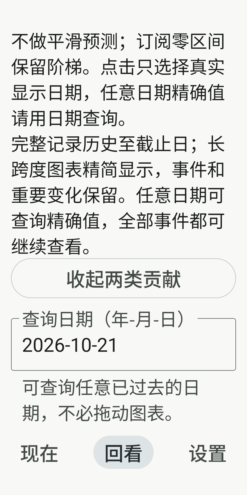
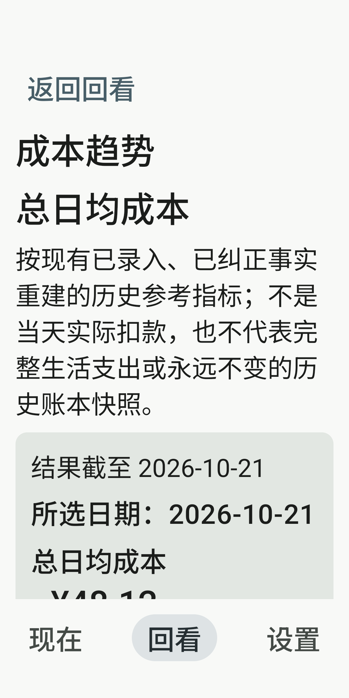
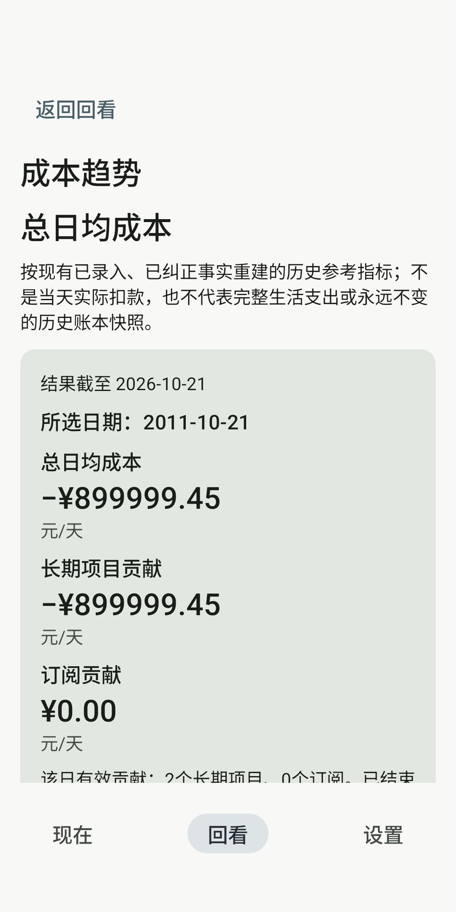
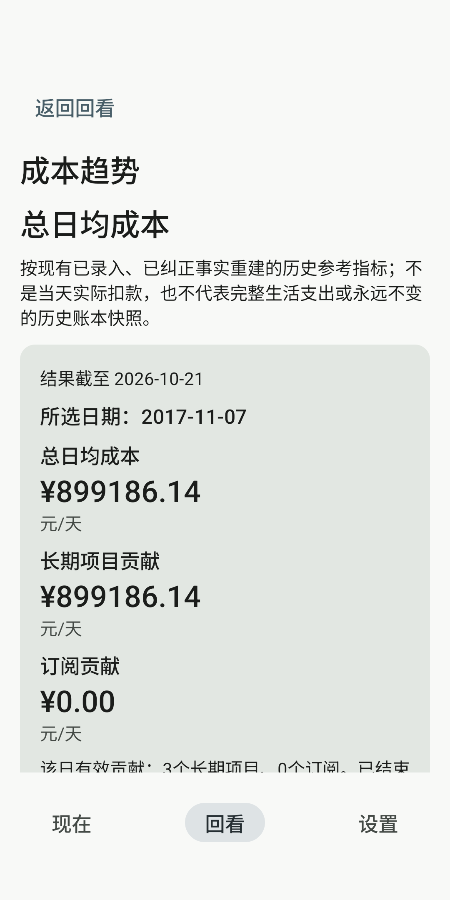

# M18 实际截图

全部来自新 `Lithic_M18_API36_20261021 / emulator-5692 / API36 x86_64`，最终Test SHA `f2f01b2d77fb4f12d24338a02218c7175a0ce299b4a9a079178580d4f6d4a257`。

图像是设备实际Compose渲染的原始PNG，由 `captureToImage` 取得；Canvas图为984×720，其余隔离宿主1080×2160。无裁改、重绘或拼接。来源路径、run UUID、字节数、SHA和尺寸逐图见 [sources.json](sources.json)。

这是plain Application / 隔离ComponentActivity中的真实LithicApp/Nav3，**不是MainActivity默认账本或屏幕全帧**。正常画布为360dp、字体1；05/06为同一宿主LocalDensity字体2，设备系统font_scale始终1.0，不冒充系统级200%、IME或TalkBack验证。底部导航及内容在独立滚动位置取证。

合成事实：20年前项目100000分、正峰项目90000000分、负谷项目初始0/次日真实收回180000000分、真实月付15000分/30标准日，以及同日51笔100分投入。均经实际Repository写入；未写入默认账本。总额与同快照首页参照一致，浏览前后完整备份事实相等。夸大的正负合成金额用于让20年极值可见，不是用户记录。三线共尺度时5元订阅贡献视觉接近零，03给出精确值。

## 完整20年总线（Canvas原区域）

SHA-256：`d46c91bc23ca02b9e4f1198f05b628ae4e2d4b613e983842a7b8870d074da358`；10846字节。

## 总线、日期轴和数值轴语境

SHA-256：`0362145322752d24b317d272367456ffe3facb4e7de4e9c81bcf8d00aafc50eb`；212747字节。

## 展开两类贡献后的共同尺度完整Canvas

SHA-256：`4d70a6d39ac4ea3343446c3f2ab170f4d2a8761a0d45426e013008934427ef86`；12799字节。

## 三线图例、日期轴及数值轴

SHA-256：`c5e4935bb6686322f0d4c44386cead266f0783e3a173161fd1f481cbde3b4118`；228824字节。

## 2026-10-21精确总额与两类贡献

SHA-256：`b3af43b3fd88b6d2fce37353cc731e390784a87af01891bdb0a13e83d187a45d`；180973字节。

## 继续显示50条后可见同日说明50

SHA-256：`ae8251c1b2cf680c6cc6ad5efc6ad6ce0e26e70099b911323f76f031852309d9`；131638字节。

## 360dp／LocalDensity200%日期输入

SHA-256：`e028edbdc30c6335a35d98107352686a51ab853563fecb5b786dbd53f2d88e6d`；269654字节。

## 360dp／LocalDensity200%返回入口

SHA-256：`f510003f0da62abdc2d9ad1a41c541f7ed4e28ac8356286d9efbf09b68a94d55`；214560字节。

## 2011-10-21负谷精确值

SHA-256：`e721caccf78d6072da5c6b88691748ef125a62f941eaa053259024057fcad5d4`；182220字节。

## 2017-11-07正峰精确值

SHA-256：`77ecd2082cff57fafa30f842e09afa67a84087c442b0c97cc014dab05d531575`；183836字节。

