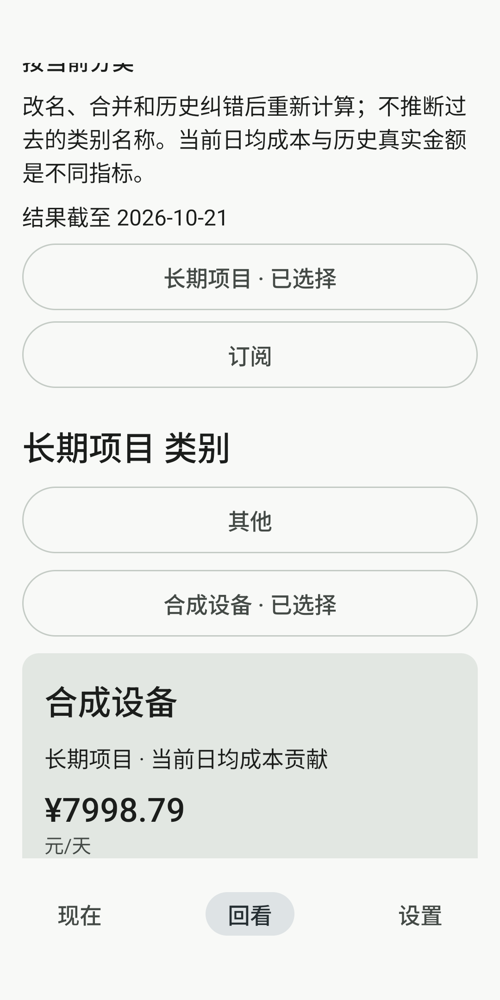
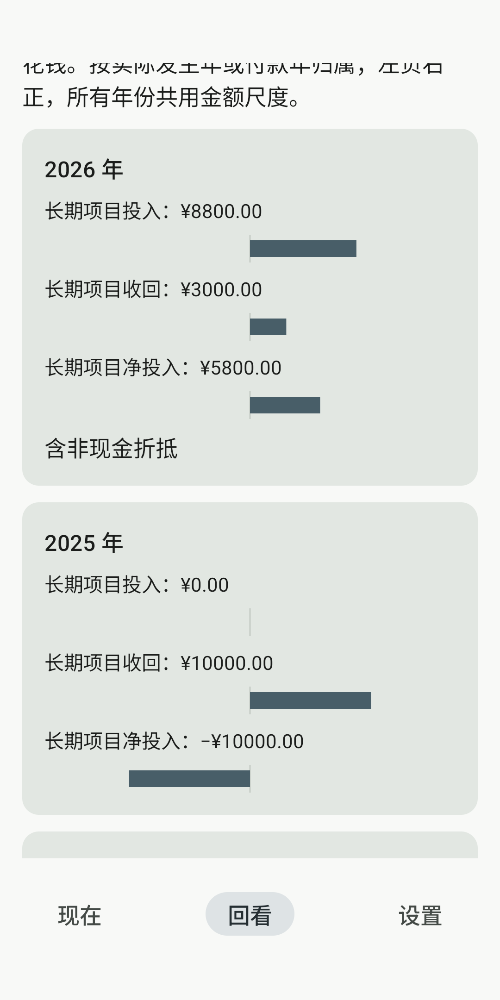
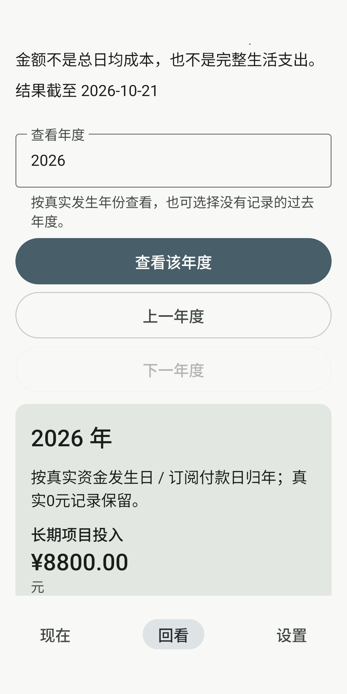
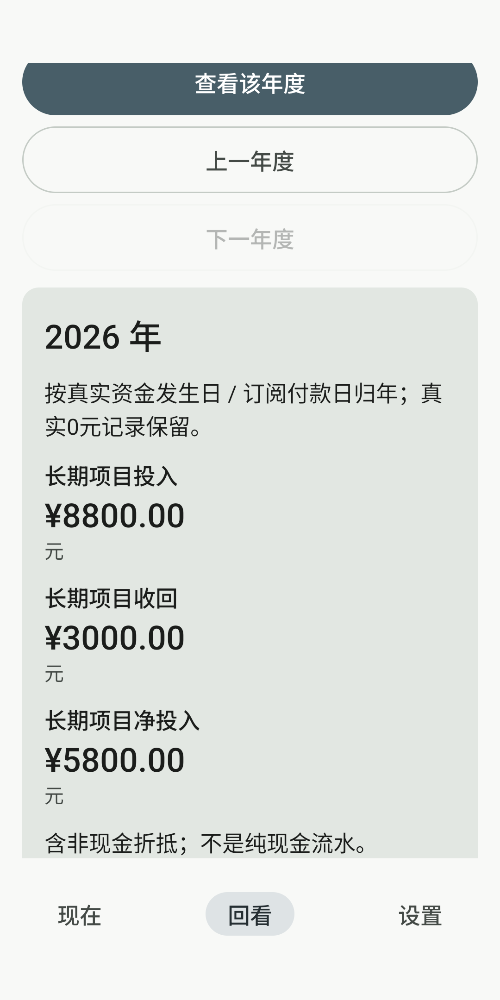
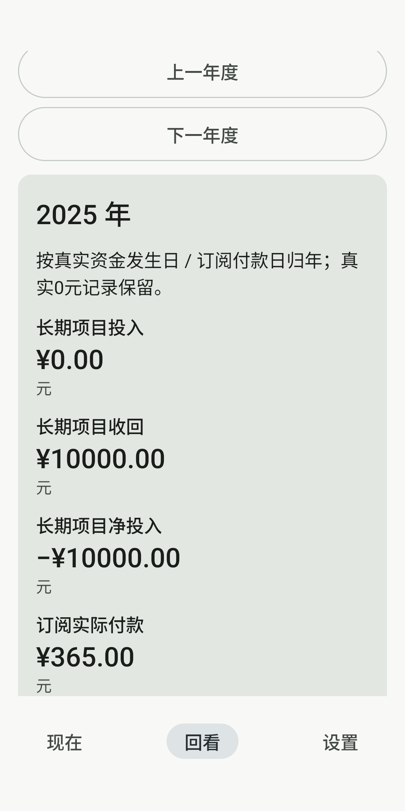
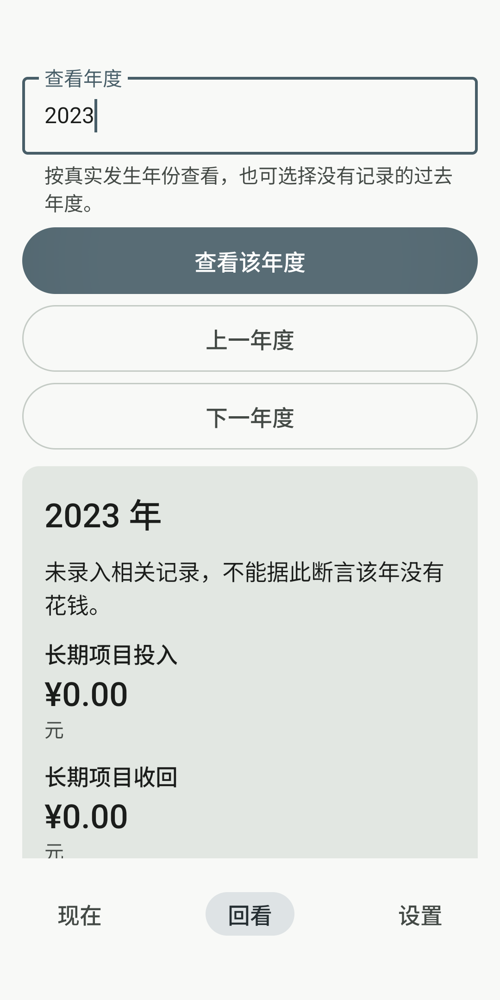
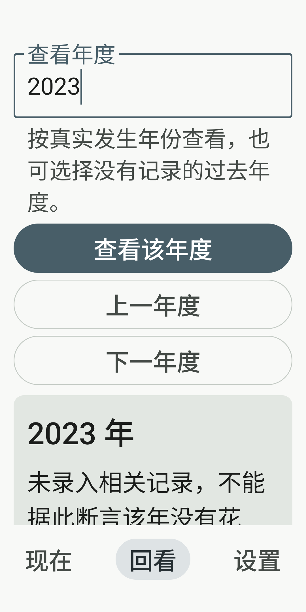
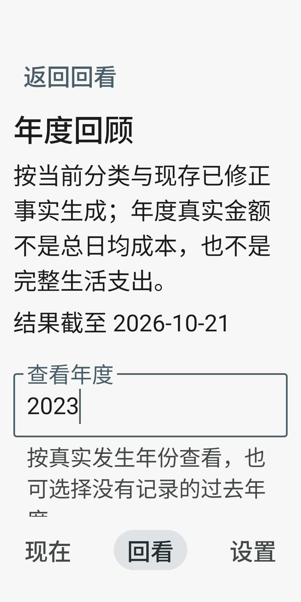

# M19 最终8张实际截图

实际设备原Lithic_M18_API36_20261021/emulator-5692/API36 x86_64；[最终旅程](../android-final-ui/M19ReportJourneyTest.result.json)中的隔离ComponentActivity承载真实LithicApp/Nav3/Compose，plain Application Runner，全新M19合成账本。不是MainActivity或私人账本。01～06正常画布；07/08以LocalDensity模拟360dp/fontScale2，不是系统字体/IME/TalkBack验证。BusinessClock注入2026-10-21，未改系统时钟。

最终App SHA `b4203c3102037752ffb376e4650673942fd43851560db4ced70a8e1d7260f5ac`，Test SHA `81e4cf0bfa9119c541e499605fad8d03bcc676d525c7b462e4c198c4a3287a98`。每图原始1080×2160、未修改；设备路径、run UUID、命令、字节/SHA见[sources.json](sources.json)。具体记录入口/导航与只读事实由旅程断言核对，不宣称每图都显示记录入口。

## 01 — 类别当前日均贡献与当前分类

183,966 bytes · SHA-256 `b851357d4cfa949c94c4c09e9cdacacbcdb163934bfe60428363dda26b40cbaa`

## 02 — 类别年度真实投入/收回/净额及负区间

135,487 bytes · SHA-256 `c6eddd424f91178e9a55c3178dff79e1f1b8082d7623ca68356a2c3ea59a79f9`

## 03 — 年度选择与项目投入

165,425 bytes · SHA-256 `163afd192ff24143dedbd8a1afddb670da8e3a1b5177dcf688865bfd5b2f6957`

## 04 — 项目三额、非现金折抵与订阅金额独立展示

144,941 bytes · SHA-256 `ad0c7eb5d5face651891e6768e16d0b205d8385e10cb5f80572645ca6e4d846f`

## 05 — 2025负净额与订阅真实付款归年

131,993 bytes · SHA-256 `0eabd5470845bf1c4e64a24c703ad4bd2a6dc66ae36bcc88300a3502ee7181e0`

## 06 — 未录入年份与真实0值的准确说明

142,893 bytes · SHA-256 `883a0769933a0fc18049d1cf84c6dd523baad82a30d6031255724f84d181acba`

## 07 — 360dp/200%年度输入与查询操作

170,311 bytes · SHA-256 `8fe4464c1157ff8514dad672959a424441d7142c88ac27f73ab3019d0601f0d8`

## 08 — 360dp/200%返回回看与截止日期

192,239 bytes · SHA-256 `75e7811d33afcba0af81b7f15210b6f1cdc28633e22508c95614b273e4c9744c`
