# UI-C1 阶段1实际样板

**VISUAL_REVIEW_REQUIRED — UI-C1**。以下均是Android真实运行原图，未改像素；待用户看图，不自授视觉通过。实现/测试/数据保护的完整边界见[报告](../../UI-C1-stage1-verification.md)，每张图的原字节SHA、设备、主题、字体与APK绑定见[登记](screenshot-manifest.json)。

## 三页 × 深浅主题：最终APK MainActivity

同一安装APK SHA-256：`f994d7820a1cb26ec0a11fe527b8e0befb3a8f1d415b62f776f915e20b067a78`。既有API36模拟器，1080×1920、density420（约411dp）、font1.0。画面中的名字/金额/蓝色封面来自已有合成QA账本，没有导入设计图照片或伪造首页总额。

| 页面 | 浅色 | 深色 |
|---|---|---|
| 现在 | 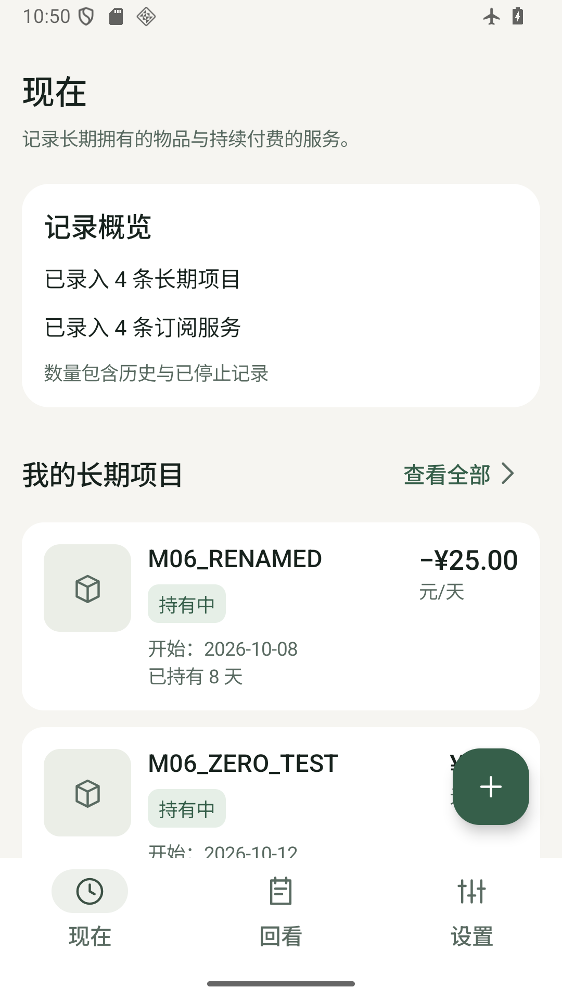 | 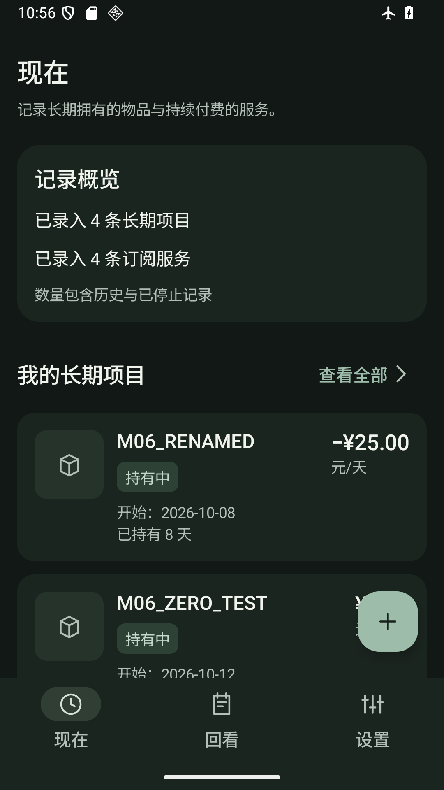 |
| 长期项目列表 | 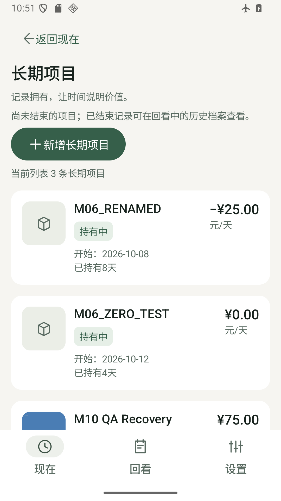 | 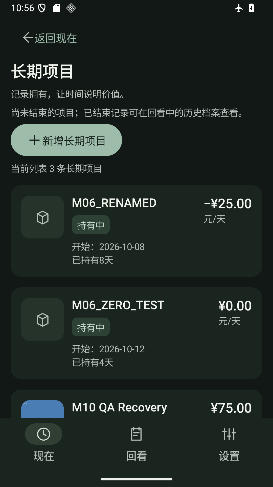 |
| 长期项目详情 | 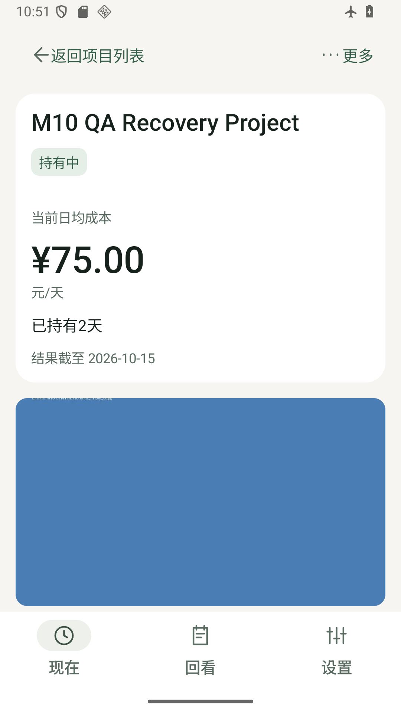 | 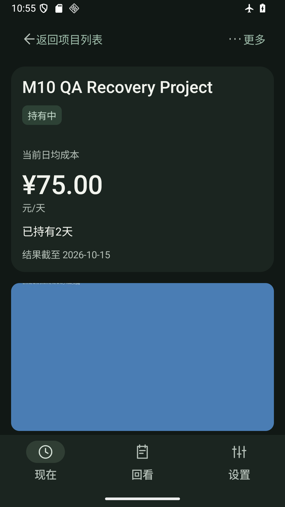 |

列表/首页可滚动，首屏下缘卡片不是完整列表截图。首页浮动新增按钮可能覆盖当时部分卡片，滚动后能完整读数；此效果如实保留。详情下方还有原资金操作/事实/事件，见[详情滚动补图](screenshots/19-project-detail-content-light.png)。蓝色图是原M10合成测试封面，不是加载占位。

## 首页全空：隔离的实际Android测试宿主

最终输入下真实LithicNavigation＋独立空Room，无新业务记录。它们**不是MainActivity真实清空账本后的截图**；原账本没有删除/切换指针。浅色测试宿主的状态栏白色字形与MainActivity不同，不作为正式系统栏验证。页面主体空状态、首次新增按钮、无重复FAB经过实际测试。

| 浅色空态 | 深色空态 |
|---|---|
| 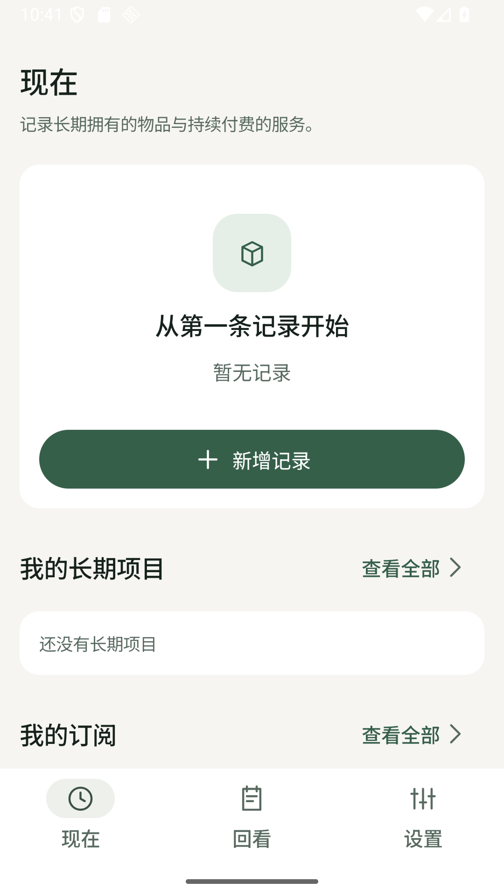 | 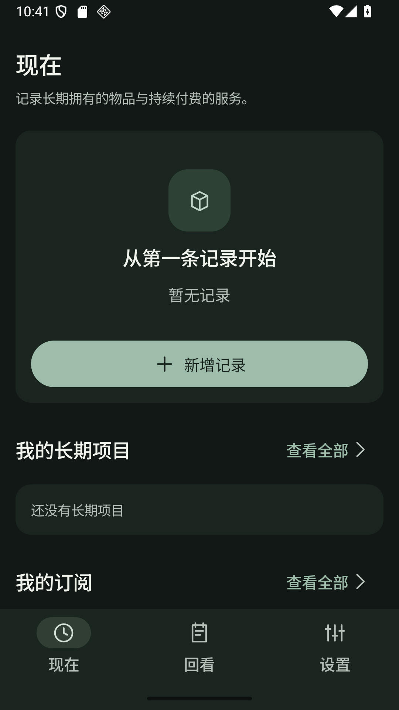 |

## 360dp、200%字体：最终APK MainActivity

同一1080×1920设备临时density480、font2.0，结束后已恢复。首页和详情滚动区域不限制固定高度，也不缩小金额。压力详情选用已有负成本项目M06_RENAMED；名称/金额与前面的有封面项目不同，属于明确不同QA对象，不是主题切换导致数据改变。

| 场景 | 浅色 | 深色 |
|---|---|---|
| 首页顶部 | 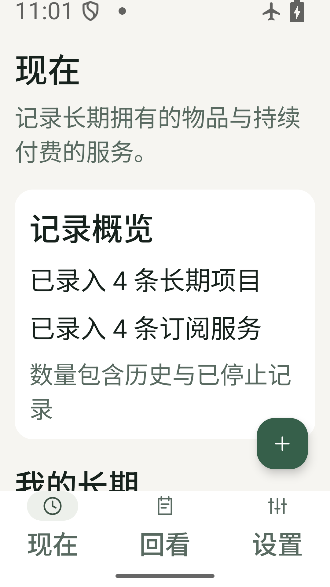 | 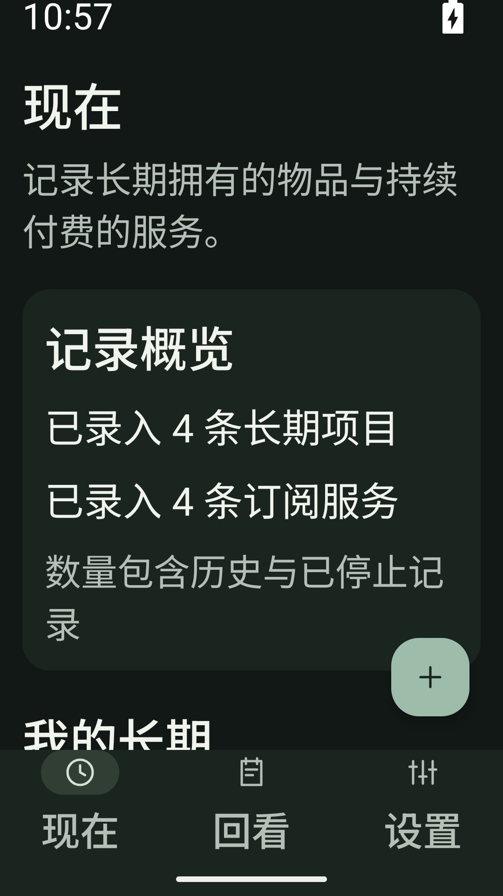 |
| 详情顶部 | 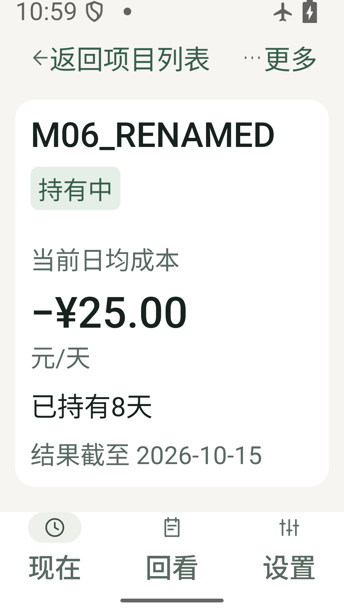 | 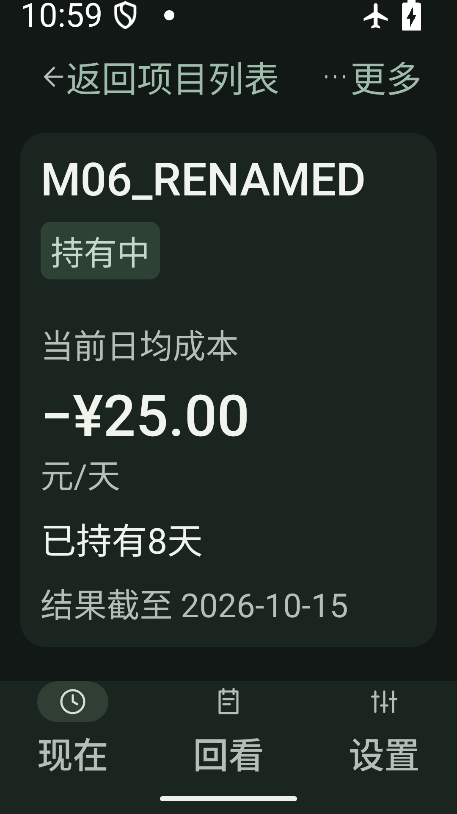 |

完整负金额重排、返回与更多操作示例：

| 首页滚动后完整金额 | 详情更多菜单：结束/删除分义 |
|---|---|
| 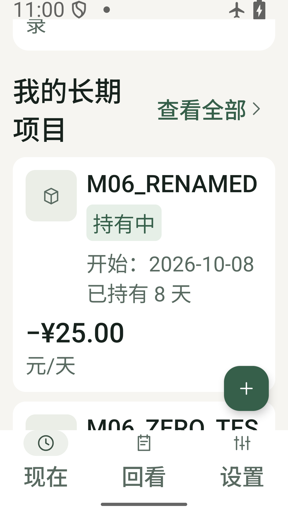 | 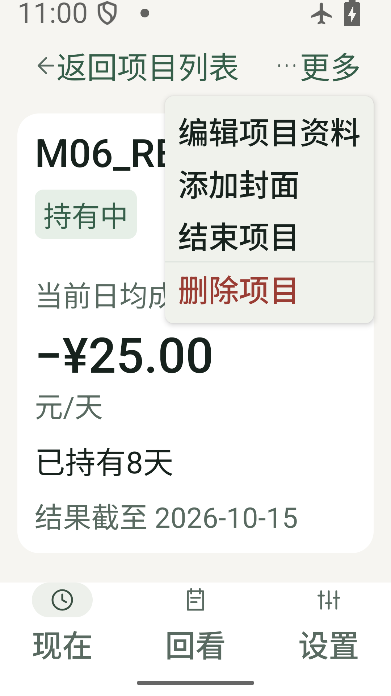 |

额外原图（保留中间滚动位置，不冒称完整卡片）：[深色滚动一](screenshots/11-now-360dp-200-dark-scrolled.png)、[深色滚动二](screenshots/12-now-360dp-200-dark-card.png)、[浅色概览中途](screenshots/17-now-360dp-200-light.png)。

## 新增菜单与详情操作

| 新增菜单（深色，font1.0） | 详情滚动内容（浅色，font1.0） |
|---|---|
| 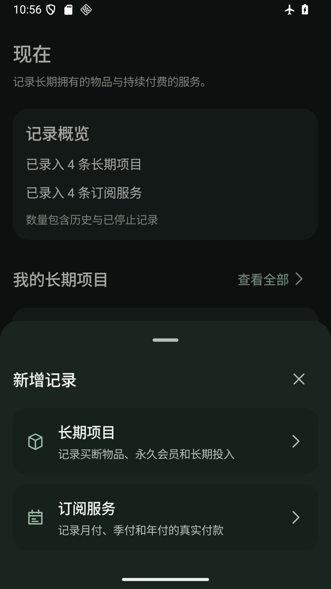 | 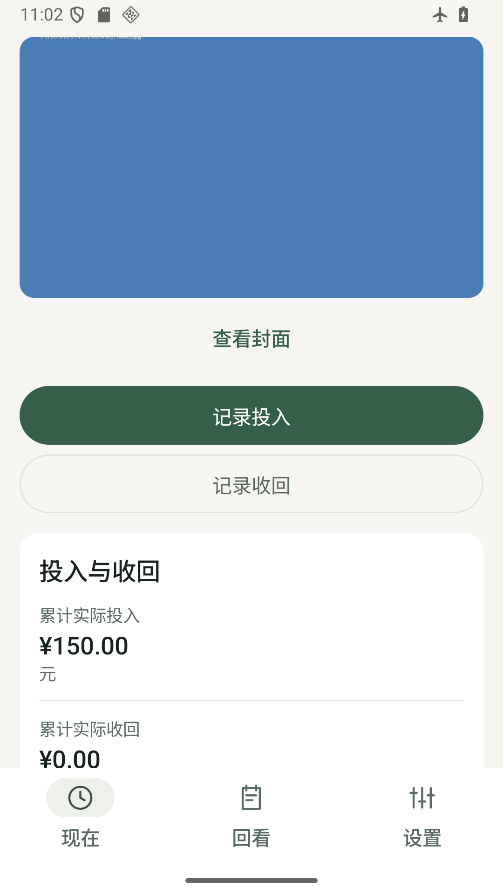 |

本轮只交三页样板及必要共享装配。没有订阅/回看/设置样板统一、没有完整表单改版或Task8全量回归。M10三项JPEG拒绝测试仍FAIL，未修复或跳过。用户确认实际样板前停止，不进入Task6～8或M11。
