# UI-C1 阶段2最终原图画廊

状态：**原图与来源已核验；实现者已逐张检查；用户/ChatGPT独立视觉验收PENDING**。[实现者原图检查](VISUAL_INSPECTION.md)单独记录，不授予视觉接受、UI-C1冻结或M10接受。生成器manifest中的PENDING表示其不执行人工视觉审核。

最终源码 HEAD `6a25965225ace3212d1653d15b45fc56ef87411e`；输入指纹 `6e10034a61e9ffc666be545645b04ea5a13bc022aa510cb5dde97694485a4f2f`。

最终 Debug APK SHA-256 `4bfd57231a9028ed5c2cd6961e2c59756936b688c6bf90159d58743301889c46`；androidTest APK SHA-256 `458e589cc52435cd6ffe693670f49af9dfd7ba671cc19cab9142f5003060e2f8`。

最终无过滤运行 `stage2-final-restored-full`：718 方法，715 PASS、3 FAIL、0 SKIPPED；整体 `FAIL`。这里只要求两个截图 producer 方法在该运行中确实 PASS，不会把图像产生成功当作整体回归成功。

[逐图完整登记](final-screenshot-manifest.json)包含每图原始元数据、图片/最终 APK/测试 APK/输入指纹、设备/API、px/dp、字体、主题、实际宿主和 JUnit/fixture 哈希。

## 16张正常字体 MainActivity 原图

以下为最终已安装 APK 的真实 MainActivity，数据是原有合成 QA 账本。Light/Dark 来自每次采集的真实系统 night 配置，字体为实际系统比例1.0。

| 页面 | Light | Dark |
|---|---|---|
| 现在 | 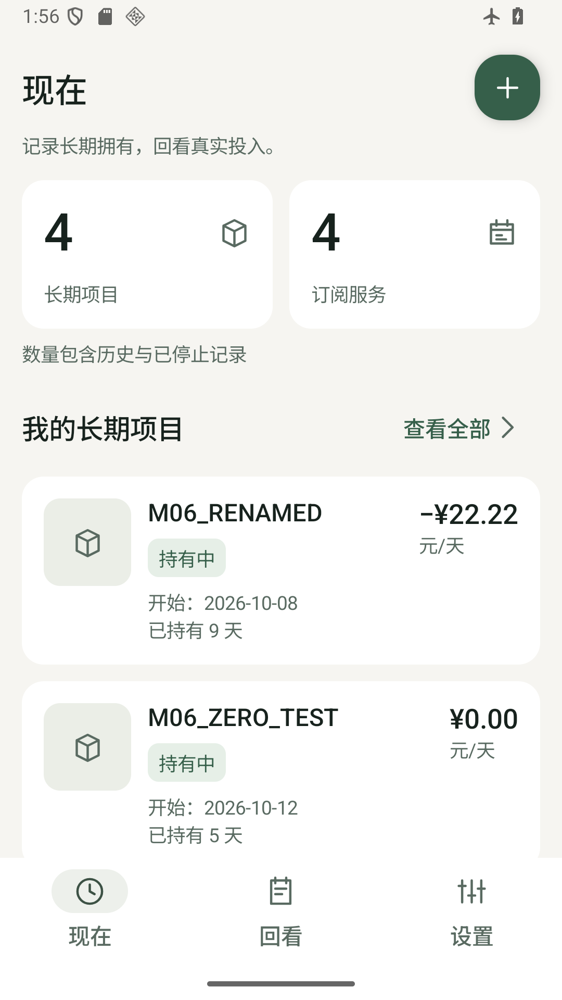 | 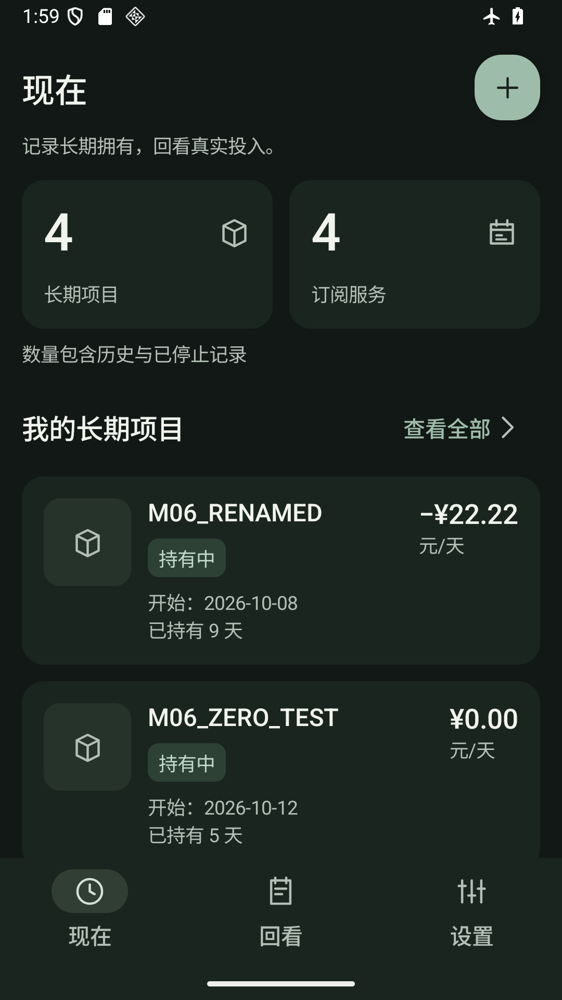 |
| 长期项目列表 | 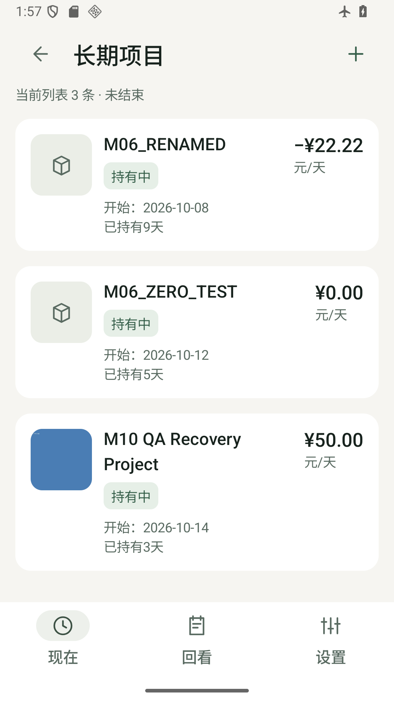 | 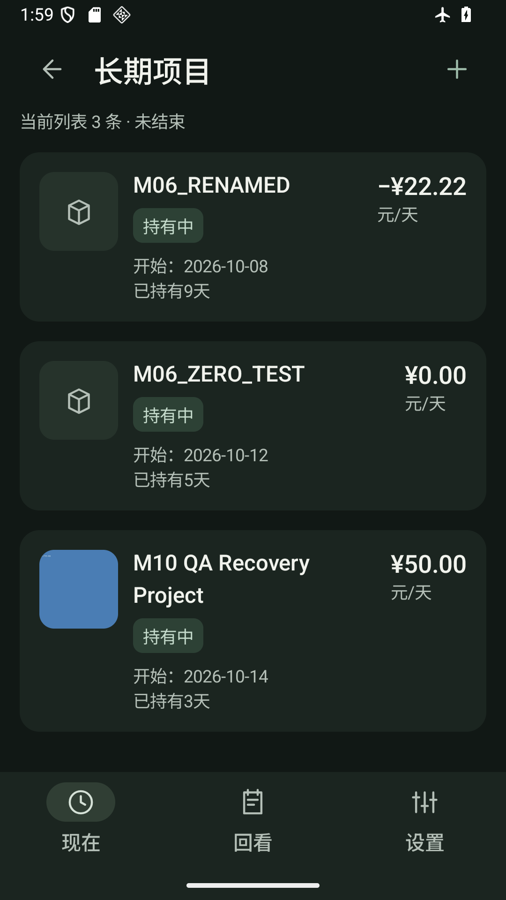 |
| 长期项目详情 | 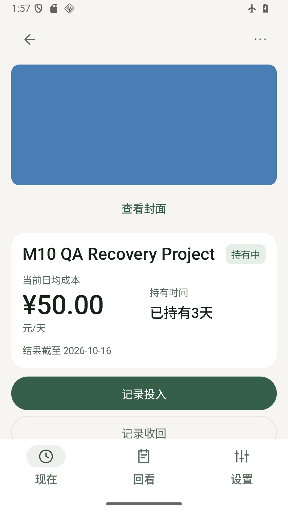 | 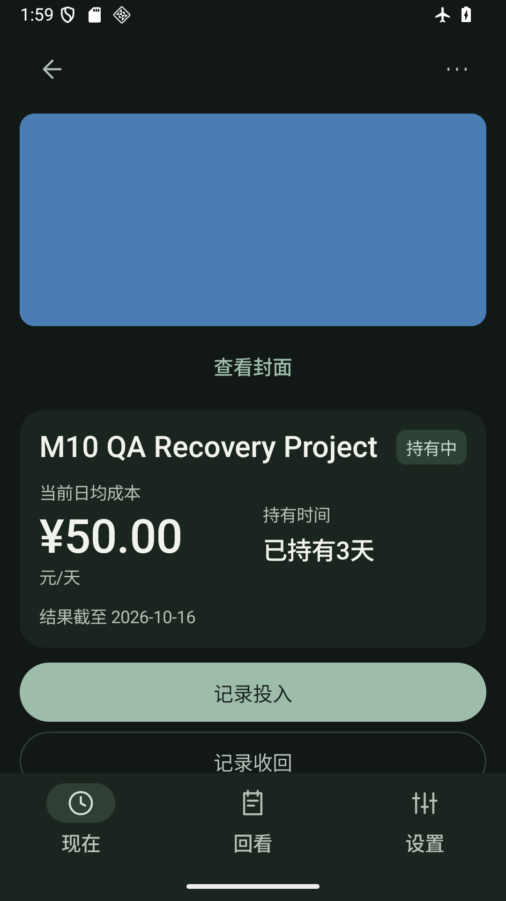 |
| 订阅服务列表 | 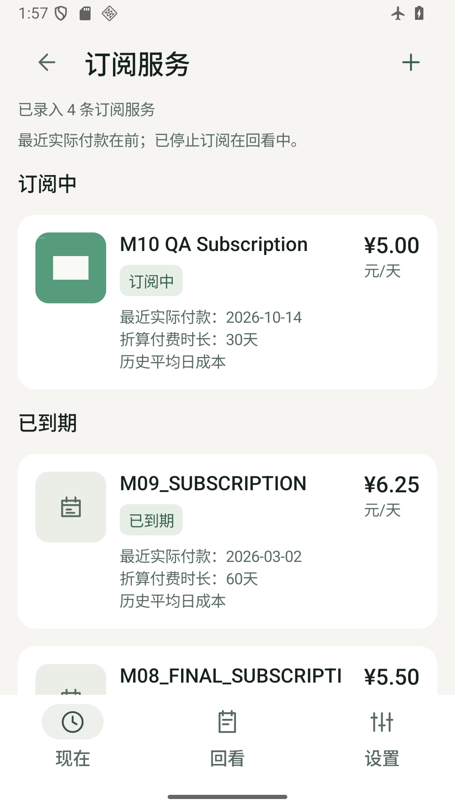 | 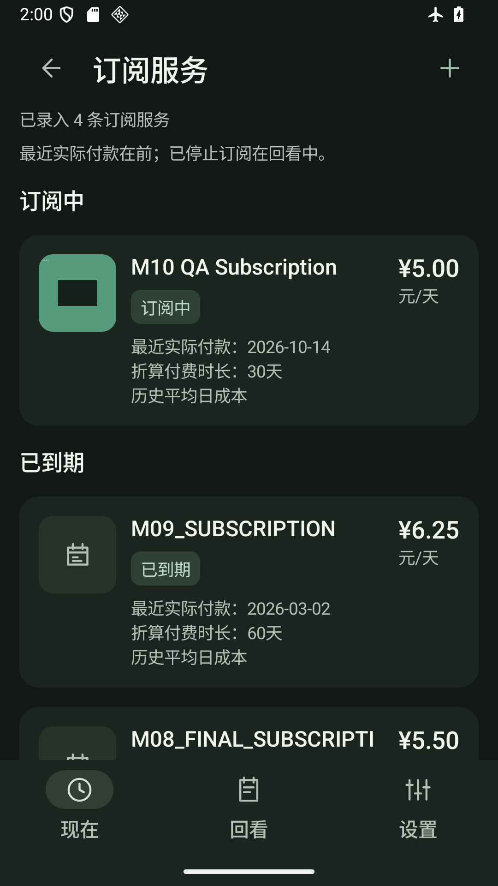 |
| 订阅服务详情 | 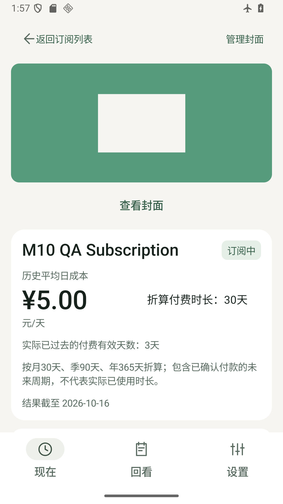 | 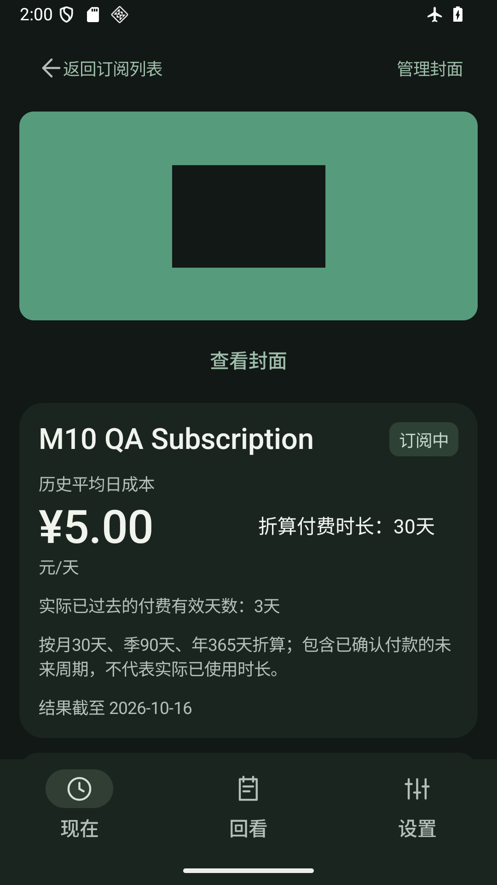 |
| 回看 | 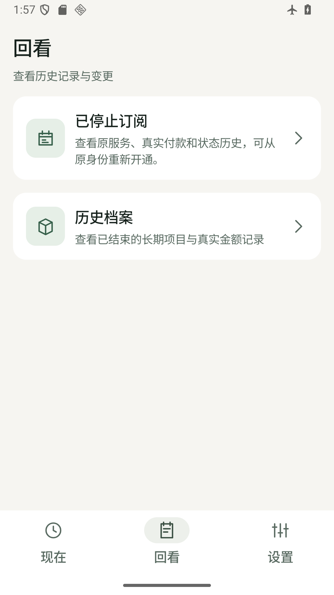 | 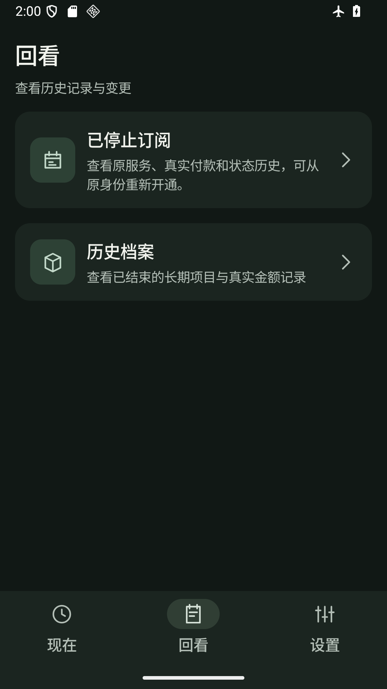 |
| 设置 | 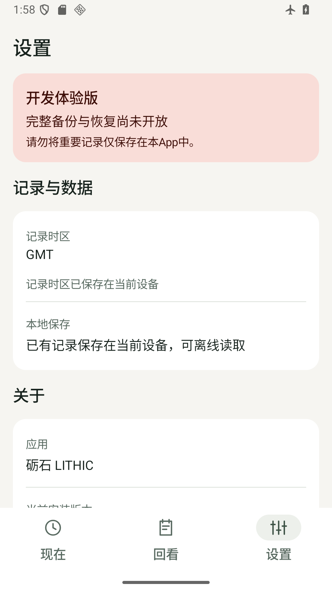 | 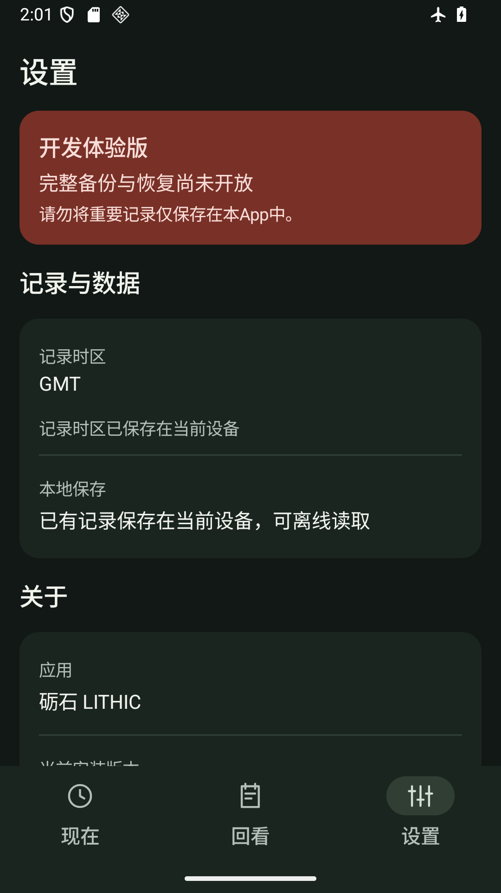 |
| 新增菜单 | 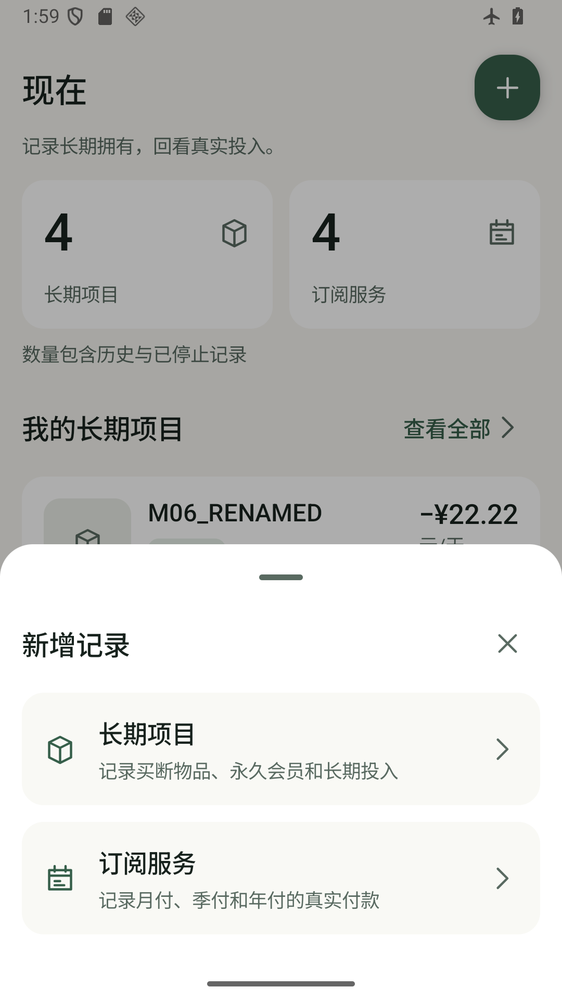 | 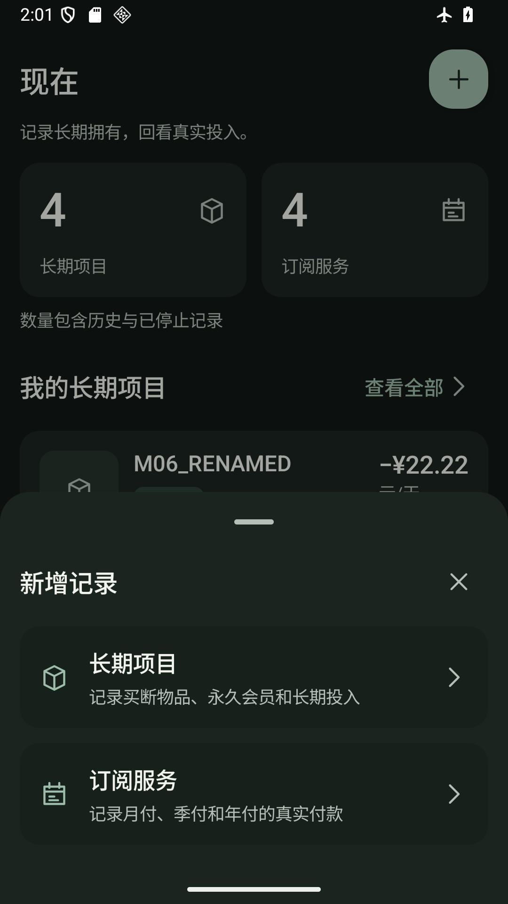 |

### 正常原图逐图来源

- `final-now-light.png`：light；1080×1920 px；411.43dp；420dpi；字体 1；API 36；宿主 `com.cooper.lithic.debug/com.cooper.lithic.app.MainActivity`；来源 `EXISTING_QA_MAINACTIVITY`；SHA-256 `e77ac13949d559a5665497e106848afb91325e54658d681443351bf05e37c20c`。
- `final-now-dark.png`：dark；1080×1920 px；411.43dp；420dpi；字体 1；API 36；宿主 `com.cooper.lithic.debug/com.cooper.lithic.app.MainActivity`；来源 `EXISTING_QA_MAINACTIVITY`；SHA-256 `2ac9056256ee7879e30be14cf1d1fe401de79daa3fbad9949b8190e4a73f4a03`。
- `final-project-list-light.png`：light；1080×1920 px；411.43dp；420dpi；字体 1；API 36；宿主 `com.cooper.lithic.debug/com.cooper.lithic.app.MainActivity`；来源 `EXISTING_QA_MAINACTIVITY`；SHA-256 `c6d1651c06a4e755f44f9ccfcc6da2a5d16363f8f4d0abe9db27a99cd9691fc6`。
- `final-project-list-dark.png`：dark；1080×1920 px；411.43dp；420dpi；字体 1；API 36；宿主 `com.cooper.lithic.debug/com.cooper.lithic.app.MainActivity`；来源 `EXISTING_QA_MAINACTIVITY`；SHA-256 `468f93cff1ea1cc0540ed356b91d5bfaf6b43146c3c2d2d1e0149c3be43a6dcb`。
- `final-project-detail-light.png`：light；1080×1920 px；411.43dp；420dpi；字体 1；API 36；宿主 `com.cooper.lithic.debug/com.cooper.lithic.app.MainActivity`；来源 `EXISTING_QA_MAINACTIVITY`；SHA-256 `1c62dbaa0de90bec0b6148953e2e2c2d38b1ce58cd4c9c1013114737c066d1b2`。
- `final-project-detail-dark.png`：dark；1080×1920 px；411.43dp；420dpi；字体 1；API 36；宿主 `com.cooper.lithic.debug/com.cooper.lithic.app.MainActivity`；来源 `EXISTING_QA_MAINACTIVITY`；SHA-256 `ef9b665c36c5f4fab8a40b8bbe1ab1899dd6a42dce583bc3999b1a4c12089b33`。
- `final-subscription-list-light.png`：light；1080×1920 px；411.43dp；420dpi；字体 1；API 36；宿主 `com.cooper.lithic.debug/com.cooper.lithic.app.MainActivity`；来源 `EXISTING_QA_MAINACTIVITY`；SHA-256 `c9311554d97dfb256fa9263419dee818e266038b2ecd7361abe77a04022c35d1`。
- `final-subscription-list-dark.png`：dark；1080×1920 px；411.43dp；420dpi；字体 1；API 36；宿主 `com.cooper.lithic.debug/com.cooper.lithic.app.MainActivity`；来源 `EXISTING_QA_MAINACTIVITY`；SHA-256 `bd6c986c521f852afd556186fc8b6a673fe297b078a360c44356b23ded2724ed`。
- `final-subscription-detail-light.png`：light；1080×1920 px；411.43dp；420dpi；字体 1；API 36；宿主 `com.cooper.lithic.debug/com.cooper.lithic.app.MainActivity`；来源 `EXISTING_QA_MAINACTIVITY`；SHA-256 `6ffb8f7019fc9bc8e27a3712f4f784e45e37053f1161bf843a1eaf5d564ffcd7`。
- `final-subscription-detail-dark.png`：dark；1080×1920 px；411.43dp；420dpi；字体 1；API 36；宿主 `com.cooper.lithic.debug/com.cooper.lithic.app.MainActivity`；来源 `EXISTING_QA_MAINACTIVITY`；SHA-256 `9584ffa1c0263a654950cc6be703b8ca23343d6a05095866125f0d68e3f9ddcd`。
- `final-review-light.png`：light；1080×1920 px；411.43dp；420dpi；字体 1；API 36；宿主 `com.cooper.lithic.debug/com.cooper.lithic.app.MainActivity`；来源 `EXISTING_QA_MAINACTIVITY`；SHA-256 `ebdfbead1fd8da1cb54eb5f265519a2695e52c67fa388c737833d419c80a4711`。
- `final-review-dark.png`：dark；1080×1920 px；411.43dp；420dpi；字体 1；API 36；宿主 `com.cooper.lithic.debug/com.cooper.lithic.app.MainActivity`；来源 `EXISTING_QA_MAINACTIVITY`；SHA-256 `88ec7aa05c5968ae99d191551e25cc5abc203db68419da51ab609bc3b2b2460f`。
- `final-settings-light.png`：light；1080×1920 px；411.43dp；420dpi；字体 1；API 36；宿主 `com.cooper.lithic.debug/com.cooper.lithic.app.MainActivity`；来源 `EXISTING_QA_MAINACTIVITY`；SHA-256 `eb3f054ade23bd952f4b6ebfb3b39db5aeb8debb70cdf21828c577838339616f`。
- `final-settings-dark.png`：dark；1080×1920 px；411.43dp；420dpi；字体 1；API 36；宿主 `com.cooper.lithic.debug/com.cooper.lithic.app.MainActivity`；来源 `EXISTING_QA_MAINACTIVITY`；SHA-256 `9373b01108d4ffe5897fa99af45b147408b32e527107553b353214937eec633d`。
- `final-add-menu-light.png`：light；1080×1920 px；411.43dp；420dpi；字体 1；API 36；宿主 `com.cooper.lithic.debug/com.cooper.lithic.app.MainActivity`；来源 `EXISTING_QA_MAINACTIVITY`；SHA-256 `0e409e6834f7e60dd27a1511c1ba42c3b2f207aa00990bf3538a26c76f5fab62`。
- `final-add-menu-dark.png`：dark；1080×1920 px；411.43dp；420dpi；字体 1；API 36；宿主 `com.cooper.lithic.debug/com.cooper.lithic.app.MainActivity`；来源 `EXISTING_QA_MAINACTIVITY`；SHA-256 `3f0680673de728ac1d208a8c07b81fb00849dd47728ec5382f99b0342ab7e227`。

## MainActivity 附加原图

真实系统360dp／200%图按逐图元数据识别。文件名表示采集意图；真实IME、错误、滚动、表单与危险操作可达结论须结合运行观察逐项确认。

### final-ended-project-correction-light — light

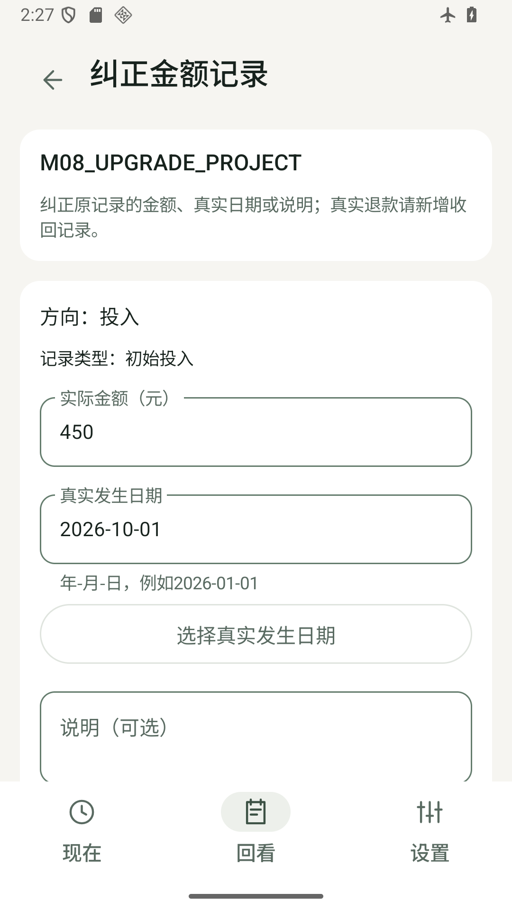

light；1080×1920 px；411.43dp；420dpi；字体 1；API 36；宿主 `com.cooper.lithic.debug/com.cooper.lithic.app.MainActivity`；来源 `EXISTING_QA_MAINACTIVITY`。

MainActivity 原有合成 QA 账本。附图名称仅标识采集意图，内容与交互结论须逐张核验。

原文件 `final-ended-project-correction-light.png`；SHA-256 `d85314b8ddec8eec298d7e706e1241fea03220af5be9a8607d211e4a1f96d5d0`。

### final-native-ime-amount-dark — dark

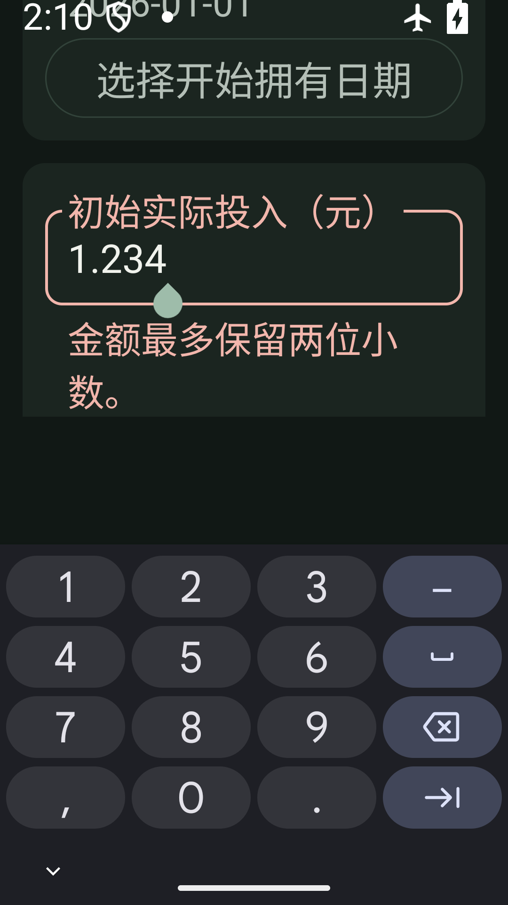

dark；1080×1920 px；360.00dp；480dpi；字体 2；API 36；宿主 `com.cooper.lithic.debug/com.cooper.lithic.app.MainActivity`；来源 `EXISTING_QA_MAINACTIVITY`。

MainActivity 原有合成 QA 账本。附图名称仅标识采集意图，内容与交互结论须逐张核验。

原文件 `final-native-ime-amount-dark.png`；SHA-256 `0c3dab5dd8bd67761a4a77b8126e2c6ceb3e7a4914975d0ceb15952f1e94fb7c`。

### final-native-ime-amount-light — light

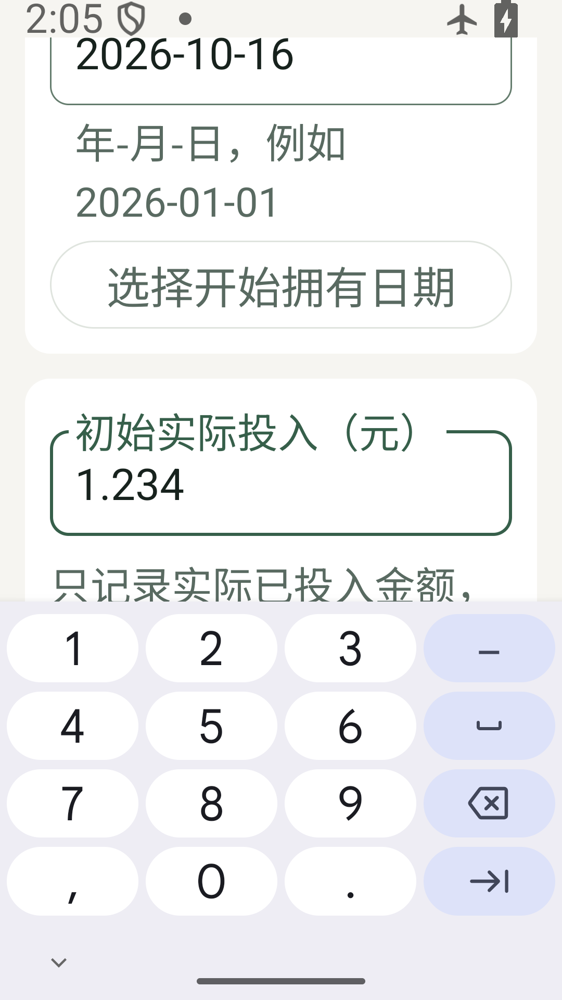

light；1080×1920 px；360.00dp；480dpi；字体 2；API 36；宿主 `com.cooper.lithic.debug/com.cooper.lithic.app.MainActivity`；来源 `EXISTING_QA_MAINACTIVITY`。

MainActivity 原有合成 QA 账本。附图名称仅标识采集意图，内容与交互结论须逐张核验。

原文件 `final-native-ime-amount-light.png`；SHA-256 `b84137f03fe97a6a65b3d405a8ecda06a5af6e3e2b5d07930cc2b129235b26a3`。

### final-native-ime-project-light — light

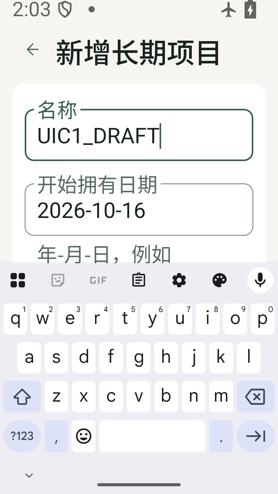

light；1080×1920 px；360.00dp；480dpi；字体 2；API 36；宿主 `com.cooper.lithic.debug/com.cooper.lithic.app.MainActivity`；来源 `EXISTING_QA_MAINACTIVITY`。

MainActivity 原有合成 QA 账本。附图名称仅标识采集意图，内容与交互结论须逐张核验。

原文件 `final-native-ime-project-light.png`；SHA-256 `a0896ee5aa9c0ce96c77e1d4e965b56d30e8e09b6421dec41ad5b8c4bafbdfa2`。

### final-native-ime-submit-error-light — light

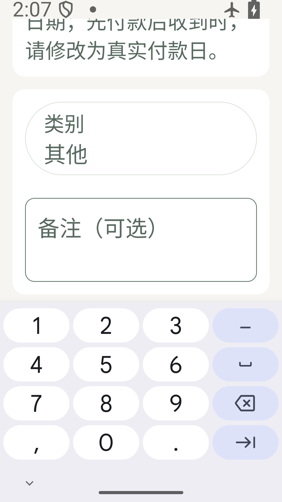

light；1080×1920 px；360.00dp；480dpi；字体 2；API 36；宿主 `com.cooper.lithic.debug/com.cooper.lithic.app.MainActivity`；来源 `EXISTING_QA_MAINACTIVITY`。

MainActivity 原有合成 QA 账本。附图名称仅标识采集意图，内容与交互结论须逐张核验。

原文件 `final-native-ime-submit-error-light.png`；SHA-256 `47bdbda013127092ed8791488013e766005a335a85b3b2940d810f6bc25dd362`。

### final-pressure-add-menu-light — light

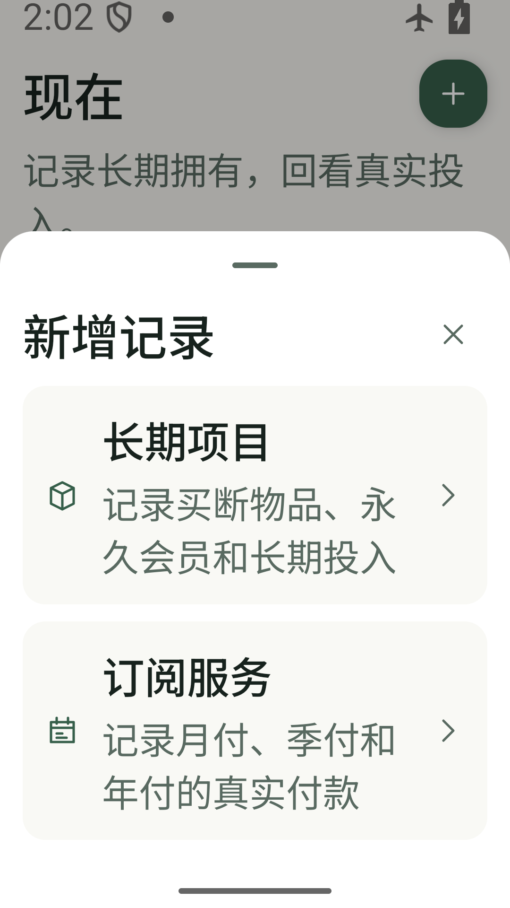

light；1080×1920 px；360.00dp；480dpi；字体 2；API 36；宿主 `com.cooper.lithic.debug/com.cooper.lithic.app.MainActivity`；来源 `EXISTING_QA_MAINACTIVITY`。

MainActivity 原有合成 QA 账本。附图名称仅标识采集意图，内容与交互结论须逐张核验。

原文件 `final-pressure-add-menu-light.png`；SHA-256 `cb2658c6833d5dbf965932f72952a667206ed4512b2444418c84156055a278fc`。

### final-pressure-add-money-dark — dark

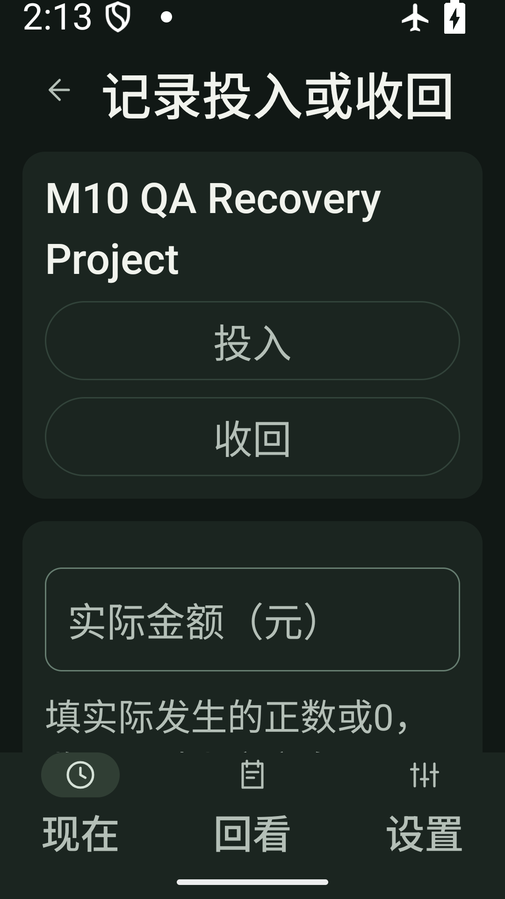

dark；1080×1920 px；360.00dp；480dpi；字体 2；API 36；宿主 `com.cooper.lithic.debug/com.cooper.lithic.app.MainActivity`；来源 `EXISTING_QA_MAINACTIVITY`。

MainActivity 原有合成 QA 账本。附图名称仅标识采集意图，内容与交互结论须逐张核验。

原文件 `final-pressure-add-money-dark.png`；SHA-256 `0ef6984f8468005cc87f0d69e2bc1776af3087785b4c69a7a16bec59eeab2412`。

### final-pressure-cover-editor-dark — dark

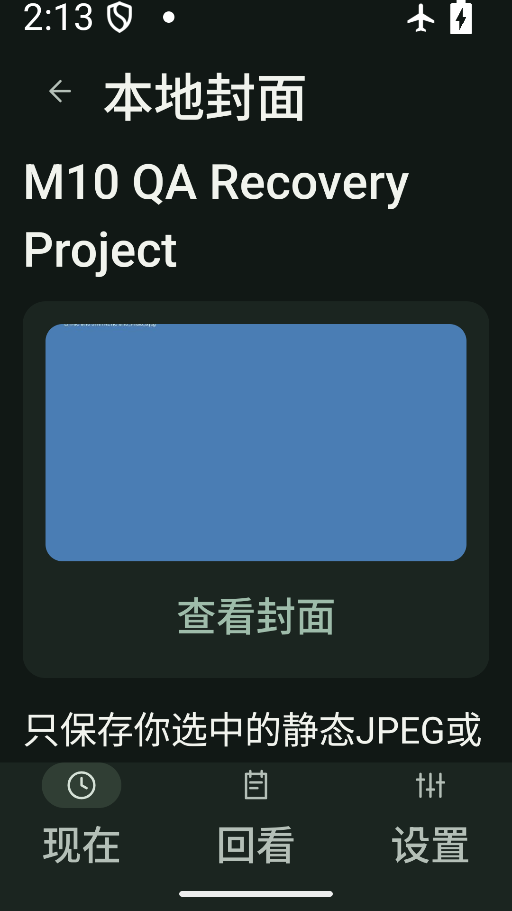

dark；1080×1920 px；360.00dp；480dpi；字体 2；API 36；宿主 `com.cooper.lithic.debug/com.cooper.lithic.app.MainActivity`；来源 `EXISTING_QA_MAINACTIVITY`。

MainActivity 原有合成 QA 账本。附图名称仅标识采集意图，内容与交互结论须逐张核验。

原文件 `final-pressure-cover-editor-dark.png`；SHA-256 `8dbf847973af8da5ad4ed1bb7377b4181223f0cc72b09dc56d8d521766a5b6bd`。

### final-pressure-delete-project-dark — dark

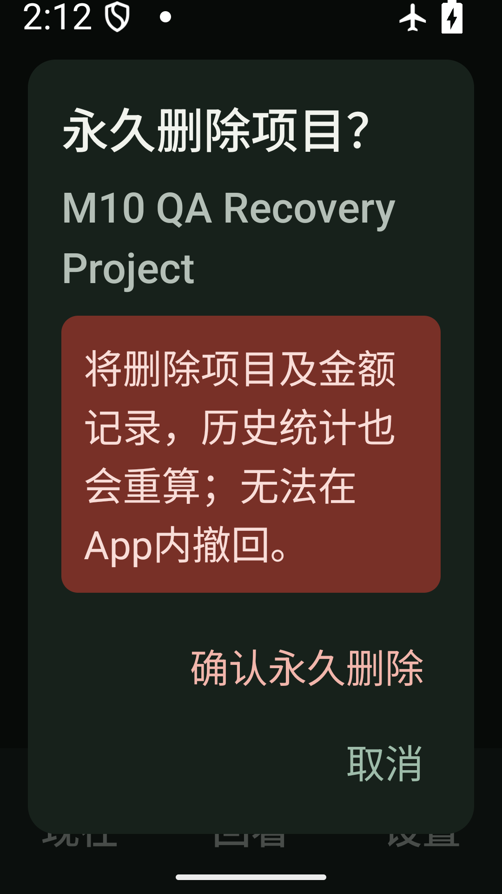

dark；1080×1920 px；360.00dp；480dpi；字体 2；API 36；宿主 `com.cooper.lithic.debug/com.cooper.lithic.app.MainActivity`；来源 `EXISTING_QA_MAINACTIVITY`。

MainActivity 原有合成 QA 账本。附图名称仅标识采集意图，内容与交互结论须逐张核验。

原文件 `final-pressure-delete-project-dark.png`；SHA-256 `a0060d2dc9843343476482429ec9a84ba8030b08ab10498584ac18cbbac8cbb9`。

### final-pressure-discard-dark — dark

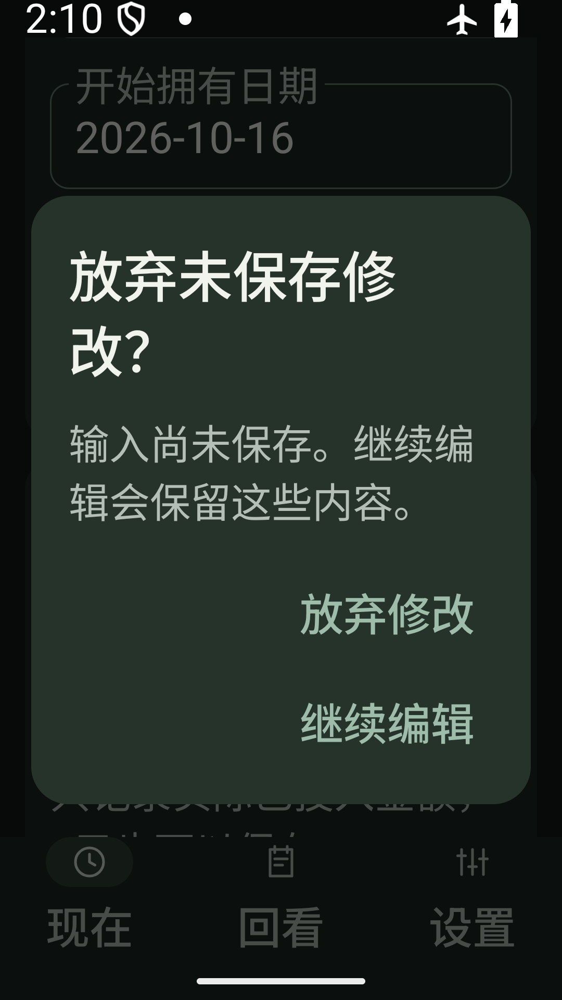

dark；1080×1920 px；360.00dp；480dpi；字体 2；API 36；宿主 `com.cooper.lithic.debug/com.cooper.lithic.app.MainActivity`；来源 `EXISTING_QA_MAINACTIVITY`。

MainActivity 原有合成 QA 账本。附图名称仅标识采集意图，内容与交互结论须逐张核验。

原文件 `final-pressure-discard-dark.png`；SHA-256 `376d6951bb4f95c70a51118c74ad1df89cdc3678c66244ab1b06032b8ce3a8d9`。

### final-pressure-discard-light — light

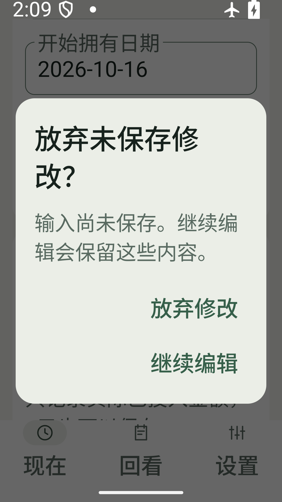

light；1080×1920 px；360.00dp；480dpi；字体 2；API 36；宿主 `com.cooper.lithic.debug/com.cooper.lithic.app.MainActivity`；来源 `EXISTING_QA_MAINACTIVITY`。

MainActivity 原有合成 QA 账本。附图名称仅标识采集意图，内容与交互结论须逐张核验。

原文件 `final-pressure-discard-light.png`；SHA-256 `f706d102ad10342d2bebb3b45f77e47e8b5603d9b24611959573a3bbf94e701e`。

### final-pressure-end-project-dark — dark

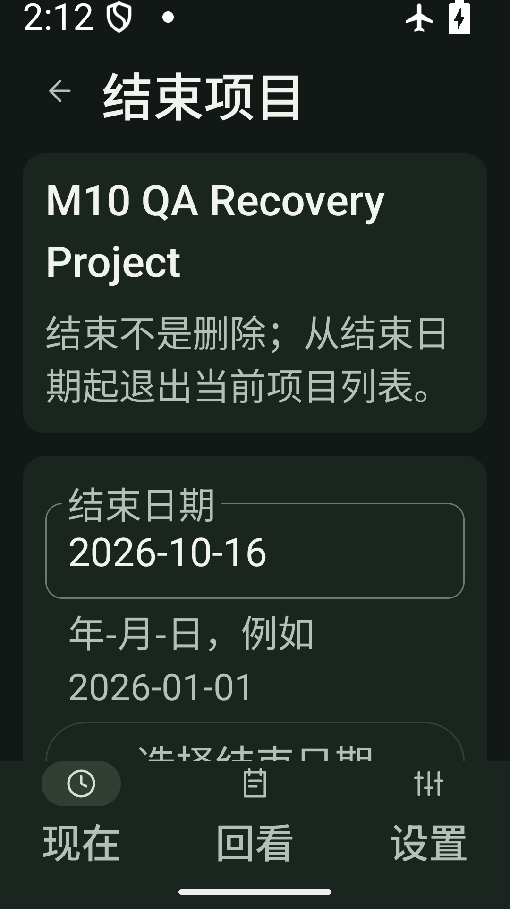

dark；1080×1920 px；360.00dp；480dpi；字体 2；API 36；宿主 `com.cooper.lithic.debug/com.cooper.lithic.app.MainActivity`；来源 `EXISTING_QA_MAINACTIVITY`。

MainActivity 原有合成 QA 账本。附图名称仅标识采集意图，内容与交互结论须逐张核验。

原文件 `final-pressure-end-project-dark.png`；SHA-256 `46a429d9009ae2f91a8222710d40447cc5d3fb05ce8477878f625a98b1b67eb4`。

### final-pressure-now-dark — dark

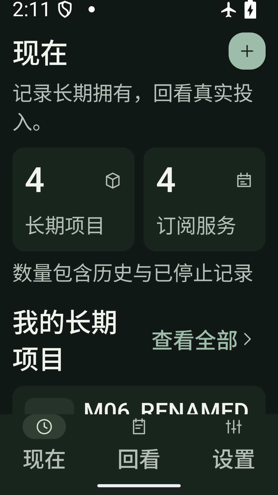

dark；1080×1920 px；360.00dp；480dpi；字体 2；API 36；宿主 `com.cooper.lithic.debug/com.cooper.lithic.app.MainActivity`；来源 `EXISTING_QA_MAINACTIVITY`。

MainActivity 原有合成 QA 账本。附图名称仅标识采集意图，内容与交互结论须逐张核验。

原文件 `final-pressure-now-dark.png`；SHA-256 `6ee7a258ff57b52d825529620c2d4081c96623c543770ace647193427958881b`。

### final-pressure-now-light — light

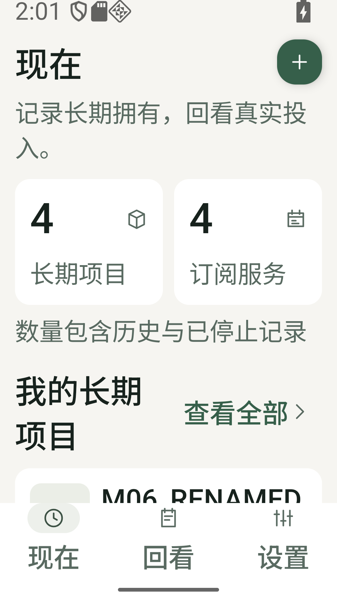

light；1080×1920 px；360.00dp；480dpi；字体 2；API 36；宿主 `com.cooper.lithic.debug/com.cooper.lithic.app.MainActivity`；来源 `EXISTING_QA_MAINACTIVITY`。

MainActivity 原有合成 QA 账本。附图名称仅标识采集意图，内容与交互结论须逐张核验。

原文件 `final-pressure-now-light.png`；SHA-256 `b50599964cab77cdd2c73852b786ddded6e6f2b9ab7bbe39b68a902b61fc263c`。

### final-pressure-project-create-light — light

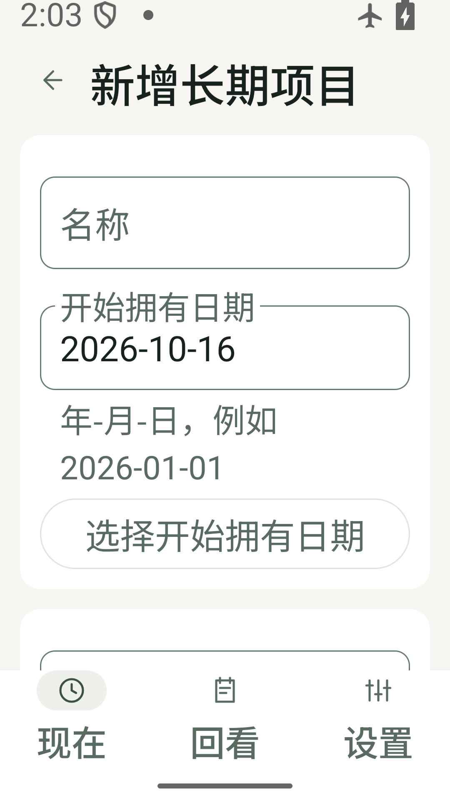

light；1080×1920 px；360.00dp；480dpi；字体 2；API 36；宿主 `com.cooper.lithic.debug/com.cooper.lithic.app.MainActivity`；来源 `EXISTING_QA_MAINACTIVITY`。

MainActivity 原有合成 QA 账本。附图名称仅标识采集意图，内容与交互结论须逐张核验。

原文件 `final-pressure-project-create-light.png`；SHA-256 `c4507328c2da27c867f180f0e5c2384ea350c5d3aff392c69f127eb8e1dacd59`。

### final-pressure-project-detail-dark — dark

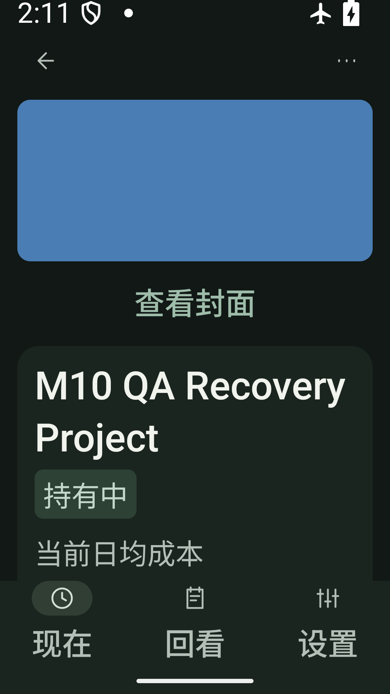

dark；1080×1920 px；360.00dp；480dpi；字体 2；API 36；宿主 `com.cooper.lithic.debug/com.cooper.lithic.app.MainActivity`；来源 `EXISTING_QA_MAINACTIVITY`。

MainActivity 原有合成 QA 账本。附图名称仅标识采集意图，内容与交互结论须逐张核验。

原文件 `final-pressure-project-detail-dark.png`；SHA-256 `f75c1e0cd28494eb7862e75618a268fc34d04359531fd0ba378978b41018ace2`。

### final-pressure-project-list-dark — dark

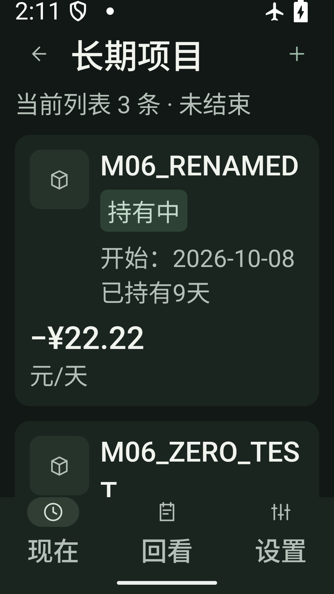

dark；1080×1920 px；360.00dp；480dpi；字体 2；API 36；宿主 `com.cooper.lithic.debug/com.cooper.lithic.app.MainActivity`；来源 `EXISTING_QA_MAINACTIVITY`。

MainActivity 原有合成 QA 账本。附图名称仅标识采集意图，内容与交互结论须逐张核验。

原文件 `final-pressure-project-list-dark.png`；SHA-256 `863c5f3fa413a93a6a2853bccd1e9b1765c56d54314e3d354fc5b54d94201801`。

### final-pressure-project-more-dark — dark

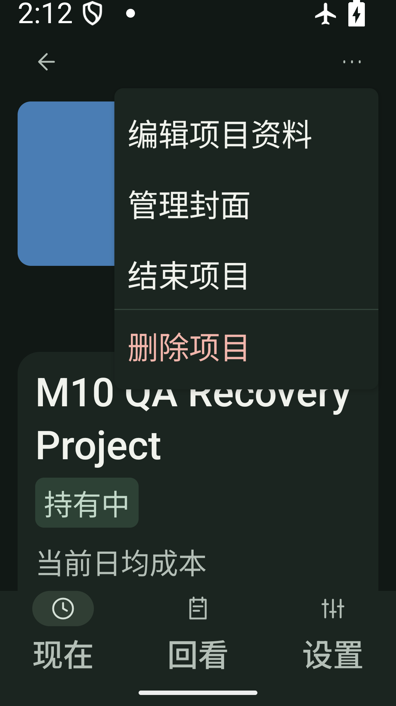

dark；1080×1920 px；360.00dp；480dpi；字体 2；API 36；宿主 `com.cooper.lithic.debug/com.cooper.lithic.app.MainActivity`；来源 `EXISTING_QA_MAINACTIVITY`。

MainActivity 原有合成 QA 账本。附图名称仅标识采集意图，内容与交互结论须逐张核验。

原文件 `final-pressure-project-more-dark.png`；SHA-256 `75294cb55a041a7d3f1284054679608c4b0f0045c143327a628b83d0bc2991fe`。

### final-pressure-renewal-dark — dark

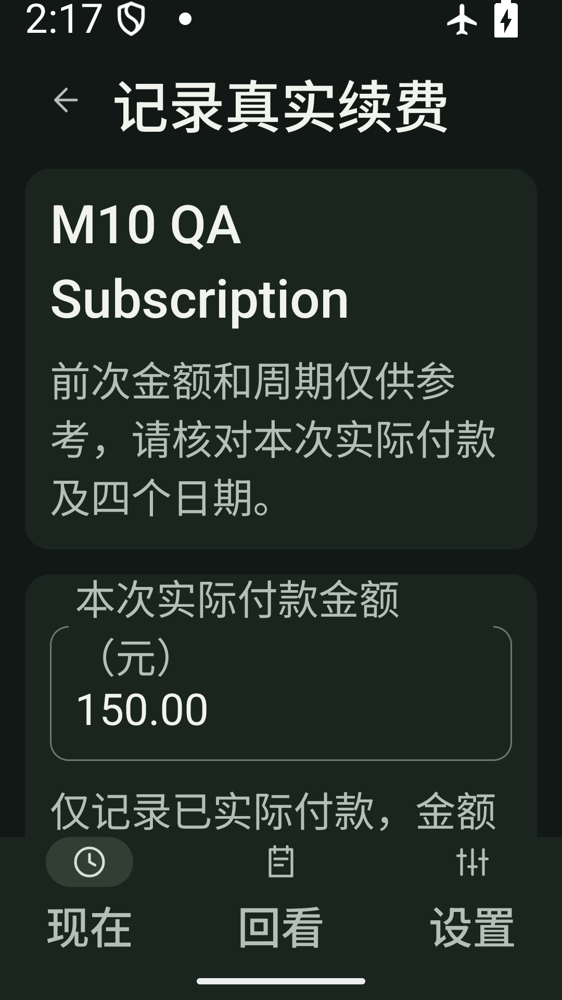

dark；1080×1920 px；360.00dp；480dpi；字体 2；API 36；宿主 `com.cooper.lithic.debug/com.cooper.lithic.app.MainActivity`；来源 `EXISTING_QA_MAINACTIVITY`。

MainActivity 原有合成 QA 账本。附图名称仅标识采集意图，内容与交互结论须逐张核验。

原文件 `final-pressure-renewal-dark.png`；SHA-256 `bc1504c157f0d3ea308fa662aacb889bdc7fdb6cc4e26ed9a63689e35eb63595`。

### final-pressure-stop-subscription-dark — dark

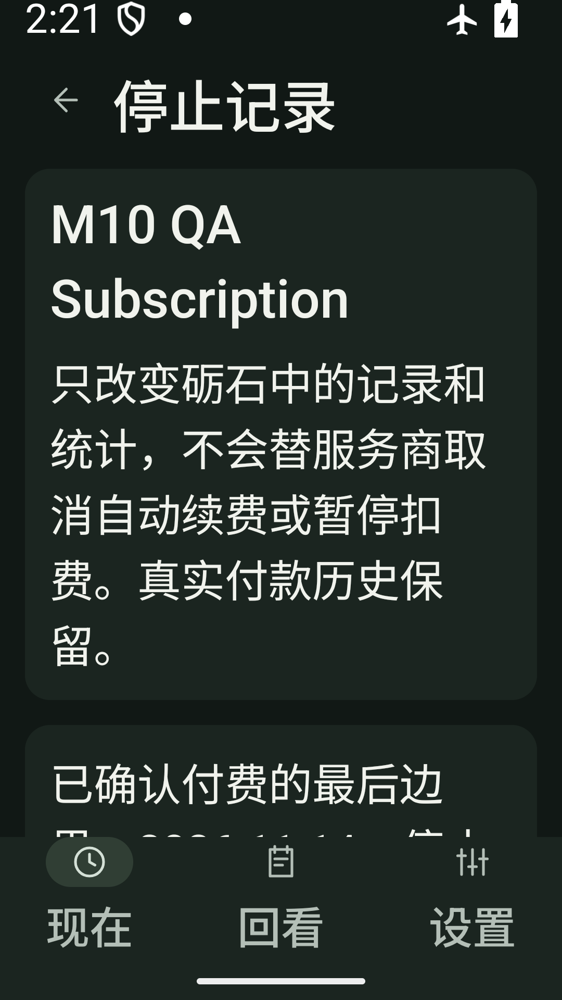

dark；1080×1920 px；360.00dp；480dpi；字体 2；API 36；宿主 `com.cooper.lithic.debug/com.cooper.lithic.app.MainActivity`；来源 `EXISTING_QA_MAINACTIVITY`。

MainActivity 原有合成 QA 账本。附图名称仅标识采集意图，内容与交互结论须逐张核验。

原文件 `final-pressure-stop-subscription-dark.png`；SHA-256 `27e0a7e7e5fd4cf9a17be4fbdf409fa3ae051dbaf4e7cac2db7f4af0239c1048`。

### final-pressure-subscription-create-light — light

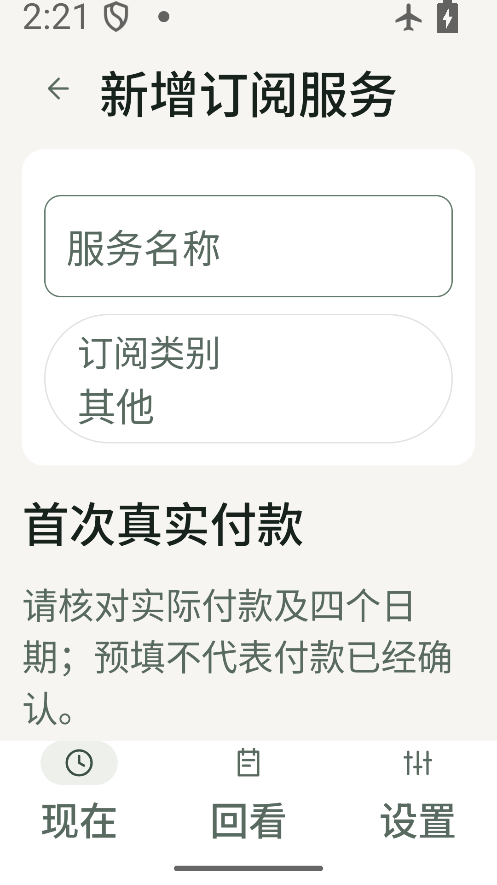

light；1080×1920 px；360.00dp；480dpi；字体 2；API 36；宿主 `com.cooper.lithic.debug/com.cooper.lithic.app.MainActivity`；来源 `EXISTING_QA_MAINACTIVITY`。

MainActivity 原有合成 QA 账本。附图名称仅标识采集意图，内容与交互结论须逐张核验。

原文件 `final-pressure-subscription-create-light.png`；SHA-256 `0bfe12edddddc26628e0f98b96d38844b33fc637eb8a4b785401c1a0afeca430`。

### final-pressure-subscription-detail-dark — dark

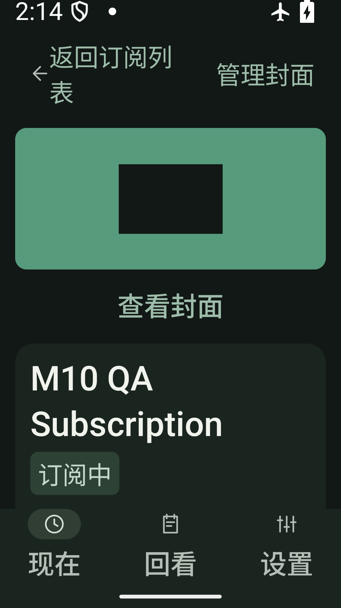

dark；1080×1920 px；360.00dp；480dpi；字体 2；API 36；宿主 `com.cooper.lithic.debug/com.cooper.lithic.app.MainActivity`；来源 `EXISTING_QA_MAINACTIVITY`。

MainActivity 原有合成 QA 账本。附图名称仅标识采集意图，内容与交互结论须逐张核验。

原文件 `final-pressure-subscription-detail-dark.png`；SHA-256 `a25dc9ca9323ffbc456a993e094d8f1dc8ed8cc2480cc6473139df44b28f5ce2`。

### final-pressure-subscription-list-dark — dark

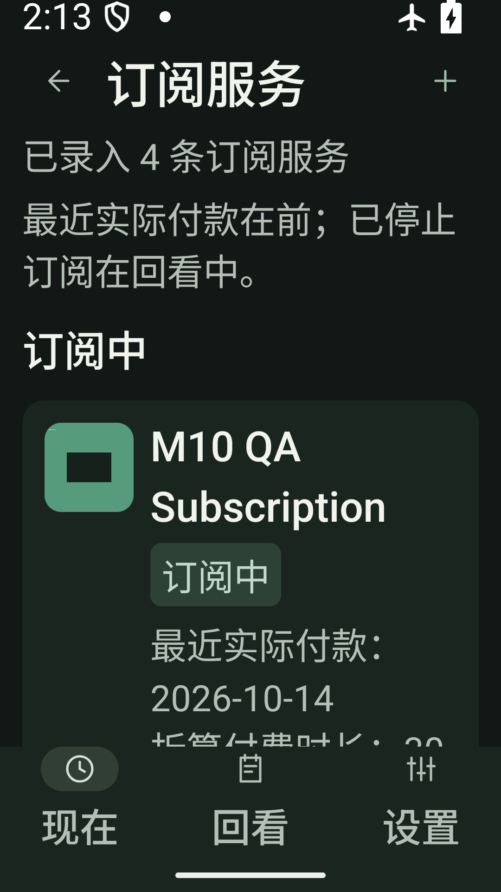

dark；1080×1920 px；360.00dp；480dpi；字体 2；API 36；宿主 `com.cooper.lithic.debug/com.cooper.lithic.app.MainActivity`；来源 `EXISTING_QA_MAINACTIVITY`。

MainActivity 原有合成 QA 账本。附图名称仅标识采集意图，内容与交互结论须逐张核验。

原文件 `final-pressure-subscription-list-dark.png`；SHA-256 `105ce6b58419f124c5baece7dd8b06b61b22c8ce0551e534a0e6275ed16efe76`。

### final-pressure-subscription-payment-fields-light — light

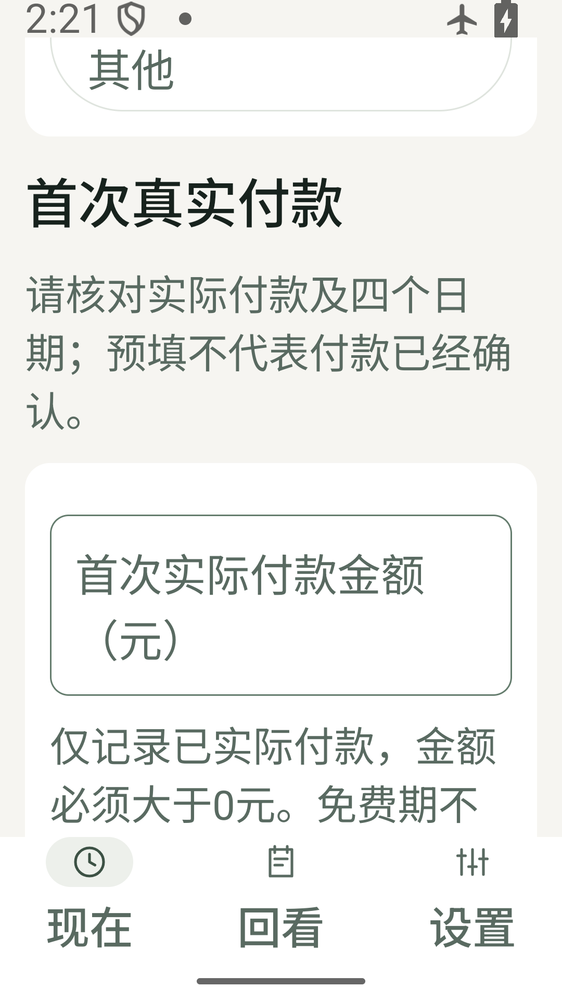

light；1080×1920 px；360.00dp；480dpi；字体 2；API 36；宿主 `com.cooper.lithic.debug/com.cooper.lithic.app.MainActivity`；来源 `EXISTING_QA_MAINACTIVITY`。

MainActivity 原有合成 QA 账本。附图名称仅标识采集意图，内容与交互结论须逐张核验。

原文件 `final-pressure-subscription-payment-fields-light.png`；SHA-256 `f46bf10e387e0c69bbd09f091052930d85ad16be3699e0126dfc736497151c16`。

### final-pressure-validation-dark — dark

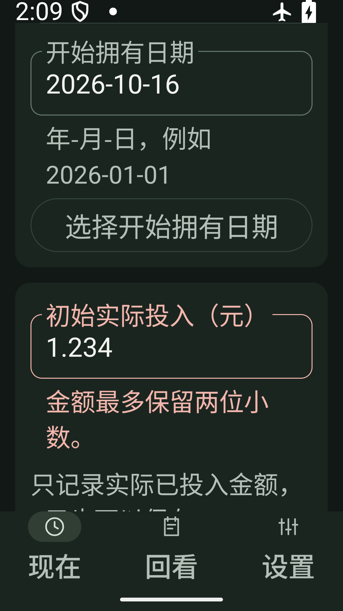

dark；1080×1920 px；360.00dp；480dpi；字体 2；API 36；宿主 `com.cooper.lithic.debug/com.cooper.lithic.app.MainActivity`；来源 `EXISTING_QA_MAINACTIVITY`。

MainActivity 原有合成 QA 账本。附图名称仅标识采集意图，内容与交互结论须逐张核验。

原文件 `final-pressure-validation-dark.png`；SHA-256 `f17b7c5a632b2b998e3160e6f17c7628dd1671e303711a03ed1f5c3fad8998cc`。

### final-pressure-validation-light — light

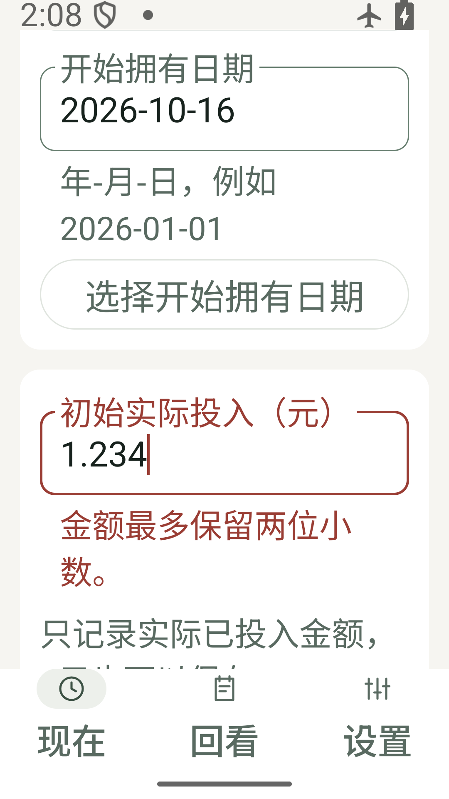

light；1080×1920 px；360.00dp；480dpi；字体 2；API 36；宿主 `com.cooper.lithic.debug/com.cooper.lithic.app.MainActivity`；来源 `EXISTING_QA_MAINACTIVITY`。

MainActivity 原有合成 QA 账本。附图名称仅标识采集意图，内容与交互结论须逐张核验。

原文件 `final-pressure-validation-light.png`；SHA-256 `18983c8704679804e6acf0f7d02746b58413e1b204f810c016bc874a2e46bd68`。

### final-project-core-scroll-light — light

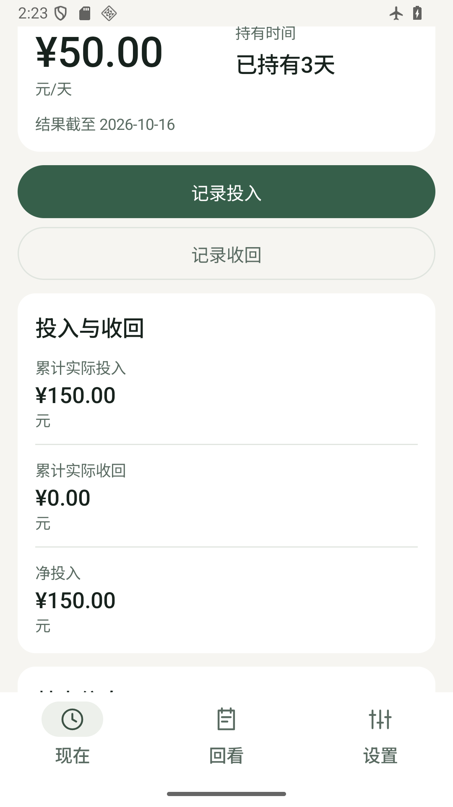

light；1080×1920 px；411.43dp；420dpi；字体 1；API 36；宿主 `com.cooper.lithic.debug/com.cooper.lithic.app.MainActivity`；来源 `EXISTING_QA_MAINACTIVITY`。

MainActivity 原有合成 QA 账本。附图名称仅标识采集意图，内容与交互结论须逐张核验。

原文件 `final-project-core-scroll-light.png`；SHA-256 `2315690814bc34104569ed433978b980c8dafd8d6e8648053ed5b3f5fef31211`。

### final-project-history-dark — dark

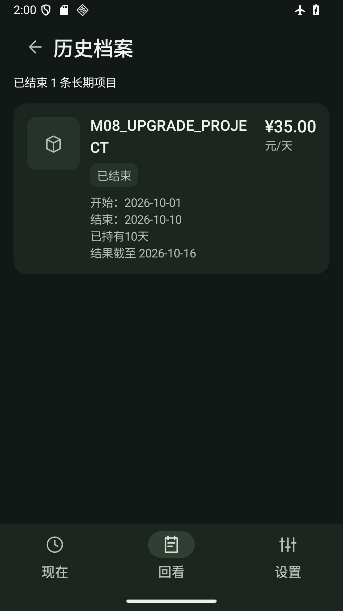

dark；1080×1920 px；411.43dp；420dpi；字体 1；API 36；宿主 `com.cooper.lithic.debug/com.cooper.lithic.app.MainActivity`；来源 `EXISTING_QA_MAINACTIVITY`。

MainActivity 原有合成 QA 账本。附图名称仅标识采集意图，内容与交互结论须逐张核验。

原文件 `final-project-history-dark.png`；SHA-256 `d37f5bfc4b9f7a2ea206a27b17068a8ddc9c0a8ea09a25a8d1d2662f5af86e13`。

### final-project-history-light — light

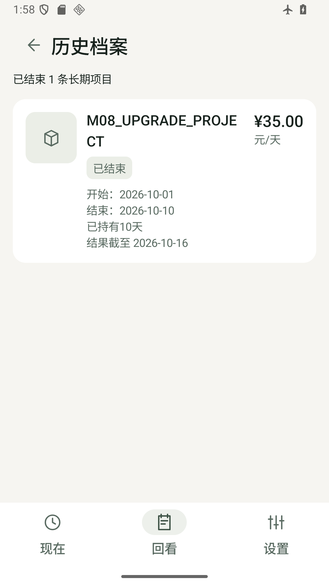

light；1080×1920 px；411.43dp；420dpi；字体 1；API 36；宿主 `com.cooper.lithic.debug/com.cooper.lithic.app.MainActivity`；来源 `EXISTING_QA_MAINACTIVITY`。

MainActivity 原有合成 QA 账本。附图名称仅标识采集意图，内容与交互结论须逐张核验。

原文件 `final-project-history-light.png`；SHA-256 `0d1497bccd5ce61e1c30eb217d6b0e3b4b2caf08e77fb78a446752b66812bc95`。

### final-settings-about-dark — dark

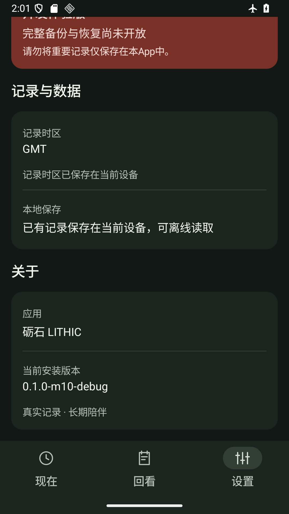

dark；1080×1920 px；411.43dp；420dpi；字体 1；API 36；宿主 `com.cooper.lithic.debug/com.cooper.lithic.app.MainActivity`；来源 `EXISTING_QA_MAINACTIVITY`。

MainActivity 原有合成 QA 账本。附图名称仅标识采集意图，内容与交互结论须逐张核验。

原文件 `final-settings-about-dark.png`；SHA-256 `fba6d66c9ffb672d2439ead4ba629c7f3844da3bb68991e00f646a17923f980c`。

### final-settings-about-light — light

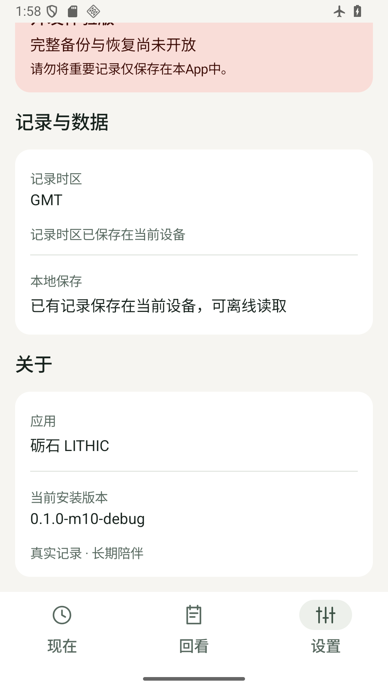

light；1080×1920 px；411.43dp；420dpi；字体 1；API 36；宿主 `com.cooper.lithic.debug/com.cooper.lithic.app.MainActivity`；来源 `EXISTING_QA_MAINACTIVITY`。

MainActivity 原有合成 QA 账本。附图名称仅标识采集意图，内容与交互结论须逐张核验。

原文件 `final-settings-about-light.png`；SHA-256 `60651fd45a6efaff317e2179fa74ee44b6a5da985ac95a168f4a04426fd5a4ba`。

### final-stop-subscription-light — light

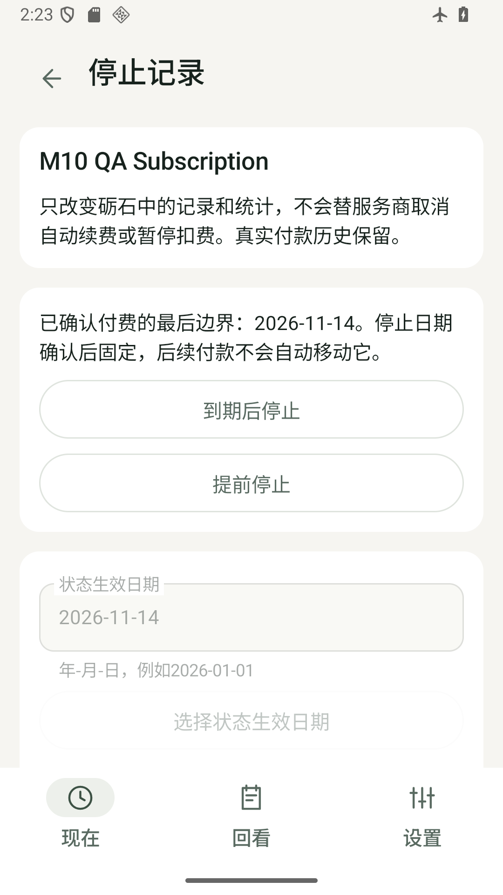

light；1080×1920 px；411.43dp；420dpi；字体 1；API 36；宿主 `com.cooper.lithic.debug/com.cooper.lithic.app.MainActivity`；来源 `EXISTING_QA_MAINACTIVITY`。

MainActivity 原有合成 QA 账本。附图名称仅标识采集意图，内容与交互结论须逐张核验。

原文件 `final-stop-subscription-light.png`；SHA-256 `6121fcfcd14a64d8745925c8bd90c38b1ff4630d6260671597d3d34266b03312`。

### final-subscription-current-plan-light — light

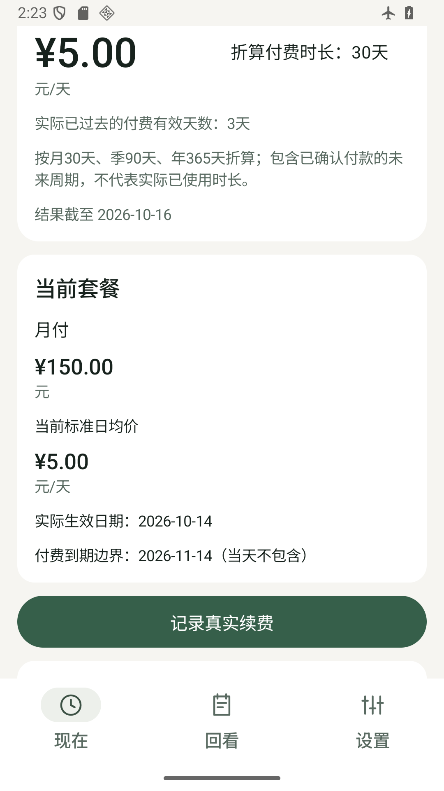

light；1080×1920 px；411.43dp；420dpi；字体 1；API 36；宿主 `com.cooper.lithic.debug/com.cooper.lithic.app.MainActivity`；来源 `EXISTING_QA_MAINACTIVITY`。

MainActivity 原有合成 QA 账本。附图名称仅标识采集意图，内容与交互结论须逐张核验。

原文件 `final-subscription-current-plan-light.png`；SHA-256 `3591196f09617ff1cd3ecde83537a89fab2ee79a4a5a8897fff2224f9f5a9d23`。

### final-subscription-history-dark — dark

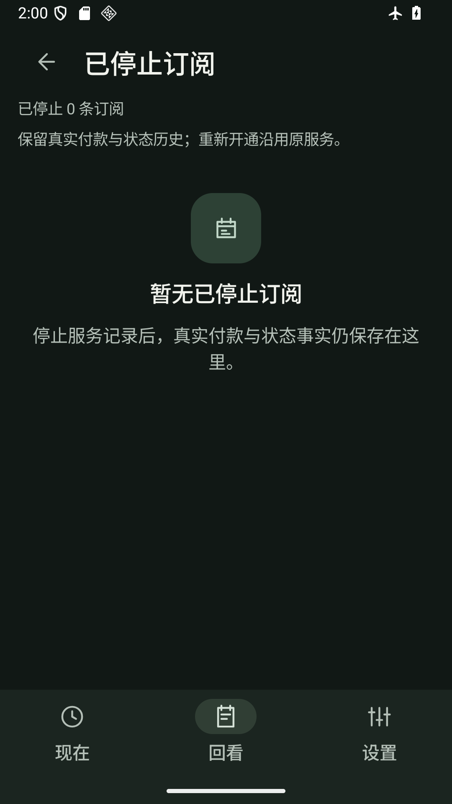

dark；1080×1920 px；411.43dp；420dpi；字体 1；API 36；宿主 `com.cooper.lithic.debug/com.cooper.lithic.app.MainActivity`；来源 `EXISTING_QA_MAINACTIVITY`。

MainActivity 原有合成 QA 账本。附图名称仅标识采集意图，内容与交互结论须逐张核验。

原文件 `final-subscription-history-dark.png`；SHA-256 `c0d6299752b8541d51059086ed1e50dfce921ff6b407e5ae0a46201020909078`。

### final-subscription-history-light — light

light；1080×1920 px；411.43dp；420dpi；字体 1；API 36；宿主 `com.cooper.lithic.debug/com.cooper.lithic.app.MainActivity`；来源 `EXISTING_QA_MAINACTIVITY`。

MainActivity 原有合成 QA 账本。附图名称仅标识采集意图，内容与交互结论须逐张核验。

原文件 `final-subscription-history-light.png`；SHA-256 `29f3dcea9b92eb85c03e7a077509e18e159a1da89bdccee1ef87f20c164d02b7`。

### final-subscription-operations-light — light

light；1080×1920 px；411.43dp；420dpi；字体 1；API 36；宿主 `com.cooper.lithic.debug/com.cooper.lithic.app.MainActivity`；来源 `EXISTING_QA_MAINACTIVITY`。

MainActivity 原有合成 QA 账本。附图名称仅标识采集意图，内容与交互结论须逐张核验。

原文件 `final-subscription-operations-light.png`；SHA-256 `b63afd50f1ed6320741ad819ff0985d687846608e87353f360322a62a44ee8c9`。

## 隔离合成 Room／展示态补图

以下14张来自最终无过滤运行的 `UIC1Stage2EvidenceTest`，宿主身份按原始元数据登记。主题为显式 Compose 主题，不能写成系统深浅切换或 MainActivity。订阅 producer 未内嵌 APK/输入哈希，本登记显式通过最终 JUnit 中的确切 producer 方法 PASS、最终测试 APK 与源码输入建立外部关联。

### 订阅服务列表：真实订阅中/暂停/到期分组 — light

light；1080×1920 px；411.43dp；420dpi；字体 1；API 36；宿主 `com.cooper.lithic.debug/androidx.activity.ComponentActivity`；来源 `ISOLATED_SYNTHETIC_ROOM_TEST_HOST`。

隔离合成 Room，使用生产 Repository/领域引擎/导航；不是原有真实账本或 MainActivity。

原文件 `final-isolated-subscriptions-subscription-list-light.png`；SHA-256 `3c68aa299880a6233ebb04f01d3873f7092034a00a863b1bb77c85e3203d4633`。

### 订阅详情：历史平均与预付未来周期 — light

light；1080×1920 px；411.43dp；420dpi；字体 1；API 36；宿主 `com.cooper.lithic.debug/androidx.activity.ComponentActivity`；来源 `ISOLATED_SYNTHETIC_ROOM_TEST_HOST`。

隔离合成 Room，使用生产 Repository/领域引擎/导航；不是原有真实账本或 MainActivity。

原文件 `final-isolated-subscriptions-subscription-detail-light.png`；SHA-256 `049b55069db4ec5cd4eda3db2b6ac62a23bbcc52cdb26f8504b7d72ea53d046d`。

### 真实付款历史：未来周期尚未生效 — light

light；1080×1920 px；411.43dp；420dpi；字体 1；API 36；宿主 `com.cooper.lithic.debug/androidx.activity.ComponentActivity`；来源 `ISOLATED_SYNTHETIC_ROOM_TEST_HOST`。

隔离合成 Room，使用生产 Repository/领域引擎/导航；不是原有真实账本或 MainActivity。

原文件 `final-isolated-subscriptions-subscription-payment-history-light.png`；SHA-256 `62ea240bdc88044332a3b940cd5fe1aae7e6e8ec6bb1eafce2e35cf6e9f9ed24`。

### 错误付款删除确认：未确认、未写入 — light

light；1080×1920 px；411.43dp；420dpi；字体 1；API 36；宿主 `com.cooper.lithic.debug/androidx.activity.ComponentActivity`；来源 `ISOLATED_SYNTHETIC_ROOM_TEST_HOST`。

隔离合成 Room，使用生产 Repository/领域引擎/导航；不是原有真实账本或 MainActivity。

原文件 `final-isolated-subscriptions-subscription-delete-payment-light.png`；SHA-256 `bdeed8e5e03c1c47a0115657414b6a5450de1d1047b7ed1afe24a19fe78ea099`。

### 已停止订阅历史：真实付款及停止事实 — light

light；1080×1920 px；411.43dp；420dpi；字体 1；API 36；宿主 `com.cooper.lithic.debug/androidx.activity.ComponentActivity`；来源 `ISOLATED_SYNTHETIC_ROOM_TEST_HOST`。

隔离合成 Room，使用生产 Repository/领域引擎/导航；不是原有真实账本或 MainActivity。

原文件 `final-isolated-subscriptions-subscription-history-light.png`；SHA-256 `eb9d23a1516e2f4b707a571070cb5b59a711e08da1a6947d794214326099573e`。

### 已结束项目历史档案：真实领域结果 — light

light；1080×1920 px；411.43dp；420dpi；字体 1；API 36；宿主 `com.cooper.lithic.debug/androidx.activity.ComponentActivity`；来源 `ISOLATED_SYNTHETIC_ROOM_TEST_HOST`。

隔离合成 Room，使用生产 Repository/领域引擎/导航；不是原有真实账本或 MainActivity。

原文件 `final-isolated-subscriptions-project-history-light.png`；SHA-256 `8a7fb7e6941dccf65ea86d9da25dc87cce8c43bfeccf8b4890d9520b02581360`。

### 读取失败：保留上次真实订阅记录 — light

light；1080×1920 px；411.43dp；420dpi；字体 1；API 36；宿主 `com.cooper.lithic.debug/androidx.activity.ComponentActivity`；来源 `SYNTHETIC_PRESENTATION_STATE_TEST_HOST`。

只注入读取错误展示态；不是实际磁盘故障、损坏或真实 MainActivity 读取失败。

原文件 `final-isolated-subscriptions-subscription-stale-error-light.png`；SHA-256 `49cfc069397e4fa0938aa4765729ae3137083d1c9caffc4996ee74015a376333`。

### 首次读取失败：数量未知，不宣称空账本 — light

light；1080×1920 px；411.43dp；420dpi；字体 1；API 36；宿主 `com.cooper.lithic.debug/androidx.activity.ComponentActivity`；来源 `SYNTHETIC_PRESENTATION_STATE_TEST_HOST`。

只注入读取错误展示态；不是实际磁盘故障、损坏或真实 MainActivity 读取失败。

原文件 `final-isolated-subscriptions-subscription-read-error-light.png`；SHA-256 `37a2cd510a3fafae73f3f7a5e05833a9f80137f83aabcd0b907bbb5c23a4bc1f`。

### 有封面引用但无法读取：显示明确错误 — light

light；1080×1920 px；411.43dp；420dpi；字体 1；API 36；宿主 `com.cooper.lithic.debug/androidx.activity.ComponentActivity`；来源 `SYNTHETIC_PRESENTATION_STATE_TEST_HOST`。

在真实隔离 Repository 详情上注入未持久化的缺失封面引用；不是实际丢图、磁盘故障或数据损坏。

原文件 `final-isolated-subscriptions-subscription-cover-error-light.png`；SHA-256 `755d352618f5af31c9d56a31a710b47556489a74983be68dff9cf264cef32a90`。

### 订阅服务列表：真实订阅中/暂停/到期分组 — dark

dark；1080×1920 px；411.43dp；420dpi；字体 1；API 36；宿主 `com.cooper.lithic.debug/androidx.activity.ComponentActivity`；来源 `ISOLATED_SYNTHETIC_ROOM_TEST_HOST`。

隔离合成 Room，使用生产 Repository/领域引擎/导航；不是原有真实账本或 MainActivity。

原文件 `final-isolated-subscriptions-subscription-list-dark.png`；SHA-256 `3ebba634fa6e5f27e8273b4df718746180fe2f82c25c09f223626bc866437862`。

### 订阅详情：历史平均与预付未来周期 — dark

dark；1080×1920 px；411.43dp；420dpi；字体 1；API 36；宿主 `com.cooper.lithic.debug/androidx.activity.ComponentActivity`；来源 `ISOLATED_SYNTHETIC_ROOM_TEST_HOST`。

隔离合成 Room，使用生产 Repository/领域引擎/导航；不是原有真实账本或 MainActivity。

原文件 `final-isolated-subscriptions-subscription-detail-dark.png`；SHA-256 `73a81670dac8c924147687a5d1c9a1ca562365dc090222d1c604bfad5840bf6e`。

### 读取失败：保留上次真实订阅记录 — dark

dark；1080×1920 px；411.43dp；420dpi；字体 1；API 36；宿主 `com.cooper.lithic.debug/androidx.activity.ComponentActivity`；来源 `SYNTHETIC_PRESENTATION_STATE_TEST_HOST`。

只注入读取错误展示态；不是实际磁盘故障、损坏或真实 MainActivity 读取失败。

原文件 `final-isolated-subscriptions-subscription-stale-error-dark.png`；SHA-256 `6e63dba8f62a82ad86105a959dd3c474c13d2ee28d5351df88f7fcd4b12a8915`。

### 首次读取失败：数量未知，不宣称空账本 — dark

dark；1080×1920 px；411.43dp；420dpi；字体 1；API 36；宿主 `com.cooper.lithic.debug/androidx.activity.ComponentActivity`；来源 `SYNTHETIC_PRESENTATION_STATE_TEST_HOST`。

只注入读取错误展示态；不是实际磁盘故障、损坏或真实 MainActivity 读取失败。

原文件 `final-isolated-subscriptions-subscription-read-error-dark.png`；SHA-256 `1d500c18c53d5b853e542b0f3a23b722354b9fc6367acde2898ac6bd337473bc`。

### 有封面引用但无法读取：显示明确错误 — dark

dark；1080×1920 px；411.43dp；420dpi；字体 1；API 36；宿主 `com.cooper.lithic.debug/androidx.activity.ComponentActivity`；来源 `SYNTHETIC_PRESENTATION_STATE_TEST_HOST`。

在真实隔离 Repository 详情上注入未持久化的缺失封面引用；不是实际丢图、磁盘故障或数据损坏。

原文件 `final-isolated-subscriptions-subscription-cover-error-dark.png`；SHA-256 `321b99a34b43f0588e248605fb504669d13b1cc25797b0786c6c52c8ac208c2a`。

## 真实空 Room 测试宿主

以下2张来自最终 `UIC1Stage2EmptyEvidenceTest`；原始 JSON 内嵌的已安装 APK 哈希必须与最终 APK 相同，前台宿主、真正空的生产读取结果、原有指针不变与自身UUID目录清理断言均来自该 producer。主题为显式 Compose 主题；同时保留原始系统 uiMode 数值，不把二者混同。

### 现在 — light

light；1080×1920 px；411.43dp；420dpi；字体 1；API 36；宿主 `com.cooper.lithic.debug/androidx.activity.ComponentActivity`；来源 `ISOLATED_EMPTY_ROOM_TEST_HOST`。

真实空 Room，经生产 readHomeOverview/Repository 读取；显式 Compose 主题测试宿主，未使用真实账本。

原文件 `final-isolated-empty-empty-home-light.png`；SHA-256 `32a610053d8076a3a6249cea1b96bae77150fd2760db6652dba16cd82caf2feb`。

### 现在 — dark

dark；1080×1920 px；411.43dp；420dpi；字体 1；API 36；宿主 `com.cooper.lithic.debug/androidx.activity.ComponentActivity`；来源 `ISOLATED_EMPTY_ROOM_TEST_HOST`。

真实空 Room，经生产 readHomeOverview/Repository 读取；显式 Compose 主题测试宿主，未使用真实账本。

原文件 `final-isolated-empty-empty-home-dark.png`；SHA-256 `fa3c3d2ae4254beede6b77caab4730b4e0aef4e23a7a2eabe3f6bff85c0ed1d3`。

## 原图与验收边界

全部 PNG 按原字节保留；隔离图只改目标文件名复制，不解码、缩放、修图或拼图。读取错误与缺失封面是明确标注的展示态注入，不代表真实磁盘故障、文件损坏或正式账本错误。

必须逐张打开原图，直接对照 [Light原稿](../../../design/ui-c1/source-v1/ui-reference-light.png) 与 [Dark原稿](../../../design/ui-c1/source-v1/ui-reference-dark.png)，检查布局、间距、封面、金额、状态、按钮、导航与一致性。脚本未执行这项视觉工作；全部逐图视觉审查状态仍为 PENDING。
