# Task6 实际双主题检查图

这12张均来自真实 MainActivity 与原有QA账本；不是隔离宿主、最终Task8的16图或用户视觉接受。普通字体1.0，API36，1080×1920／420dpi。每张实际APK、焦点、设备设置及原PNG SHA见[逐图登记](task6-screenshot-manifest.json)。

前10张来自状态语义修复后的APK；最后一对详情来自随后仅把折算时长文字改为bodyLarge的APK，避免正常字号下单位孤立换行。两输入差异只有详情这一行字号；本组不伪称来自同一APK。Task8必须在全部表单完成后以同一最终APK重拍正式16图。

| 页面 | 浅色 | 深色 |
|---|---|---|
| 回看 | 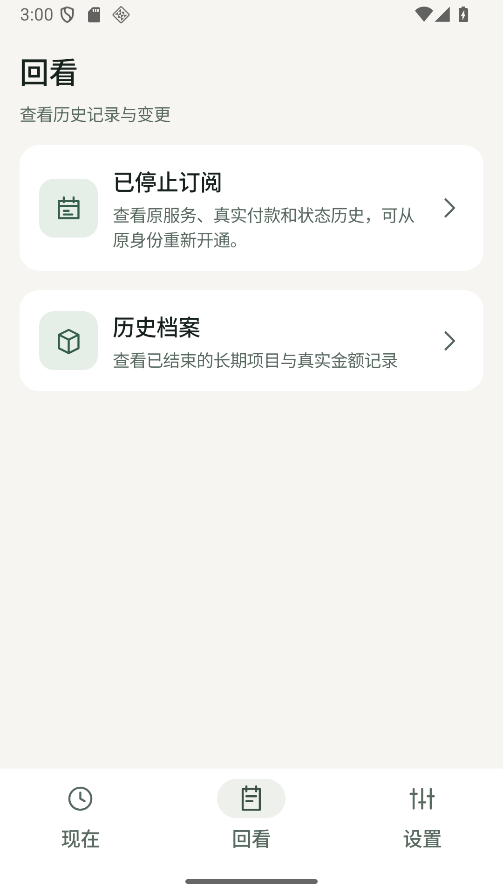 | 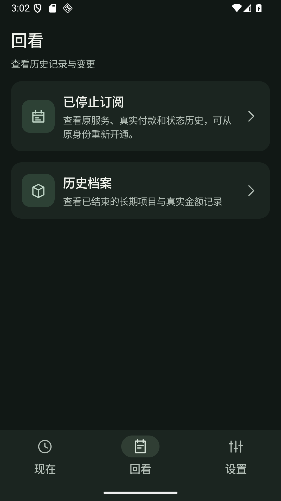 |
| 历史档案 | 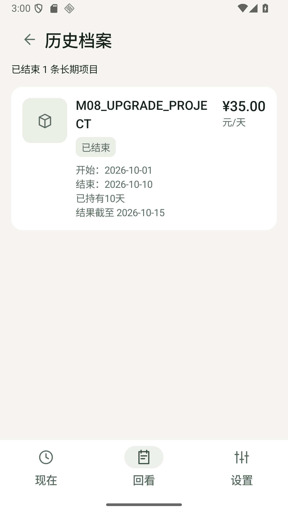 | 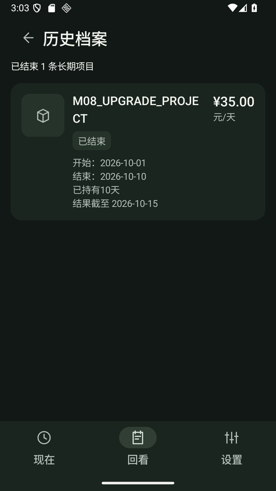 |
| 已停止订阅（实际空历史） | 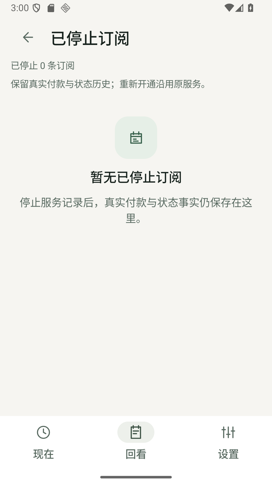 | 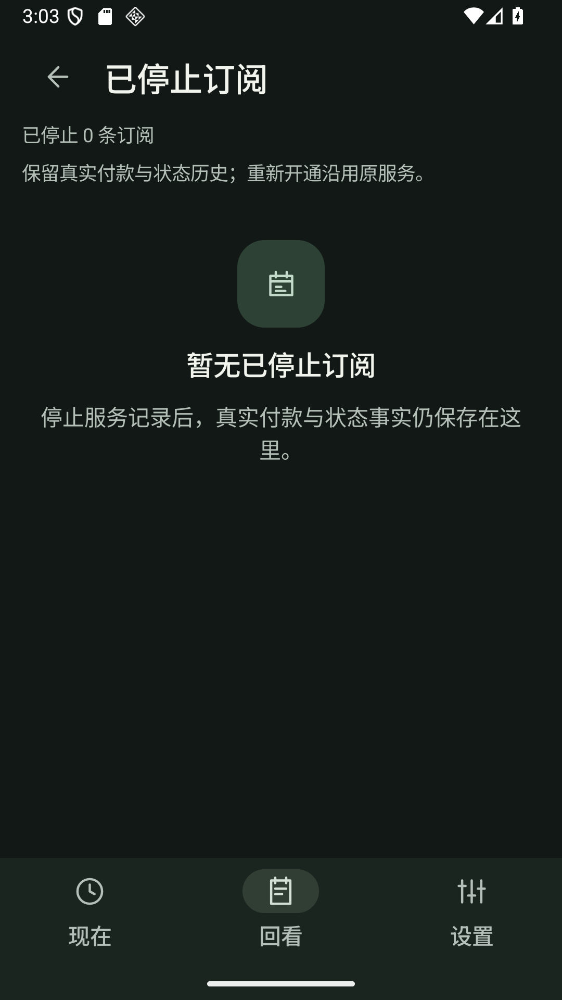 |
| 设置 | 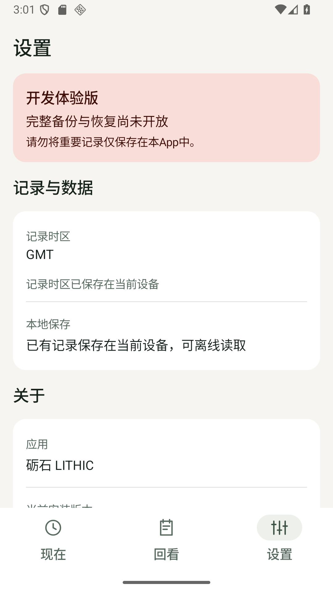 | 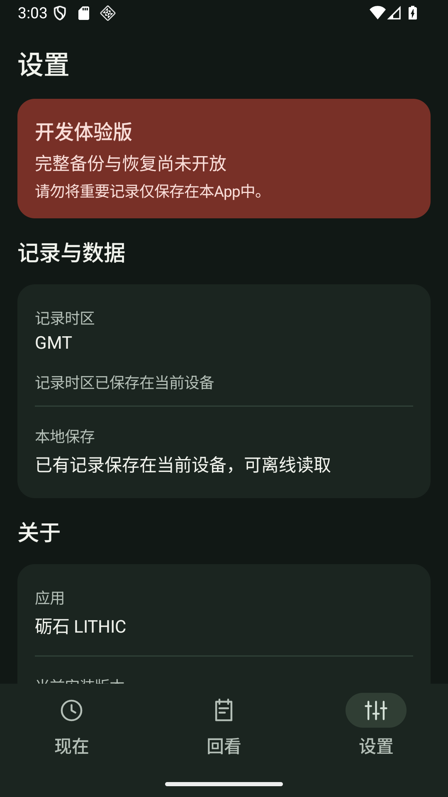 |
| 订阅列表 | 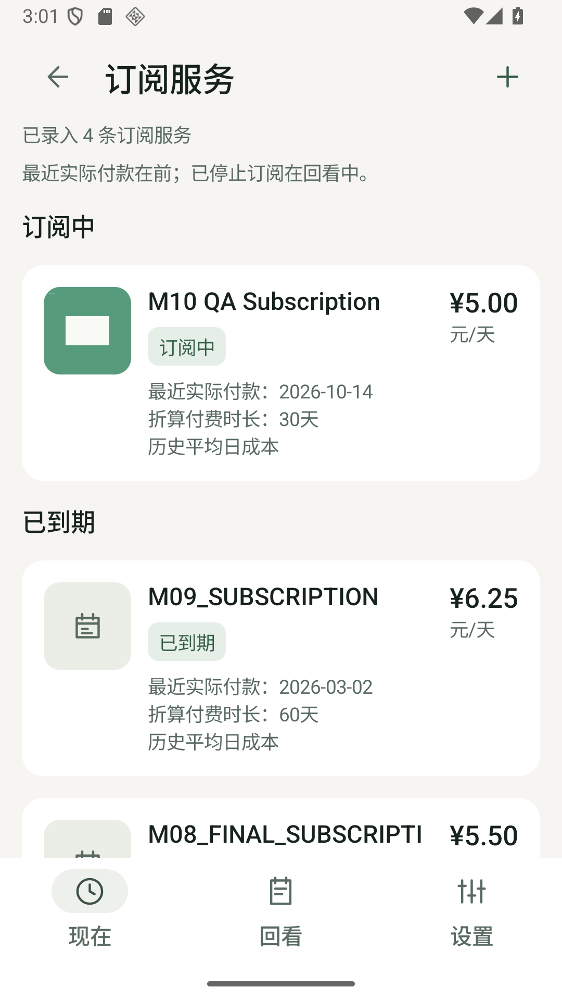 | 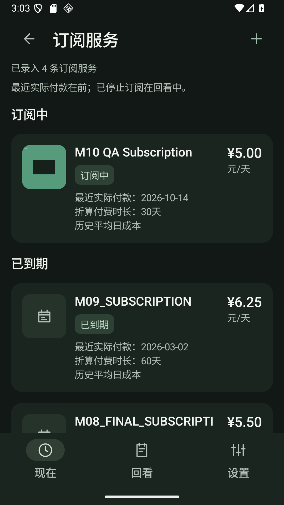 |
| 订阅详情（修正单位换行） | 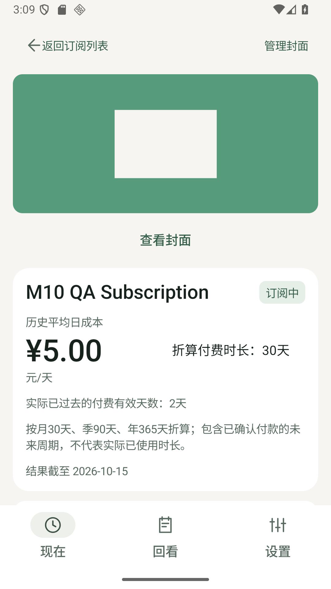 | 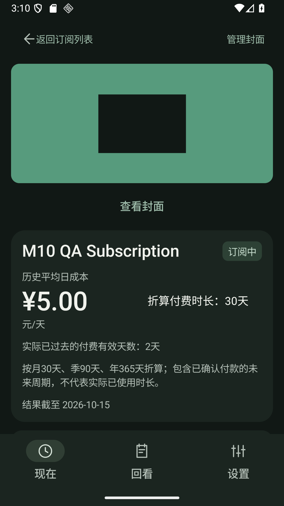 |

较早的两张详情和五张驱动诊断图仍保留，不能冒充本图册最终选图或Task8照片。所有原QA名称、金额、范围及私有封面字节不改；设置关于区可继续滚动，首屏图不证明所有行同屏。
