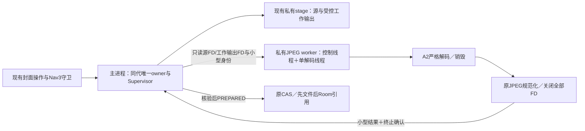

# M10-R2 — JPEG资源安全架构

日期：2026-10-16（Asia/Shanghai）。**DOCS / ARCHITECTURE ONLY；PROPOSED，等待ChatGPT独立架构审查。**没有新增Service、IPC、JNI、依赖或生产代码，没有运行native/设备实验或App构建。

阅读入口：[决策及准入](M10_JPEG_R2_DECISION.md) · [资源模型](M10_JPEG_R2_RESOURCE_BUDGET.md) · [失败与恢复](M10_JPEG_R2_FAILURE_RECOVERY.md)。本文中的新类型、接口、进程和凭据都是提案，不是当前实现。

## 1. 任务契约与事实基线

Goal：选出值得下一阶段验证的最小资源/异常隔离架构，明确不能证明的部分。Scope：四份R2文档、唯一CURRENT_STATE与新checkpoint；只推`research/m10-jpeg-strict-r2`。不实施R3、M10生产修复或M11，不改原规划、R0/R1、产品规则、Room v2或原测试断言。

独立worktree：`E:/CODEX/.codex/worktrees/m10-jpeg-strict-r2/砺石新APP`，来源R1锁定`2cdad4aa40f9503aad13245670adc9a4d13db32b`。M10仍`41596820145dc4a3fa6d041728a59540d828108a`，UI-C1冻结`0dce7dd0725a54be4f0280870ef6ca47c48ea7ed`，main远端`145326ddd4ce28abbf7c2706fe25f9d38c599c3a`；开工均核对，原工作不覆盖。

继承事实，未在R2重新执行：

- 固定libjpeg-turbo3.2.0的A1/A2对两锁样本均正确接受/拒绝；四ABI COMPILED，运行只有API36 x86_64。
- 122次decoder调用、121结构化返回、1次监督超时UNKNOWN；不是122项产品测试PASS。
- A2完整40MP444首次峰值237,952KiB RSS（约232.375MiB），三轮最高238,080KiB；A1同完整输入265,344KiB（259.125MiB）。RSS不是native堆。
- A2一次检查空档6,141.244ms；一次晚取消120.063秒无native结果，后续成功不关闭UNKNOWN。
- M10原三项JPEG拒绝测试仍FAIL，M10 PENDING；UI-C1 ACCEPTED / FROZEN — PASS WITH NOTES；M11 NOT_AUTHORIZED。

证据仍取R1 [执行](M10_JPEG_R1_EXECUTION.md)、[结果](M10_JPEG_R1_RESULTS.md)、[资源](M10_JPEG_R1_RESOURCE_REPORT.md)、[生产提案](M10_JPEG_R1_PRODUCTION_RECOMMENDATION.md)及原日志。R0[可行性](M10_JPEG_R0_FEASIBILITY.md)、[矩阵](M10_JPEG_R0_TEST_MATRIX.md)、[提案](M10_JPEG_R0_PRODUCTION_PROPOSAL.md)保留当时语境。

## 2. 四条路线的实质比较

### A — 同进程A2＋受控分配

可行候选：在固定源码低层`jpeg_get_small/large`及对应free预算，而不是创建decoder后仅包装公开allocator。后者漏掉memory manager初始化及内部静态allocator调用。预算上下文必须在`jpeg_CreateDecompress`前经保留的`client_data`关联，覆盖初始manager分配；具体关联和部分初始化失败须注入验证。按请求绑定上下文、checked加减、池头/对齐/预算元数据一起计费；包含创建部分失败、销毁、caller源/行缓冲。保留上游正常manager及虚拟数组逻辑，尽量不重写整套allocator。依据S03/S04。

这仍是待验证的自有backend/上游适配，需补丁哈希、每版本差异审查、全分配清单及逐点失败注入。限制malloc请求字节不等于限制allocator arena、RSS、JVM或Bitmap；MAXMEMORY也不提供这个保证。

优点是无进程/IPC启动成本、沿用当前调用链。决定性不足是native SIGSEGV/abort仍直接危及主进程；CPU检查仍无最坏间隔，同进程不能安全强杀一个卡住的native线程。异步pthread取消、其他线程销毁decoder、信号handler里longjmp均不作为可接受中止方案。**A单独作为生产首选不采用**；预算backend可作为B内部的最小硬化。

### B — 独立Android worker进程

**首选待验证路线：同UID、非导出的私有bound worker，完整处理原JPEG的严格预检与规范化，串行单任务；辅以A的低层预算和外部监督。**不是只隔离预检后把40MP原图交回主进程再次解码。

| 变体 | 作用 | 仍不能保证 |
|---|---|---|
| B1：私有`:jpeg_worker`、同UID | native地址空间分离；主进程可独立撤销提交资格并监督终止 | 不是文件权限沙箱；同UID任意代码仍可能访问私有库；kill有内核/身份/时序限制 |
| B2：`isolatedProcess=true` | 特殊UID、无自身权限，以FD访问授权文件 | 不能推断主进程有直接杀该UID权限；终止能力与API26路径需另外证明 |

当前推荐B1作为**崩溃/卡死隔离候选**，不是对任意native代码执行攻击的安全隔离证明。若独立审查要求worker即使被利用也不能访问账本，B1不满足，必须转审B2；未解决B2终止路径前不能生产GO。两种变体不混称。[Android Service属性](https://developer.android.com/guide/topics/manifest/service-element)、[killProcess约束](https://developer.android.com/reference/android/os/Process#killProcess(int))。

API26可采用显式绑定，不使用常驻/前台Service、WorkManager或网络；启动和IPC耗时UNKNOWN，不填写预计毫秒数。主进程与worker共同占内存，系统LMK/低内存仍可能影响二者；**“worker崩溃不直接崩溃主进程”不等于“全设备内存绝对安全”**。[API26 bound-service边界](https://developer.android.com/about/versions/oreo/background#services)。

### C — 有限内存＋私有系数spill

固定3.2.0的`jmemnobs.c`在backing-store入口直接报错，当前构建**没有可用磁盘spill**。上游有virtual-array/backend接口，可研究新backend，但须自己实现有界读写、偏移/容量、关闭和中断清理；不能靠降低MAXMEMORY自动获得spill。系数是可丢弃工作数据，不默认每轮I/O都fsync；owner持久元数据与最终输出仍按原协议持久化。

只把系数payload搬到磁盘，不能省掉行指针、窗口、decoder池、Bitmap或页缓存。40MP444典型系数工作文件约240,000,000字节，极端采样/形状要按公式预算；叠加64MiB源、2MiB输出与准备副本，明显超过原输入额度。多scan会多轮读写系数，文件容量不是总I/O量。详见资源文档。

必须由原generation/owner创建私有工作文件、限制并发、登记有效归属及worker持有，取消/SIGKILL后按证明清理；未知残留继续保留。会扩大原M10 stage协议及磁盘不足处理，并增加上游维护和闪存延迟。**C作为备选资源研究，不与B一开始同时实施**；若B完整40MP的实际内存无法接受，再单独审批C，或维持NO_GO。

### D — 显式资源准入

保留64MiB、40MP及1600px/2MiB输出契约。允许识别既有非法格式/溢出和准确资源估算；单并发是调度，不删格式。不能把R1的384MiB、100scan研究参数直接升格为产品规则。

任何新预算/scan/时间/编码/单边阈值若会拒绝原规格内合法JPEG，标记 **PRODUCT_COMPATIBILITY_CHANGE_REQUIRED**，需产品明确批准。即使40MP数字未改，也可能事实上缩窄兼容范围。具体受影响输入、提示与替代路径见资源文档的D表。D不是本轮默认修复，不能用“环境策略”掩盖永久拒绝合法progressive。

## 3. B的推荐组件边界（设计）

PNG继续原路径，不经worker；目标、金额、订阅事实及DB只属于主进程。worker不接收真实URI、账本对象、任意路径、generation目录或正式media写权限；B1中的“只接FD”是代码契约，不能误称内核撤销了同UID文件访问权限。

新增worker会执行Application初始化。现有`LithicApplication.onCreate()`无条件启动AppContainer，因此未来必须先作API26兼容的进程身份门禁：只有确认主进程才启动唯一存储owner，worker不得建Room/DataStore/coordinator；身份未知时fail-closed，不以新空账本兜底。具体进程识别实现须下一阶段验证，不直接使用API28+专用接口作为API26唯一实现。

### IPC和线程

提议使用**小型、类型明确的Android内置AIDL/Binder接口**，仅会话握手、启动、取消、终结和小型结果，不增加RPC框架。选择理由是FD所有权、请求字段和同步身份握手需可审查；Messenger同样可行，但需要自行验证Bundle字段及发送线程身份。本方案不同时维护两套IPC。

hello/控制调用只入队、立即返回，不执行decode；单解码executor与控制/Binder线程分离。身份必须在**worker→host同步hello回调内部**、仍处于该Binder transaction时读取系统calling UID及诊断PID；host普通返回线程、worker自报PID与nonce不能替代它。回调在native载入/处理输入前完成，结合新session nonce校验同应用私有组件。PID不是安全ID，不持久化作为恢复/杀进程依据；oneway回调不能假定取得calling PID。[Binder身份约束](https://developer.android.com/reference/android/os/Binder#getCallingPid())。

请求只含版本、generation/asset/attempt/session标识、源大小/SHA/FD身份、policy/build ID及受控FD。业务operationId仍由现有ViewModel/命令持有，attempt不替代业务身份；worker不理解CAS或成本。结果只含受限字段、真实错误类别及已关闭资源确认，禁止Bitmap/整图ByteArray穿过Binder，禁止把worker返回的路径当作可打开路径。

### 监督与单次进程生命周期

推荐每次JPEG任务使用一个会话、完成后退休该worker进程，下一任务在旧会话确证终止后才进入；避免把allocator残留RSS及不明旧任务叠加。冷启动/ART成本增加，需要实测；不是已证明最优性能。

worker自身deadline监视器与主进程watchdog并存：软取消只设安全标志；超过grace则撤销结果资格并请求专用worker退出。B1父进程可研究对当前同UID、同会话worker发kill；不得盲用持久PID，必须验证目标、PID复用、自动重启和失联竞态。worker自退只可杀自己已确认的专用进程。kill调用返回、unbind、onDestroy或“没收到消息”都不是完成证明。

主进程保留专用session Binder的死亡监测，绑定不得在native运行时主动丢弃该endpoint；正常成功须完整匹配结果＋全部FD关闭＋worker退休确证，失败也须确认消费者结束及退休/死亡，才允许释放消费者pin。仅死亡无完整结果不能构成成功，timeout/未知不得解除pin。成功退休需处理结果与death的先后顺序，意图明确的退休不分类为NATIVE_CRASH。自动重连不能自动重放任务；退役先撤销绑定/重建资格，新session未经主进程批准不得工作。API26的安全终止/身份/自动重启证明是硬闸门，失败就不投产。[IBinder](https://developer.android.com/reference/android/os/IBinder)、[ServiceConnection](https://developer.android.com/reference/android/content/ServiceConnection)。

正常成功要求：当前attempt未被取消/超时、完整严格解码与规范化成功、所有句柄关闭、输出由主进程独立核验/fsync、worker退休已证，然后才PREPARED。无法确证终止时保守保留stage并停止新JPEG任务，不把主进程UI线程堵在wait/全局锁内。`onBindingDied`可用于API26；`onNullBinding`从API28才有，API26仍须独立启动期限与无回调失败处理。PID复用及终止竞态仍是下一阶段硬闸门，不能用一次kill成功代替证明。详细状态见失败文档。

### FD和后续验证

源写入、关闭、fsync后固定字节身份，由主进程重新以只读/no-follow打开regular file并核对dev/inode/长度，传递FD；parent关闭自己的FD不能撤销worker副本。dup共享offset，因此严格与规范化串行并显式seek，或用独立重新打开的描述符/pread；不做共享offset并行读。输出FD只能指向主进程排他创建的本attempt临时文件，codec按原2MiB与有限重试写入；没有OS磁盘配额保证。[ParcelFileDescriptor](https://developer.android.com/reference/android/os/ParcelFileDescriptor)。

主进程不再次解码40MP原源。接回的是≤2MiB、最长边≤1600的规范化输出，仍要做原文件/容器/尺寸/SHA及有界已存解码核验；这是剩余有界解码面，不宣称主进程完全没有图片解码风险。

## 4. 当前接缝与最小维护面

当前`MediaRepository.prepareImport`完整持coordinator，Store又持文件mutex；不能只在normalize前插一次长IPC。要先在原锁序下登记stage、消费者lease和generation pin，释放锁执行计算，再短锁核对attempt和代并发布准备。worker从不获取coordinator/Room；不建立第二个数据库或提交锁。具体文件和v1未提交准备的兼容处理见[DECISION](M10_JPEG_R2_DECISION.md)与[FAILURE_RECOVERY](M10_JPEG_R2_FAILURE_RECOVERY.md)。

## 5. 可追溯来源（R2只读核对）

固定源码取R1已验签tar，SHA-256 `6f30092cef9fb839779646608f4ee14ae3cbac989c47fa05e841b0841f09878e`；成员哈希在R1[构建输入清单](m10-jpeg-r1/evidence/build-runs/20261016T085225.922399Z-26740/source-inputs.json)。不是跟随最新main源码。

| ID | 来源与定位 | 支撑范围 |
|---|---|---|
| S01 | R1上述四报告、[原始结果计数](m10-jpeg-r1/evidence/result-counts.json)、[扩展原JSONL](m10-jpeg-r1/evidence/expanded.jsonl)、[完整444](m10-jpeg-r1/evidence/single-444.json) | 继承实测/UNKNOWN；R2没有重跑 |
| S02 | [R1 probe](m10-jpeg-r1/native/strictjpeg_probe.c) 271～440、597～684；[监督脚本](m10-jpeg-r1/scripts/run_android.py) | 检查点、cleanup、超时不是native终止证明 |
| S03 | [固定jmemnobs.c](https://github.com/libjpeg-turbo/libjpeg-turbo/blob/3.2.0/src/jmemnobs.c) 31～91；[jmemmgr.c](https://github.com/libjpeg-turbo/libjpeg-turbo/blob/3.2.0/src/jmemmgr.c) 267～414、578～587、696～915、1113～1229；[jdapimin.c](https://github.com/libjpeg-turbo/libjpeg-turbo/blob/3.2.0/src/jdapimin.c) 51～67 | 分配/池开销、无spill、创建早期预算 |
| S04 | [jdinput.c](https://github.com/libjpeg-turbo/libjpeg-turbo/blob/3.2.0/src/jdinput.c) 54～57、119～154；[jdcoefct.c](https://github.com/libjpeg-turbo/libjpeg-turbo/blob/3.2.0/src/jdcoefct.c) 895～909；[jdapistd.c](https://github.com/libjpeg-turbo/libjpeg-turbo/blob/3.2.0/src/jdapistd.c) 57～85；[jmemsys.h](https://github.com/libjpeg-turbo/libjpeg-turbo/blob/3.2.0/src/jmemsys.h) 104～131 | padding、multiscan、master/progress边界、backing-store接口 |
| S05 | [LocalImageStore](../../app/src/main/java/com/cooper/lithic/data/media/LocalImageStore.kt) 68～145、245～318、374～397；[MediaRepository](../../app/src/main/java/com/cooper/lithic/data/media/MediaRepository.kt) 52～119、241～245、283～324 | 当前锁、内存active、失败清理、CAS与双引用 |
| S06 | [MediaFileProtocol](../../app/src/main/java/com/cooper/lithic/data/media/MediaFileProtocol.kt) 26～29、76～113、139～151、189～202；[DataGenerationStore](../../app/src/main/java/com/cooper/lithic/data/backup/DataGenerationStore.kt) 27～43、202～220 | 凭据精确字段/已知文件、代owner与close |
| S07 | [AndroidImageCodec](../../app/src/main/java/com/cooper/lithic/data/media/AndroidImageCodec.kt) 54～130、236～287；[LithicApplication](../../app/src/main/java/com/cooper/lithic/app/LithicApplication.kt) 6～13 | 第二次解码、重叠Bitmap、当前格式域与进程启动 |
| S08 | [M10当前契约](../planning/M10_CONTRACT.md)、[原M10计划](../planning/original-v1/lithic_v1_plan/docs/superpowers/plans/2026-10-10-m10.md)、[BACKUP B02～B05/B08](../planning/original-v1/lithic_v1_plan/docs/specs/BACKUP_SPEC.md)、[Q05决定](../DECISIONS.md) | 文件先引用、保留原字节、未来快照/切代边界 |
| S09 | 本文Android官方链接，访问日期2026-10-16 | API语义/版本，不是本项目设备实证 |

R2的架构推导与选型均为PROPOSED；未将来源中的计划案例、现有源码或本地协作复核写成新实验PASS。
