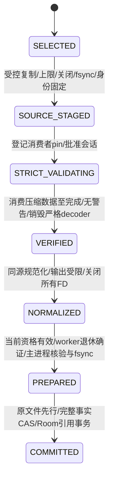

# M10-R2 — 失败、消费者归属与恢复契约

日期：2026-10-16。**PROPOSED / DOCS ONLY**。本状态机未实现，原M10协议、Room v2、三项JPEG FAIL及原SIGKILL测试证据保持不变。配套：[架构](M10_JPEG_R2_ARCHITECTURE.md) · [资源](M10_JPEG_R2_RESOURCE_BUDGET.md) · [决策](M10_JPEG_R2_DECISION.md)。

## 1. 不变量与身份

1. 正式业务事实只由现有主进程唯一owner/coordinator写入；worker不得初始化Room/DataStore，也不持正式media目录/账本对象。B1同UID是代码职责隔离，不是对恶意native代码的权限沙箱。
2. 源字节固定后，严格校验与规范化使用同一受控源身份；成功只适用于当前generation、assetId、attemptId、workerSession、源SHA/size/dev/inode及decoder/policy build。不能把旧代/旧inode/另一版本结果重放。
3. assetId及既有业务operationId保持原含义；attemptId用于一次计算尝试，不产生另一笔资金或替代幂等提交身份。重试可换attempt，但只能有一个被授权活跃的JPEG消费者。
4. 任何失败、超时、崩溃、载入失败或未知结果均不得提交正式封面引用。只有PREPARED可进入原CAS；不创造空白图片、宽松成功或替代账本。
5. UI取消、结果资格撤销、worker资源释放是三个独立事件。允许先响应用户，不能先删仍被消费的文件。

## 2. 成功状态机

| 状态 | 已证明什么 | 仍不能做什么 |
|---|---|---|
| SELECTED | 用户选中候选URI；还不是可信图片 | 不提交引用、不以URI持久权限替代私有源 |
| SOURCE_STAGED | 原64MiB/40MP等既有检查及受控源副本、固定身份 | header通过不是严格完整性；不交给业务保存 |
| STRICT_VALIDATING | session已登记，worker实际消费压缩图像数据 | 主进程不能读“任务已发出”作为成功；不能释放消费者pin |
| VERIFIED | worker内严格decode完成、finish成功且严格decoder已销毁 | 不是主进程持久提交凭据；源还要供规范化使用，不能删/改源 |
| NORMALIZED | worker对同源按原方向/尺寸/质量协议生成受限输出并终结资源 | 未收到/核验小型结果或未确证退休，不能准备成功 |
| PREPARED | 当前attempt未被撤销、worker已终止、host核验实际输出/哈希/持久化，按新私有协议登记证明 | 不等于业务已提交，不绕过目标当前事实/封面CAS |
| COMMITTED | 原封面CAS与文件→Room协议完成 | 后续旧图回收仍走双引用/归属检查；不宣称跨文件/DB原子 |

内部VERIFIED不能脱离会话作为可恢复凭据。主进程只在NORMALIZED后的全部条件成立才持久记录有效准备结果；回调丢失则不能从输出“看起来正常”反推原JPEG严格校验成功。会话结果与退休death回调可乱序到达，二者都须匹配并等齐；正常受控退休不标NATIVE_CRASH。

## 3. 结果类别与消费者存活是两个维度

建议内部Outcome与ConsumerState分别保存/监督。ConsumerState为NONE、ACTIVE、CLOSED_CONFIRMED、DEAD_CONFIRMED或UNKNOWN；CLOSED_CONFIRMED不等于进程退休完成，不能据此启动下一JPEG任务。deadline到达只确定TIMEOUT，native真实结果可能仍UNKNOWN。系统death证明该进程不再持FD，但API26通常不能仅凭death判断是否OOM/native fault。不得把所有断连都写成NATIVE_CRASH。

| Outcome | 可接受证据 | 对外语义及提交 | 清理前提 |
|---|---|---|---|
| VALIDATION_FAILED | 严格decoder真实完整性错误/警告，结构化返回 | 原`INVALID_IMAGE`，清晰保旧；绝不宽松回退 | 结果已终结并关闭，且退休确证；或匹配进程确证死亡 |
| RESOURCE_REJECTED | checked预算/真实分配不足/工作空间不足等明确证据 | 资源不足/无法完成，不能伪称图片损坏；禁止提交。新永久兼容cap另审 | 同上；收到资源错误不等于进程必已无句柄 |
| CANCELLED | 当前请求已撤销；若称“native已取消”须有对应结果 | 可先显示取消已接收并撤销结果资格；导航仍服从原Nav3离开守卫，pin由Supervisor接管 | 只在消费者结束确证后释放，不能因Kotlin Job取消直接finally删stage |
| TIMEOUT | host单调时钟deadline到达 | “校验超时，未保存”；撤销结果资格，迟到成功也不能提交 | 超时本身不证明停算；继续监督、隔离并保留 |
| NATIVE_CRASH | 确有native崩溃诊断且匹配本会话死亡 | 技术失败，不能计普通坏图拒绝PASS | 进程已死后可按owner/引用规则处理；保留非敏感诊断 |
| LOAD_ERROR | linker/符号/ABI/JNI初始化明确失败 | 校验能力不可用；不回退宽松导入，不伪装INVALID_IMAGE | 完成关闭/死亡确认；未启动任务也须核对已传FD |
| RESULT_UNKNOWN | 无完整匹配结果、异常断连、host恢复不知旧消费者情况 | “未能确认校验结果，未保存”；不推测成功/失败 | 未知时保守保留、禁止新JPEG叠加；待身份/结束证据恢复 |

以上是拟新增**内部**分类。现`MediaFailureKind`没有全部类别；生产提案需保留`INVALID_IMAGE`给真实图片拒绝，保留IO等既有分类并以明确UI消息承载资源/能力问题，或经批准扩展技术分类。不能把所有错误压成INVALID_IMAGE，也不能本轮修改enum。取消传播必须先把消费者监管转交app级Supervisor，避免界面协程消失后失去释放责任。

JNI未来须在C边界消化libjpeg错误/longjmp并销毁可安全销毁的资源，不能跨仍有非平凡析构的C++栈longjmp；JNI pending exception转为技术失败并返回受控边界。SIGABRT/SEGV、系统OOM、进程消失及无结果不能被catch后记为INVALID_IMAGE。这些路径本轮均NOT_RUN。[JNI官方约束](https://developer.android.com/training/articles/perf-jni)。

## 4. stage所有权、消费者pin及锁

### 新JPEG准备协议，不另建业务状态库

拟在原`MediaFileProtocol`内增加**私有JPEG stage owner v2**，不改Room schema/backupFormatVersion，不创建平行CURRENT_STATE或持久业务任务队列。PNG沿用v1。

- v2 owner必须让旧版v1的精确格式校验拒绝认领，旧程序因归属未知而保留；不能仅在v1 stage添加未知sidecar。旧GC即使不删未知sidecar，仍可能删它认识的source文件。
- 主进程独占写一个有界的`strict-state.json`（提议名），包含阶段/consumer登记、attempt/session、源身份和terminal receipt；严格字段/版本/长度校验，原子替换及按原持久化要求处理。任何缺损/未知字段/不明所有权采用保守保留。
- receipt只由host依据匹配完整结果、消费者结束证明、输出核验产生；不是worker自报`ok`、当前Bitmap可解码、mtime或一个裸SHA即可成立。worker不得写owner/receipt或任意路径。
- 此文件不是训练GT、完整历史操作日志或跨版本信任令牌，不记录私人URI/图片内容。恢复到另一代或备份不能带它跨代充当新证明。

**消费者pin**同时保护源、工作输出、stage和generation；与当前UI租约/Store内存active集合分离。一个actor拥有读取FD后，即使host关自己的FD，pin仍保持。拟由app级Supervisor负责会话与pin；它不是第二套DB owner。

当前`prepareImport`持coordinator整个调用、Store又持file mutex；必须拆为：原锁序coordinator→file mutex下短时登记/固定源和pin → 释放两锁等待worker → 原锁序下核对代/attempt/结果、发布准备或安全清理。源复制、并发保护的具体短锁边界需验证；不得为了异步化放弃现有稳定操作身份和文件归属检查。不持全代写锁等待IPC、join、timeout或进程死亡，也不允许worker取主进程锁。[当前Store](../../app/src/main/java/com/cooper/lithic/data/media/LocalImageStore.kt)、[Repository](../../app/src/main/java/com/cooper/lithic/data/media/MediaRepository.kt)、[Coordinator](../../app/src/main/java/com/cooper/lithic/data/repository/LocalWriteCoordinator.kt)。

### 何时清理

| 情况 | 允许行为 |
|---|---|
| 已登记但FD未交出、无其他消费者 | 撤销资格后按精确owner删除已知临时文件，保留未知子项 |
| 完整关闭结果＋匹配worker退休确证 | 释放消费者pin；失败删已知本attempt工作数据，成功转PREPARED；仍执行代/owner/引用复核 |
| worker确证死亡，无完整成功结果 | 所有该进程FD由OS关闭；不推测成功。原源可待重试，或经owner规则清理；结果记未知/崩溃等真实类别 |
| TIMEOUT、仅kill返回、unbind、取消Job、parent关FD、缺少回调 | 都不足以解除pin/删仍可能被消费的文件；继续监督，保守保留并停止新JPEG任务 |
| 非本owner/错代/链接/未知残留 | 原保守策略：不认领、不提交、不按年龄/文件名猜测删除 |

正常退休前结果明确所有FD关闭；仍要求退休确证，是为了不把不明残留计算/allocator进程与下一任务叠加。worker死亡可证明句柄结束，但不能单独证明严格校验成功。输出文件≤2MiB是受控codec行为而非系统quota；写超限/FD偏移异常必须作技术失败，不承认结果。

## 5. 断连、host死亡及重启

1. native工作启动前，host已持久登记session/源/代及消费者状态，worker也已建立当前client Binder死亡监测与自身看门狗。host UI离开不等于client进程死亡；取消监管继续。
2. host死亡时worker应自退，但这必须实测，不能假设onDestroy一定执行或Android必同时杀同UID所有进程。worker不得转为后台持续导入、自动提交或建账本。
3. 主进程重启先做v2 stage/会话恢复，再允许媒体GC和新JPEG启动。尝试与仍活worker进行匹配恢复握手；持久PID仅作诊断，不能盲kill。新绑定若已启动另一个worker，不能把新session存活当旧session已死。
4. 仅当能证明旧消费者已结束，才恢复/释放pin。若无法区分旧进程或无法确定死亡，标RESULT_UNKNOWN，隔离本stage、禁止JPEG新任务叠加，其他已存数据可继续使用。不得重建generation或清账本来消除阻塞。
5. 这可能保留磁盘占用：不以TTL自动解决未知，只允许明确归属和结束证据后的回收；有限空间不足则拒绝新导入。若这一恢复策略无法在API26上闭合或长期占用无法受控，方案NO_GO，不能把风险留给用户手工清数据。

`linkToDeath`应链接长寿命会话endpoint且不能在native存活时主动弃用；Service自动重连不重放任务。进程终止/身份/PID复用是下一阶段必须验证的门槛，不是已实现的保证。[IBinder](https://developer.android.com/reference/android/os/IBinder)、[ServiceConnection](https://developer.android.com/reference/android/content/ServiceConnection)、[FD所有权](https://developer.android.com/reference/android/os/ParcelFileDescriptor)。

## 6. 保护旧封面、业务事实和历史边界

- **两类旧封面**：新源STRICT_VALIDATING至PREPARED阶段，不改任何项目/订阅coverId、不覆盖旧media文件；原封面持续可读。失败后独立核对原引用、元数据、SHA及图片字节。已提交Q05封面不重编码，不因新规则后台删除。
- **资金/付款/状态**：worker不接触库；host prepare也不写资金/付款/状态。前后七表逐行比对，仅成功提交允许目标cover引用及对应media元数据变化；金额事件、Renewal/StateChange身份和全部字段不变。
- **CAS与幂等**：保留现target旧封面/完整事实基线、固定asset/operation身份和精确重放。迟到worker结果、已删目标、目标被改、错代或过期attempt均不能更新当前封面。已提交后重试只确认原目标事实，不能生成第二个asset事件。
- **文件先于Room**：PREPARED后仍使用现O_EXCL/no-follow、inode/归属、fsync/校验与Room事务，失败保护旧图。共享双引用检查与原顺序不变；不宣称文件和DB原子。
- **旧未提交v1准备**：原Store成功后已删除source，仅凭规范化asset不能补造原图STRICT receipt。新提交若要求严格源证明，应明确要求重选原图或提交独立兼容决策；不静默接受旧准备、不删旧未知资源，也不追溯宣称已严格验证。该草稿升级体验须另审。
- **SIGKILL**：原“文件落实后DB前”“DB后旧图清理前”证据不重写。未来新增worker持FD、strict完成前、结果返回前/后、receipt落盘前/后、退休前/后、host死亡恢复等探针；只有真实执行才可登记PASS。
- **generation与备份**：新增消费者pin必须让owner.close/未来切代等待安全结束或明确失败，不可worker尚读取时关闭/清理旧代。M11/M12仍未实施；快照继续同代coordinator一致性，stage/source/spill/FD/receipt均不是备份业务内容，恢复不复用旧generation/inode证明。Q05恢复原字节及Q06回退边界继续NOT_RUN。[原BACKUP B02～B05/B08](../planning/original-v1/lithic_v1_plan/docs/specs/BACKUP_SPEC.md)。

## 7. 验证门槛

需要证明：注册先于FD移交、所有出口资源归属明确；所有失败/未知零业务提交；pin不随UI协程提前解除；SIGKILL/host死亡/Service重连/错结果不会让GC误删活跃源；错误/关闭结果不能伪装成功；正确成功仍走原双类封面/CAS/共享资源/重放协议。R2仅审查这些契约，实际测试均NOT_RUN，具体最小实验见[DECISION](M10_JPEG_R2_DECISION.md)。
